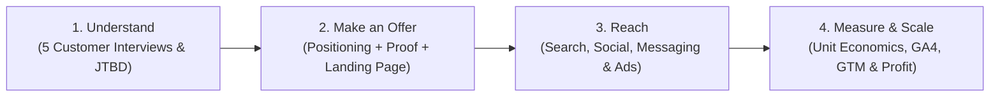

<div align="center">


# 📈 Digital Marketing by Vicky: Zero to Pro

### From Understanding One Customer to Running Measured, Full-Funnel Campaigns

[](https://github.com/ABVicky/Digital-Marketing-by-Vicky/stargazers)
[](https://github.com/ABVicky/Digital-Marketing-by-Vicky/network/members)
[](#-curriculum--learning-roadmap)
[](#-the-practice-client-mitti-studio)
[](appendix/B-template-library.md)
[](#-copyright--terms-of-use)

<br>

**[📖 Read Online (Interactive Web App)](https://abvicky.github.io/Digital-Marketing-by-Vicky/)** &nbsp;•&nbsp;
**[🚀 Start Module 00](modules/00-welcome.md)** &nbsp;•&nbsp;
**[🗺️ Full Roadmap](#-curriculum--learning-roadmap)** &nbsp;•&nbsp;
**[🧰 50-Template Library](appendix/B-template-library.md)** &nbsp;•&nbsp;
**[🎓 Final Exam](appendix/D-final-exam.md)** &nbsp;•&nbsp;
**[👤 About the Author](#-meet-the-author)**

</div>

<br>

> [!TIP]
> **Experience the Interactive Web Application:** Read this entire study guide with instant keyboard search (`⌘K`), audience track lens (`🌟 All`, `👔 Non-Tech`, `💻 Tech`), dark/light themes, exercises with solutions, and offline progress tracking at **[abvicky.github.io/Digital-Marketing-by-Vicky](https://abvicky.github.io/Digital-Marketing-by-Vicky/)**.

---

## 🎯 Why This Guide Exists

> ✍️ *“Most marketing advice falls into two traps: fluffy 'hacks' and growth-tricks that stop working within a month, or dry textbook theories that never explain how to make your next ₹10,000 profitably. I built this guide to give you a complete, honest, and practical system. Everything is in one place, 100% free, with zero paywalls.”*  
> — **Vicky**

Most teams run marketing like a lottery: they post random content, boost posts blindly, copy competitor slogans, and wonder why revenue stays flat. 

Real marketing is not guessing; it is a **repeatable engineering discipline**:

1. **Understand:** Listen to real buyers, uncover triggers and anxieties, and define Jobs-to-be-Done.
2. **Offer:** Craft clear positioning with credible proof, unit economics, and high-converting landing pages.
3. **Reach:** Select channel fits deliberately (SEO, Social, Email/WhatsApp, Google & Meta Ads).
4. **Measure:** Track real events (GA4, GTM, Server-side), calculate true payback, and optimize profit—not applause.



---

## 🧭 Two Tailored Tracks: Non-Tech vs. Tech

This curriculum includes tailored tracks so you learn at the exact depth you need. You can toggle between tracks at any time using the audience switcher (`🌟 All`, `👔 Non-Tech`, `💻 Tech`) in the web reader:

| Dimension | 👔 Non-Tech Track | 💻 Tech Track |
|---|---|---|
| **Primary Audience** | Business owners, founders, freelancers, copywriters, creators, marketing managers | Technical marketers, developers, data analysts, marketing-ops specialists |
| **Focus Areas** | Customer psychology, offer design, copywriting, budgets, creative briefs, reports | Technical SEO, structured data, GA4 data layers, GTM tags, server-side tracking, SQL, CRM webhooks |
| **Prerequisites** | None! Clear thinking, curiosity, and basic English | Basic HTML/JS or familiarity with data and web architecture |
| **Tools Mastered** | Canva, VN, Meta Ads Manager, Google Ads UI, MailerLite, WhatsApp Business, Notion | Google Tag Manager, Google Search Console, Schema markup, GA4 BigQuery export, Make/Zapier APIs |
| **Final Outcome** | A battle-tested marketing plan, launch calendar, and profitable ad campaigns | An end-to-end event measurement pipeline, server-side data layer, and automated attribution stack |

---

## 🏺 The Practice Client: Mitti Studio

Instead of disconnected, generic theory, every single lesson in this guide applies to a running case study: **Mitti Studio**, a fictional handmade pottery and ceramics business founded in Kolkata, India.

Across the 28 modules, you work on Mitti Studio's real problems:
- Conducting customer interviews with housewarming gifters and interior decorators.
- Calculating unit economics: product margin, packaging loss rates, and break-even Customer Acquisition Cost (CPA).
- Building an SEO topic cluster for handmade tableware and kitchen ceramics.
- Scripting Instagram Reels, writing email welcome flows, and setting up Meta Ads Advantage+ campaigns.
- Debugging Google Tag Manager purchase triggers and configuring GA4 e-commerce events.

---

## 🗺️ Curriculum & Learning Roadmap


### 🟢 Stage 1: Foundations
*Customers, numbers, positioning, and a website that actually converts.*

- **[Module 00: Welcome & How to Use This Guide](modules/00-welcome.md)** — Roadmap, learning tracks, 5-minute practice lab setup, and structured study plans.
- **[Module 01: How Digital Marketing Works](modules/01-how-digital-marketing-works.md)** — Core channels, customer journey stages, paid vs. owned vs. earned, and funnel math.
- **[Module 02: Customer Research & Positioning](modules/02-customer-research-and-positioning.md)** — Five-interview method, review mining, Jobs-to-be-Done (JTBD), and positioning statements.
- **[Module 03: Strategy & Unit Economics](modules/03-strategy-and-unit-economics.md)** — Goals, offers, break-even CPA, Lifetime Value (LTV), scenario planning, and one-page marketing plans.
- **[Module 04: Website Making Essentials](modules/04-website-making-essentials.md)** — Domains, DNS, SSL/TLS, hosting, CMS platform selection (Shopify, WordPress, Webflow), and launch hygiene.
- **[Module 05: Landing Pages That Convert](modules/05-landing-pages.md)** — Message matching, headline frameworks, trust signals, mobile checkout ergonomics, and 5-second tests.

---

### 🔵 Stage 2: Content & Search
*Words that sell, visual assets, video production, SEO, and AI search engines.*

- **[Module 06: Copywriting & Content](modules/06-copywriting-and-content.md)** — AIDA & PAS frameworks, value propositions, storytelling, microcopy, editorial calendars, and repurposing.
- **[Module 07: Design & Video Editing](modules/07-design-and-video-editing.md)** — Visual hierarchy, brand kits, mobile shooting setups, editing in VN/CapCut, thumbnail design, and licensing.
- **[Module 08: SEO: Keywords & On-Page](modules/08-seo-keywords-and-on-page.md)** — Search intent, keyword research without expensive tools, content hubs, on-page optimization, and internal links.
- **[Module 09: Technical SEO & Link Building](modules/09-technical-seo-and-links.md)** — Crawlability, indexing, Core Web Vitals, Schema.org JSON-LD structured data, and authentic digital PR link earning.
- **[Module 10: Local SEO & AI Search](modules/10-local-seo-and-ai-search.md)** — Google Business Profile optimization, local review velocity, Google AI Overviews, and ranking in Perplexity/ChatGPT.

---

### 🟠 Stage 3: Social, Email & Ads
*Organic audience building, messaging channels, and profitable paid advertising.*

- **[Module 11: Social Media Strategy & Influencers](modules/11-social-media-strategy.md)** — Platform selection matrix, community engagement, nano/micro-creator collaborations, and legal disclosures.
- **[Module 12: Instagram Marketing](modules/12-instagram.md)** — Profile optimization, short-form Reels production, educational carousels, Story sequences, and DM lead automation.
- **[Module 13: Facebook (Organic)](modules/13-facebook-organic.md)** — Community groups, local event promotion, Page engagement mechanics, and organic community management.
- **[Module 14: YouTube Marketing](modules/14-youtube.md)** — Search-driven topics, high-retention scripting, pacing, YouTube Shorts workflows, and YouTube Studio analytics.
- **[Module 15: LinkedIn Marketing](modules/15-linkedin.md)** — Executive profiles, founder-led content, B2B thought leadership, outbound outreach protocols, and LinkedIn Campaign Manager.
- **[Module 16: X (Twitter) & Threads](modules/16-x-and-threads.md)** — Real-time commentary, text hooks, industry listening, public customer service, and crisis management.
- **[Module 17: Email & WhatsApp Marketing](modules/17-email-and-whatsapp.md)** — Ethical lead capture, automated welcome and abandoned checkout flows, deliverability hygiene, and WhatsApp Business API.
- **[Module 18: Google Ads](modules/18-google-ads.md)** — High-intent Search campaigns, match types, smart bidding, Google Shopping feeds, and Performance Max guardrails.
- **[Module 19: Meta Ads (Facebook & Instagram)](modules/19-meta-ads.md)** — Account hierarchy, creative testing matrices, Advantage+ shopping, lead generation forms, retargeting, and budget scaling.

---

### 🟣 Stage 4: Measure & Scale
*Data integrity, Google Tag Manager, conversion testing, automation, and privacy.*

- **[Module 20: Analytics & Tracking](modules/20-analytics-and-tracking.md)** — GA4 configuration, UTM parameter governance, multi-touch attribution models, incrementality, and executive reporting.
- **[Module 21: Google Tag Manager](modules/21-google-tag-manager.md)** — Data layers, triggers, custom JavaScript variables, preview debugging, server-side tagging, and consent mode v2.
- **[Module 22: Conversion Optimization](modules/22-conversion-optimization.md)** — Quantitative and qualitative audit methods, hypothesis formulation, A/B test sample sizing, and low-traffic CRO tactics.
- **[Module 23: Automation & CRM](modules/23-automation-and-crm.md)** — Lead scoring rubrics, lifecycle automation pipelines, webhook connections with Make/Zapier, and CRM data hygiene.
- **[Module 24: AI Tools for Marketers](modules/24-ai-tools-for-marketers.md)** — Practical LLM workflows for research, drafting, and analysis; structured prompts; AI agents; and human-in-the-loop quality checks.
- **[Module 25: Privacy, Law & Ethics](modules/25-privacy-law-and-ethics.md)** — DPDP Act, GDPR basics, advertising standards, dark pattern compliance, spam regulations, and data breach response drills.

---

### 🌟 Stage 5: Pro & Career
*Industry-specific playbooks, client proposals, freelancing, and career growth.*

- **[Module 26: Industry Playbooks](modules/26-industry-playbooks.md)** — 11 detailed go-to-market playbooks (D2C E-commerce, Local Retail, SaaS, B2B Services, Healthcare, Real Estate, Education, Hospitality, Creators, Non-profit, and Mobile Apps).
- **[Module 27: Becoming a Pro](modules/27-becoming-a-pro.md)** — Crafting a marketing portfolio, pricing freelance retainers, writing client proposals, interview preparation, and 30-60-90 day plans.

---

### 📚 The Reference Vault (Appendices A–G)

- **[Appendix A: Cheat Sheet](appendix/A-cheat-sheet.md)** — Formulas (ROAS, CPA, CAC, LTV), campaign checklists, and channel selection quick-reference.
- **[Appendix B: 50-Template Library](appendix/B-template-library.md)** — 50 ready-to-copy briefs, ad copy matrices, email sequences, reporting spreadsheets, and audit rubrics.
- **[Appendix C: Glossary](appendix/C-glossary.md)** — 100+ digital marketing concepts and technical terms defined in simple, unambiguous language.
- **[Appendix D: Final Exam](appendix/D-final-exam.md)** — 40 comprehensive evaluation questions and 5 practical scenario challenges with complete solutions.
- **[Appendix E: Capstone Projects](appendix/E-capstone-projects.md)** — Six end-to-end portfolio capstones (E-commerce launch, B2B pipeline, Local SEO revamp, Full tracking audit, etc.).
- **[Appendix F: Troubleshooting Guide](appendix/F-troubleshooting.md)** — Systematic diagnosis matrix: symptom → root cause → corrective action for underperforming campaigns.
- **[Appendix G: Resources & 30-Day Plan](appendix/G-resources.md)** — Curated official documentation, free software stack recommendations, and a structured 4-week study plan.

---

## ⚡ What Makes This Reader Special

We designed the reader platform from scratch to ensure learning is focused, distraction-free, and respectful of your privacy:

- 🏎️ **Lightning-Fast & Lightweight:** Built in pure HTML5, modern CSS, and vanilla JavaScript. Zero bloated frontend frameworks.
- 🎯 **Interactive Audience Lens:** Easily filter modules for strategic business application or technical implementation with a single click.
- 🔍 **Instant Fuzzy Search (`⌘K` / `/`):** Search any concept, term, formula, or template across all 28 modules instantaneously.
- 🌓 **Day & Night Contrast Themes:** Crafted with a calm, high-legibility palette using Emerald Mint (`#3CC9A0`), Sapphire (`#2F6AA8`), and Charcoal (`#17191F`).
- 🔒 **100% Private & Offline-Capable:** No third-party ad trackers, zero cookies, and zero surveillance. Your progress is stored locally in your browser.
- ⌨️ **Keyboard Ergonomics:** Navigate between chapters using `←` and `→` arrow keys, and press `Esc` to instantly close palettes and overlays.

---

## 💻 Running & Building Locally

No build tools or package managers required. The interactive reader runs directly in any modern web browser:

1. **Clone the repository:**
   ```bash
   git clone https://github.com/ABVicky/Digital-Marketing-by-Vicky.git
   cd Digital-Marketing-by-Vicky
   ```

2. **Open the interactive reader:**
   Simply double-click `index.html` or run a local lightweight server:
   ```bash
   python3 -m http.server 8000
   ```
   Then visit `http://localhost:8000` in your browser.

3. **Rebuilding course data and static SEO pages (optional):**
   If you edit any markdown module, re-bundle the offline cache and static pages with:
   ```bash
   python3 build.py
   ```

---

## 👤 Meet the Author

<div class="profile-card">
  <div class="profile-avatar">
    
  </div>
  <div class="profile-body">
    <h3>Vicky Prasad Mahato</h3>
    <span class="profile-role">Author · System Architect</span>
    <p>
      Vicky Prasad Mahato (online as <strong>abvicky</strong>) is a system architect, software engineer, and digital product builder based in Kolkata, India. He builds resilient digital systems and software tools, with a strong focus on offline-first architectures, personal data sovereignty, and practical artificial intelligence.
    </p>
    <p>
      As the founder of the <strong>Coders' Club at BBIT Kolkata</strong> and former student coordinator at the Innovation and Incubation Center (IIC) and Entrepreneurship Development Cell (EDC), Vicky has mentored hundreds of student developers in software design, problem solving, and modern development practices. He is also the creator of open-source projects including <em>Mera Paisaa</em>, an offline-first personal expense and financial tracking system.
    </p>
    <p>
      <strong>Author's Teaching Philosophy:</strong> <em>“Marketing is not about tricking people into buying things they do not need. It is about understanding who has a problem you can genuinely solve, explaining your promise with honesty and proof, and building a sustainable system that earns profit through trust.”</em>
    </p>
    <div class="profile-pills">
      <a class="pill-btn primary" href="https://abvicky.in" target="_blank" rel="noopener">🌐 abvicky.in</a>
      <a class="pill-btn" href="https://www.linkedin.com/in/abvicky/" target="_blank" rel="noopener">💼 LinkedIn Profile</a>
      <a class="pill-btn" href="https://github.com/ABVicky" target="_blank" rel="noopener">💻 GitHub (@ABVicky)</a>
    </div>
  </div>
</div>

---

## 🏢 Platform & Technical Infrastructure

<div class="profile-card">
  <div class="profile-avatar">
    
  </div>
  <div class="profile-body">
    <h3>Manikarnika Technologies</h3>
    <span class="profile-role platform">Platform Architecture & Development</span>
    <p>
      The custom reading experience, interactive design system, live audience lens engine, client-side search infrastructure, and responsive web components were designed and engineered by <strong>Manikarnika Technologies</strong>.
    </p>
    <p>
      Manikarnika Technologies builds high-performance, distraction-free educational platforms, developer tooling, and modern digital infrastructure. The platform was created from the ground up without heavy external frameworks, providing instantaneous page loads, zero runtime bloat, and full privacy for learners worldwide.
    </p>
    <div class="profile-pills">
      <a class="pill-btn primary" href="https://www.manikarnikatechnologies.in/" target="_blank" rel="noopener">🌐 manikarnikatechnologies.in</a>
    </div>
  </div>
</div>

---

## 📜 Copyright & Terms of Use

© 2026 **[Manikarnika Technologies](https://www.manikarnikatechnologies.in/)**. All rights reserved.

- **Author:** **[Vicky Prasad Mahato](https://abvicky.in)** ([LinkedIn](https://www.linkedin.com/in/abvicky/) · [GitHub](https://github.com/ABVicky))
- **Platform Architecture & Development:** **[Manikarnika Technologies](https://www.manikarnikatechnologies.in/)**

This guide, including its text, diagrams, exercises, templates, code examples, and instructional designs, is provided for personal learning and educational use. Redistribution, commercial resale, republication, or training on these materials without express written authorization is prohibited. All product names, logos, and brands mentioned are property of their respective owners and are used solely for identification and educational reference.
