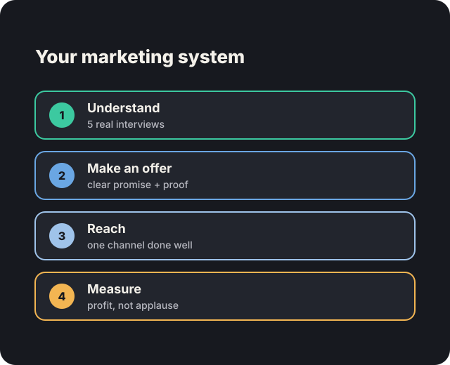

# 📈 Digital Marketing by Vicky: Zero to Pro

### From understanding one customer to running measured, full-funnel campaigns



This guide teaches digital marketing in plain language, through one fictional business. You learn why customers buy, how to choose channels, how to make useful campaigns, and how to tell whether they earned money.

## Who It's For

| Track | For | Focus |
|---|---|---|
| 👔 Non-Tech | beginners, owners, creators, marketers | customers, copy, budgets, decisions |
| 💻 Tech | developers, analysts, marketing operations | tracking, technical SEO, SQL, automation |

No marketing experience or ad spend is required. The shared lessons teach both tracks; the switcher shows or hides extra notes.

## Learning Roadmap


### 🟢 Stage 1: Foundations

*Customers, numbers and a website that works.*

- **[Module 00: Welcome & How to Use This Guide](modules/00-welcome.md)** — Roadmap, practice client, free lab and learning routes.
- **[Module 01: How Digital Marketing Works](modules/01-how-digital-marketing-works.md)** — Overview: channels, journey, roles, metrics and funnel maths.
- **[Module 02: Customer Research & Positioning](modules/02-customer-research-and-positioning.md)** — Interviews, themes, segments, jobs and positioning.
- **[Module 03: Strategy & Unit Economics](modules/03-strategy-and-unit-economics.md)** — Goals, offers, break-even CPA, scenarios and budgets.
- **[Module 04: Website Making Essentials](modules/04-website-making-essentials.md)** — Domain, hosting, platforms, build, security and launch.
- **[Module 05: Landing Pages That Convert](modules/05-landing-pages.md)** — Message match, proof, forms, checkout and user tests.

### 🔵 Stage 2: Content & Search

*Words, design, video, SEO and AI search.*

- **[Module 06: Copywriting & Content](modules/06-copywriting-and-content.md)** — Frameworks, headlines, storytelling, editing and calendars.
- **[Module 07: Design & Video Editing](modules/07-design-and-video-editing.md)** — Canva, VN, shooting, editing, thumbnails and rights.
- **[Module 08: SEO: Keywords & On-Page](modules/08-seo-keywords-and-on-page.md)** — Intent, keyword plans, pages, clusters and reporting.
- **[Module 09: Technical SEO & Link Building](modules/09-technical-seo-and-links.md)** — Crawling, indexing, speed, structured data and links.
- **[Module 10: Local SEO & AI Search](modules/10-local-seo-and-ai-search.md)** — Business Profile, reviews, AI answers and measurement.

### 🟠 Stage 3: Social, Email & Ads

*Every major platform, messaging and paid ads.*

- **[Module 11: Social Media Strategy & Influencers](modules/11-social-media-strategy.md)** — Platform choice, community, creators and reporting.
- **[Module 12: Instagram Marketing](modules/12-instagram.md)** — Profile, Reels, carousels, Stories, DMs and tests.
- **[Module 13: Facebook (Organic)](modules/13-facebook-organic.md)** — Pages, groups, events, Messenger and original content.
- **[Module 14: YouTube Marketing](modules/14-youtube.md)** — Topics, titles, scripts, Shorts, analytics and leads.
- **[Module 15: LinkedIn Marketing](modules/15-linkedin.md)** — Profiles, posts, outreach, B2B and LinkedIn Ads.
- **[Module 16: X (Twitter) & Threads](modules/16-x-and-threads.md)** — Short posts, listening, service and crisis response.
- **[Module 17: Email & WhatsApp Marketing](modules/17-email-and-whatsapp.md)** — Lists, flows, deliverability, consent and repeat sales.
- **[Module 18: Google Ads](modules/18-google-ads.md)** — Keywords, ads, bidding, Shopping, PMax and scaling.
- **[Module 19: Meta Ads (Facebook & Instagram)](modules/19-meta-ads.md)** — Campaigns, creative tests, leads, retargeting, scaling.

### 🟣 Stage 4: Measure & Scale

*Analytics, Tag Manager, testing, automation and AI.*

- **[Module 20: Analytics & Tracking](modules/20-analytics-and-tracking.md)** — GA4, UTMs, attribution, incrementality and reports.
- **[Module 21: Google Tag Manager](modules/21-google-tag-manager.md)** — Data layer, tags, triggers, testing and consent.
- **[Module 22: Conversion Optimization](modules/22-conversion-optimization.md)** — Evidence, hypotheses, A/B tests and low-traffic methods.
- **[Module 23: Automation & CRM](modules/23-automation-and-crm.md)** — Pipelines, scoring, follow-up and reliable workflows.
- **[Module 24: AI Tools for Marketers](modules/24-ai-tools-for-marketers.md)** — Tool choice, prompt recipes, agents and human checks.
- **[Module 25: Privacy, Law & Ethics](modules/25-privacy-law-and-ethics.md)** — Consent, claims, dark patterns and incident practice.

### 🌟 Stage 5: Pro

*Industry playbooks and your career.*

- **[Module 26: Industry Playbooks](modules/26-industry-playbooks.md)** — 11 playbooks, 4 worked cases and a 90-day plan.
- **[Module 27: Becoming a Pro](modules/27-becoming-a-pro.md)** — Portfolio, proposals, reports, interviews and career.

### 📚 Reference

- [Cheat Sheet](appendix/A-cheat-sheet.md)
- [50-Template Library](appendix/B-template-library.md)
- [Glossary](appendix/C-glossary.md)
- [Final Exam](appendix/D-final-exam.md)
- [Capstones](appendix/E-capstone-projects.md)
- [Troubleshooting](appendix/F-troubleshooting.md)
- [Resources & 30-Day Plan](appendix/G-resources.md)

## The Practice Client

**Mitti Studio** is a fictional Kolkata ceramics business. Its numbers are invented for practice, not industry benchmarks. Every module adds a piece to its customer, offer, campaign and measurement system.

## Read It

Open `index.html` in a browser. The text is bundled locally; fonts, Markdown rendering, code colours and diagrams load from the internet.

After editing a chapter:

```bash
python3 build.py
```

## Accuracy

Digital platforms and laws change. Time-sensitive notes were reviewed in November 2026. Check linked official pages before spending money, sending messages or making legal decisions. This guide is not legal or financial advice.

Author: [Vicky](https://abvicky.in) · Platform built by [Manikarnika Technologies](https://www.manikarnikatechnologies.in/) · © 2026 All rights reserved.
