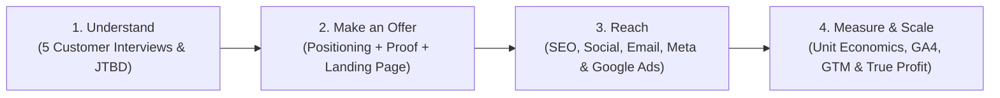
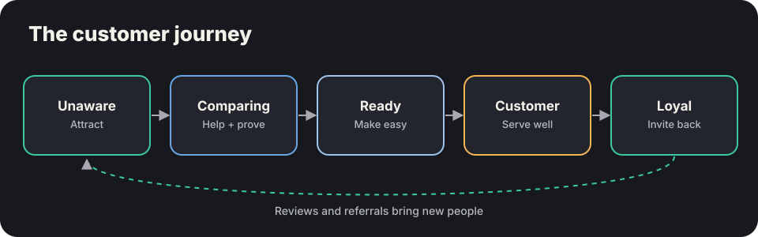
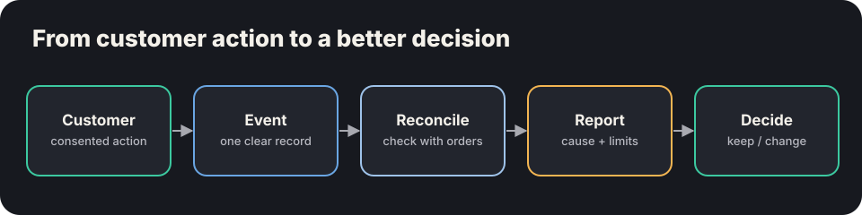

<div align="center">


# 📈 Digital Marketing by Vicky: Zero to Pro

### The Complete, Production-Grade Curriculum: From Customer Discovery to Measured, Full-Funnel Growth

[](https://github.com/ABVicky/Digital-Marketing-by-Vicky/stargazers)
[](https://github.com/ABVicky/Digital-Marketing-by-Vicky/network/members)
[](#-the-curriculum-28-modules-across-5-stages)
[-F3B552?style=flat-square)](#-the-running-case-study-mitti-studio)
[](appendix/B-template-library.md)
[](#-copyright--terms-of-use)

<br>

**[📖 Open Interactive Web Reader](https://abvicky.github.io/Digital-Marketing-by-Vicky/)** &nbsp;•&nbsp;
**[🚀 Start Module 00](modules/00-welcome.md)** &nbsp;•&nbsp;
**[🗺️ Learning Roadmap](#-the-curriculum-28-modules-across-5-stages)** &nbsp;•&nbsp;
**[🧰 50-Template Vault](appendix/B-template-library.md)** &nbsp;•&nbsp;
**[🎓 40-Question Final Exam](appendix/D-final-exam.md)** &nbsp;•&nbsp;
**[👤 Meet the Author](#-meet-the-author)**

</div>

<br>

> [!TIP]
> **Experience the Interactive Web Application:** Read this entire curriculum in our custom distraction-free web reader at **[abvicky.github.io/Digital-Marketing-by-Vicky](https://abvicky.github.io/Digital-Marketing-by-Vicky/)**.
> - ⚡ **Instant Client-Side Search (`⌘K` / `/`)**: Search every keyword, framework, script, and template across all 28 modules without page reloads.
> - 🎛️ **Live Audience Lens**: Toggle between **`👔 Non-Tech Track`** (business & copy) and **`💻 Tech Track`** (tracking & code) dynamically on any page.
> - 🌗 **Cinematic Dark & Light Modes**: Designed with an accessible Mint & Slate palette tested for extended study sessions.
> - 🔒 **100% Offline & Private**: Zero external tracking cookies; all module completion progress is saved directly in your browser's `localStorage`.

---

## 🎯 Executive Summary & Core Philosophy

Most digital marketing advice swings between two extremes:
1. **Superficial "Growth Hacks" & Trendy Tricks** that look exciting on social media but collapse the moment an ad algorithm changes or customer acquisition costs rise.
2. **Abstract Textbook Theories** filled with buzzwords that never show how to write an ad that sells, fix a leaking landing page, or configure server-side conversion tracking.

This curriculum is built on a different premise: **Marketing is a disciplined, measurable engineering system.**



Instead of guessing, you build a sustainable machine in four clear steps:
- **Understand:** Find the exact anxiety, trigger, and desired outcome using the 5-interview Jobs-to-be-Done (JTBD) protocol.
- **Offer:** Formulate a swap-tested positioning statement with undeniable proof, credible guarantees, and a high-converting web landing page.
- **Reach:** Choose channel distribution deliberately—mastering technical SEO, organic content engines, and precision-targeted Google & Meta Ads.
- **Measure:** Reconcile ad spend against gross margin, track real events in GA4 and Google Tag Manager, and scale profit rather than vanity applause.

---

## 🧭 The Customer Journey & Feedback Loop

A healthy business does not treat customer acquisition as a one-time transaction. The customer journey is an engine where every delighted buyer feeds the top of the funnel through reviews, UGC, and word-of-mouth:

<div align="center">
  
</div>

---

## ⚖️ Two Tailored Tracks: Non-Tech vs. Tech

Every module is dual-authored to serve both strategic decision-makers and technical practitioners. You can read both tracks together or filter content in real time with the **Audience Switcher** on the top navigation bar:

<div align="center">

| Dimension | 👔 Non-Tech Track (Business & Strategy) | 💻 Tech Track (Engineering & Data) |
| :--- | :--- | :--- |
| **Primary Audience** | Founders, business owners, copywriters, creative strategists, marketing managers | Technical marketers, developers, data analysts, marketing-ops specialists |
| **Prerequisites** | None. Curiosity, clear logic, and honest thinking | Basic HTML/JavaScript, SQL familiarity, or web architecture basics |
| **Core Responsibilities** | Customer interviews, positioning, messaging, ad briefs, unit economics, budgets | GTM data layers, GA4 custom parameters, technical SEO schemas, API webhooks |
| **Primary Tooling** | Canva, VN, Meta Ads Manager, Google Ads UI, MailerLite, Notion, Spreadsheets | Google Tag Manager, Google Search Console, Schema JSON-LD, GA4 BigQuery, Make/Zapier |
| **Focus Question** | *"What promise makes the customer choose us, and what is our target CPA?"* | *"How do we verify data integrity, eliminate signal loss, and automate delivery?"* |
| **Final Deliverable** | A validated go-to-market plan, launch calendar, and profitable ad campaigns | An end-to-end event measurement pipeline, server-side data layer, and automated attribution stack |

</div>

---

## 🏺 The Running Case Study: Mitti Studio

Theory without practice is quickly forgotten. Every lesson, exercise, and template in this curriculum is anchored in a real running scenario: **Mitti Studio**, a handcrafted ceramics and lifestyle brand founded in Kolkata, India.

<div align="center">
  
</div>

### Mitti Studio Client Snapshot
- **Core Offering:** Hand-thrown ceramic tableware, artisan mugs, and terracotta planters.
- **Average Order Value (AOV):** ₹1,800
- **Gross Margin:** 55% (Making: ₹810 · Delivery & Packaging: ₹180 · Contribution: ₹810)
- **Break-Even CPA:** ₹810
- **Target CPA (Target Profit Margin):** $\le$ ₹560 (preserving ₹250 contribution per new order)
- **Primary Customer Segments:**
  1. *Thoughtful Gifters* (searching for unique housewarming gifts on short notice).
  2. *Home Aesthetic Decorators* (seeking cohesive, non-factory dinner sets).
  3. *Corporate HR Managers* (procuring branded festival gift hampers).

Across 28 modules, you build Mitti Studio's entire marketing engine from zero to full profitability.

---

## 🗺️ The Curriculum: 28 Modules Across 5 Stages

<div align="center">
  
</div>

### 🟢 Stage 1: Foundations (The Business, The Customer & The Offer)
*Master the mechanics of why people buy, how unit economics work, and how to build a high-converting website.*

| Mod | Title & Direct Link | Core Competency & Method | Mitti Studio Practical Deliverable |
| :---: | :--- | :--- | :--- |
| **00** | **[Welcome & Study Guide Setup](modules/00-welcome.md)** | Free practice lab setup, learning tracks, privacy guidelines | Baseline audit & 30-day study roadmap |
| **01** | **[How Digital Marketing Works](modules/01-how-digital-marketing-works.md)** | Paid vs. owned vs. earned media, funnel math, journey stages | Full-funnel customer flow diagram & metrics scorecard |
| **02** | **[Customer Research & Positioning](modules/02-customer-research-and-positioning.md)** | 5-interview JTBD protocol, review mining, swap test | 3 customer persona profiles & swap-tested positioning statement |
| **03** | **[Strategy & Unit Economics](modules/03-strategy-and-unit-economics.md)** | AOV, contribution margin, break-even CPA, LTV forecasting | 1-page business economics model & acquisition budget |
| **04** | **[Website Making Essentials](modules/04-website-making-essentials.md)** | Domains, DNS, SSL/TLS, hosting architecture, CMS selection | Complete multi-page sitemap & launch checklist |
| **05** | **[Landing Pages That Convert](modules/05-landing-pages.md)** | Message match, headline formulas, proof architecture, form UX | "Housewarming Ceramic Gift Set" dedicated landing page |

---

### 🔵 Stage 2: Content, Search & Organic Engines
*Craft persuasive copy, produce studio-grade creative assets, and build compound SEO distribution.*

| Mod | Title & Direct Link | Core Competency & Method | Mitti Studio Practical Deliverable |
| :---: | :--- | :--- | :--- |
| **06** | **[Copywriting & Content Strategy](modules/06-copywriting-and-content.md)** | AIDA, PAS, features-to-benefits translation, content pillars | 30-day multi-channel editorial content matrix |
| **07** | **[Design & Mobile Video Editing](modules/07-design-and-video-editing.md)** | Visual hierarchy, brand kits, smartphone shooting, VN editing | 3 high-retention video Reels & thumbnail assets |
| **08** | **[SEO: Keywords & On-Page Content](modules/08-seo-keywords-and-on-page.md)** | Search intent mapping, zero-cost keyword discovery, topic clusters | "Ceramic Tableware Guide" cluster & on-page checklist |
| **09** | **[Technical SEO & Link Building](modules/09-technical-seo-and-links.md)** | Core Web Vitals, Schema.org JSON-LD markup, digital PR | Structured Product/Review schema & PR outreach pitch |
| **10** | **[Local SEO & AI Search Engines](modules/10-local-seo-and-ai-search.md)** | Google Business Profile, local review velocity, Perplexity/ChatGPT GEO | Verified Google Business Profile & AI engine citation plan |

---

### 🟠 Stage 3: Social Media, Messaging & Paid Acquisition
*Build engaged communities across platforms, launch high-ROI ads, and build retention messaging.*

| Mod | Title & Direct Link | Core Competency & Method | Mitti Studio Practical Deliverable |
| :---: | :--- | :--- | :--- |
| **11** | **[Social Media Strategy & Creators](modules/11-social-media-strategy.md)** | Platform selection matrix, micro-creator partnerships, disclosures | Creator collaboration brief & engagement KPI dashboard |
| **12** | **[Instagram Marketing Masterclass](modules/12-instagram.md)** | Hook design, 3-second retention, carousels, DM automation | 5-part Instagram Reels sequence & automated DM flow |
| **13** | **[Facebook Organic & Communities](modules/13-facebook-organic.md)** | Group community moderation, local pottery workshops, Page trust | Kolkata Decor Enthusiasts community engagement playbook |
| **14** | **[YouTube Content & Shorts](modules/14-youtube.md)** | Search-based video topics, scripting for watch time, Shorts | 1 long-form studio tour script & 3 Shorts storyboards |
| **15** | **[LinkedIn for B2B & Personal Brand](modules/15-linkedin.md)** | Executive presence, founder storytelling, B2B corporate gifting | 4 founder-led posts & corporate HR gift outreach sequence |
| **16** | **[X (Twitter) & Threads](modules/16-x-and-threads.md)** | Fast feedback loops, listening queries, crisis mitigation | Real-time social listening matrix & customer support playbook |
| **17** | **[Email & WhatsApp Marketing](modules/17-email-and-whatsapp.md)** | Lead magnets, deliverability, welcome & abandoned cart flows | 4-part automated email welcome sequence + WhatsApp reminders |
| **18** | **[Google Ads: Search, Shopping & PMax](modules/18-google-ads.md)** | High-intent keywords, match types, smart bidding, negative lists | High-intent Search campaign & Merchant Center shopping setup |
| **19** | **[Meta Ads: Facebook & Instagram](modules/19-meta-ads.md)** | Campaign hierarchy, Advantage+ shopping, creative testing matrix | 3-tier creative testing campaign with dynamic ad sets |

---

### 🟣 Stage 4: Measurement, Optimization, CRM & Privacy
*Establish bulletproof data integrity, automate customer lifecycle journeys, and operate ethically.*

| Mod | Title & Direct Link | Core Competency & Method | Mitti Studio Practical Deliverable |
| :---: | :--- | :--- | :--- |
| **20** | **[Analytics & Tracking Governance](modules/20-analytics-and-tracking.md)** | GA4 setup, UTM taxonomy, multi-touch attribution modeling | Executive marketing performance dashboard & UTM sheet |
| **21** | **[Google Tag Manager & Data Layers](modules/21-google-tag-manager.md)** | E-commerce data layers, trigger groups, Consent Mode v2 | Verified GTM container with purchase & add-to-cart tags |
| **22** | **[Conversion Rate Optimization (CRO)](modules/22-conversion-optimization.md)** | Quantitative & qualitative funnel audits, test sample sizing | CRO audit matrix & 2 high-conviction A/B test briefs |
| **23** | **[Marketing Automation & CRM](modules/23-automation-and-crm.md)** | Lead scoring, pipeline stages, webhook bridges (Make/Zapier) | Automated CRM lead scoring & follow-up routing workflow |
| **24** | **[AI Tools & Workflows for Marketers](modules/24-ai-tools-for-marketers.md)** | Prompt recipes for copy/research, AI agent loops, human review | Custom AI marketing assistant prompts & verification rubric |
| **25** | **[Privacy, Advertising Law & Ethics](modules/25-privacy-law-and-ethics.md)** | India DPDP Act, GDPR fundamentals, dark patterns, ASCI rules | Customer privacy policy, consent banner, & incident drill |

---

### 🌟 Stage 5: Professional Practice & Career Strategy
*Package your skills into client-ready deliverables, structure high-value retainers, and land career roles.*

| Mod | Title & Direct Link | Core Competency & Method | Professional Deliverable |
| :---: | :--- | :--- | :--- |
| **26** | **[11 Industry Playbooks](modules/26-industry-playbooks.md)** | Tailored GTM playbooks for D2C, SaaS, B2B, Local, Healthcare, etc. | 90-day multi-channel go-to-market rollout plan |
| **27** | **[Becoming a Pro: Portfolio & Proposals](modules/27-becoming-a-pro.md)** | Retainer pricing, client pitch decks, case study portfolios | Signed proposal template, pricing calculator & portfolio site |

---

## 🧰 The 50-Template Production Library

All 50 templates in **[Appendix B](appendix/B-template-library.md)** are ready-to-copy Markdown documents, briefs, spreadsheets, and schemas:

<div align="center">

| Category | Templates Included | Best Used For |
| :--- | :--- | :--- |
| **📋 Research & Strategy** | T01–T06 | Customer interview questionnaires, JTBD coding sheets, unit economics models, 1-page plans |
| **✍️ Copy & Landing Pages** | T07–T12 | Headline generation matrices, product page copy templates, 5-second test scorecards |
| **🔍 Search Engine Optimization** | T13–T18 | Keyword research trackers, on-page SEO checklists, JSON-LD Schema templates, PR pitches |
| **📱 Social Media & Content** | T19–T25 | Multi-platform editorial calendars, Reel scripting templates, creator outreach agreements |
| **💌 Messaging & Retention** | T26–T31 | Welcome email sequences, abandoned checkout flows, WhatsApp Business notification scripts |
| **🎯 Paid Ads (Meta & Google)** | T32–T37 | Creative testing matrices, Google Search keyword groupings, Meta ad copy decks, negative lists |
| **📊 Analytics & Tagging** | T38–T43 | UTM governance spreadsheets, GTM e-commerce data layer specifications, weekly client reports |
| **💼 Client Services & Audits** | T44–T50 | Full marketing audit rubrics, freelance proposal contracts, monthly executive slide decks |

</div>

---

## 🎓 The Reference Vault (Appendices A–G)

- 📋 **[Appendix A: Daily Cheat Sheet](appendix/A-cheat-sheet.md)** — High-frequency formulas (ROAS, MER, CAC, LTV), copy checklists, and quick channel-selection diagnostics.
- 🧰 **[Appendix B: 50-Template Library](appendix/B-template-library.md)** — Complete production-ready collection of briefs, templates, and spreadsheets.
- 📖 **[Appendix C: Comprehensive Glossary](appendix/C-glossary.md)** — 100+ digital marketing terms defined in unambiguous plain language.
- 🎓 **[Appendix D: Final Certification Exam](appendix/D-final-exam.md)** — 40 rigorous multiple-choice questions and 5 realistic scenario problems with worked solutions.
- 🏆 **[Appendix E: Six Portfolio Capstone Projects](appendix/E-capstone-projects.md)** — Multi-week portfolio projects with tiered success rubrics across both tracks.
- 🩺 **[Appendix F: Troubleshooting Guide](appendix/F-troubleshooting.md)** — Systematic diagnosis matrix: Symptom $\rightarrow$ Probable Root Cause $\rightarrow$ Concrete Fix.
- 🔗 **[Appendix G: Curated Resources & 30-Day Plan](appendix/G-resources.md)** — Free software stack, recommended books, official platform documentation, and study plans.

---

## 🔁 The Closed-Loop Measurement Framework

Marketing without measurement is blind spending. Every tactic in this curriculum ties directly into the **Measurement & Decision Loop**:

<div align="center">
  
</div>

1. **Customer Action:** The user performs a consented event (page visit, lead form submission, checkout).
2. **Event Capture:** Standardized event payloads are fired into clean data layers without signal loss.
3. **Reconcile:** Digital analytics data is verified against actual bank statements, ERP records, and payment gateway logs.
4. **Report:** Marketing reports highlight actual cause, incrementality, and limits—not vanity metrics.
5. **Decide:** Actionable decisions to double down, iterate creative, reallocate budget, or pause underperforming channels.

---

## ⚡ What Makes This Reader Special

The companion web application at **[abvicky.github.io/Digital-Marketing-by-Vicky](https://abvicky.github.io/Digital-Marketing-by-Vicky/)** was engineered from scratch without bloated third-party frameworks:

- 🏎️ **Instant Client-Side Navigation:** Built with vanilla JavaScript, modern CSS variables, and HTML5. Zero lag, zero hydration delays.
- 🎯 **Interactive Track Lens Switcher:** Toggle `🌟 All`, `👔 Non-Tech`, or `💻 Tech` anytime. Non-relevant sections fade away seamlessly.
- 🔎 **Instant Client-Side Search (`⌘K` / `/`):** Lightning-fast fuzzy index across all modules and templates.
- 🌗 **High-Legibility Color Palette:** Thoughtfully paired with high-contrast Emerald (`#3CC9A0`), Sapphire (`#2F6AA8`), and Charcoal (`#17191F`).
- 📱 **Mobile & Keyboard Ergonomics:** Dedicated swipe ergonomics on mobile; `←` and `→` keys step smoothly between consecutive chapters on desktop.
- 🔒 **Local Storage Persistence:** No accounts, no passwords, no email gates. Your progress percentage is stored purely in your own browser.

---

## 💻 Local Development & Quick Start

The entire guide is self-contained and operates directly from your local filesystem without requiring Node.js, npm, or Docker:

```bash
# 1. Clone the repository
git clone https://github.com/ABVicky/Digital-Marketing-by-Vicky.git
cd Digital-Marketing-by-Vicky

# 2. Run a lightweight local HTTP server
python3 -m http.server 8000

# 3. Open in your browser
open http://localhost:8000
```

### Rebuilding Course Bundles & Static SEO Pages
If you edit or add any `.md` module files, simply run the build script:
```bash
python3 build.py
```
This automatically updates `course-data.js`, regenerates crawlable static pages in `learn/`, and updates `sitemap.xml`.

---

## 👤 Meet the Author

<div class="profile-card">
  <div class="profile-avatar">
    
  </div>
  <div class="profile-body">
    <h3>Vicky Prasad Mahato</h3>
    <span class="profile-role">Author · System Architect</span>
    <p>
      Vicky Prasad Mahato (online as <strong>abvicky</strong>) is a system architect, software engineer, and digital product builder based in Kolkata, India. He builds resilient digital systems and software tools, with a strong focus on offline-first architectures, personal data sovereignty, and practical artificial intelligence.
    </p>
    <p>
      As the founder of the <strong>Coders' Club at BBIT Kolkata</strong> and former student coordinator at the Innovation and Incubation Center (IIC) and Entrepreneurship Development Cell (EDC), Vicky has mentored hundreds of student developers in software design, problem solving, and modern development practices. He is also the creator of open-source projects including <em>Mera Paisaa</em>, an offline-first personal expense and financial tracking system.
    </p>
    <p>
      <strong>Author's Teaching Philosophy:</strong> <em>“Marketing is not about tricking people into buying things they do not need. It is about understanding who has a problem you can genuinely solve, explaining your promise with honesty and proof, and building a sustainable system that earns profit through trust.”</em>
    </p>
    <div class="profile-pills">
      <a class="pill-btn primary" href="https://abvicky.in" target="_blank" rel="noopener">🌐 abvicky.in</a>
      <a class="pill-btn" href="https://www.linkedin.com/in/abvicky/" target="_blank" rel="noopener">💼 LinkedIn Profile</a>
      <a class="pill-btn" href="https://github.com/ABVicky" target="_blank" rel="noopener">💻 GitHub (@ABVicky)</a>
    </div>
  </div>
</div>

---

## 🏢 Platform & Technical Infrastructure

<div class="profile-card">
  <div class="profile-avatar">
    
  </div>
  <div class="profile-body">
    <h3>Manikarnika Technologies</h3>
    <span class="profile-role platform">Platform Architecture & Engineering</span>
    <p>
      The custom reading experience, interactive design system, live audience lens engine, client-side search infrastructure, and responsive web components were designed and engineered by <strong>Manikarnika Technologies</strong>.
    </p>
    <p>
      Manikarnika Technologies builds high-performance, distraction-free educational platforms, developer tooling, and modern digital infrastructure. The platform was created from the ground up without heavy external frameworks, providing instantaneous page loads, zero runtime bloat, and full privacy for learners worldwide.
    </p>
    <div class="profile-pills">
      <a class="pill-btn primary" href="https://www.manikarnikatechnologies.in/" target="_blank" rel="noopener">🌐 manikarnikatechnologies.in</a>
    </div>
  </div>
</div>

---

## 📜 Copyright & Terms of Use

© 2026 **[Manikarnika Technologies](https://www.manikarnikatechnologies.in/)**. All rights reserved.

- **Author:** **[Vicky Prasad Mahato](https://abvicky.in)** ([LinkedIn](https://www.linkedin.com/in/abvicky/) · [GitHub](https://github.com/ABVicky))
- **Platform Architecture & Development:** **[Manikarnika Technologies](https://www.manikarnikatechnologies.in/)**

This guide, including its text, diagrams, exercises, templates, code examples, and instructional designs, is provided for personal learning and educational use. Redistribution, commercial resale, republication, or training on these materials without express written authorization is prohibited. All product names, logos, and brands mentioned are property of their respective owners and are used solely for identification and educational reference.
