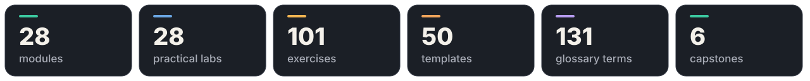
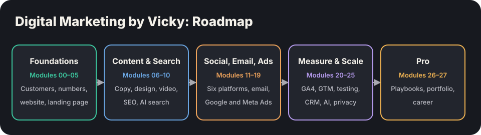
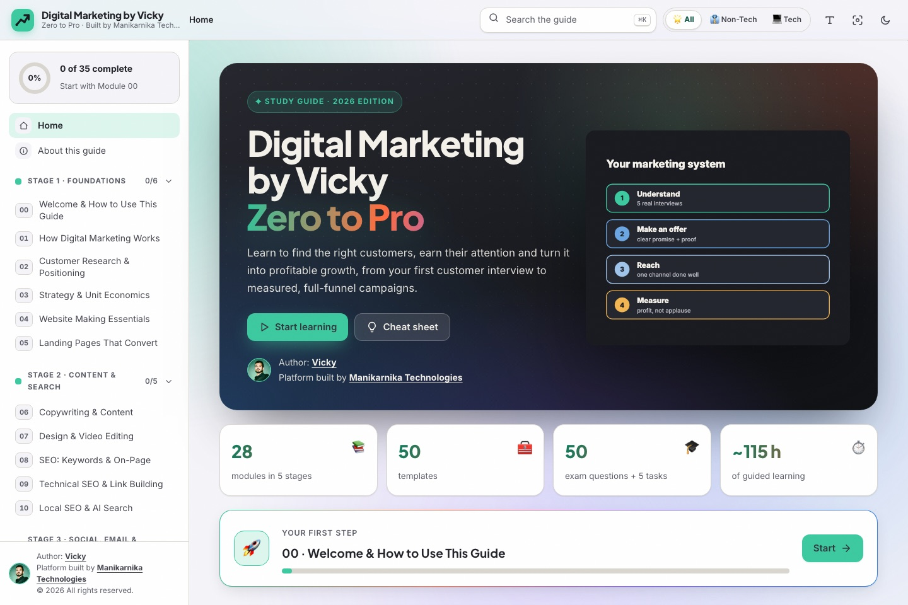
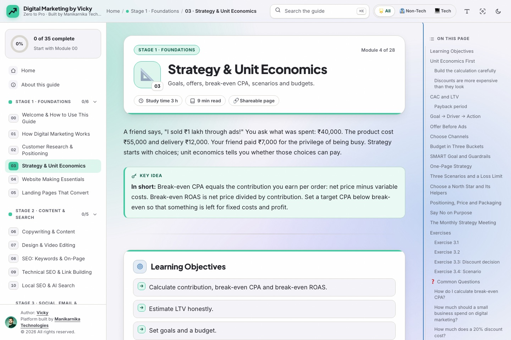

<a href="https://abvicky.github.io/Digital-Marketing-by-Vicky/"></a>

# Digital Marketing by Vicky: Zero to Pro

<p align="center">
  <a href="https://abvicky.github.io/Digital-Marketing-by-Vicky/"></a>
  <a href="https://github.com/ABVicky/Digital-Marketing-by-Vicky/stargazers"></a>
  <a href="LICENSE"></a>
  
  <a href="https://github.com/ABVicky/Digital-Marketing-by-Vicky/commits/main"></a>
</p>

<p align="center">
  <b><a href="modules/00-welcome.md">Start here</a></b> ·
  <b><a href="#curriculum">Curriculum</a></b> ·
  <b><a href="#choose-your-route">Routes</a></b> ·
  <b><a href="appendix/B-template-library.md">Templates</a></b> ·
  <b><a href="appendix/C-glossary.md">Glossary</a></b> ·
  <b><a href="appendix/D-final-exam.md">Exam</a></b> ·
  <b><a href="#questions">Questions</a></b>
</p>

Learn digital marketing by building it for one business. You interview customers, work out the profit on an order, make a page, choose channels, set up tracking and decide what to do next. No experience, code or ad budget is needed to begin.



## How it works

| 1 · Understand | 2 · Offer | 3 · Reach | 4 · Measure |
|---|---|---|---|
| Five real interviews, themes and positioning | Profit per order, clear promise, tested page | SEO, social, email and ads, chosen on purpose | Orders, GA4 and GTM, tests and limits |
| [Module 02](modules/02-customer-research-and-positioning.md) | [03](modules/03-strategy-and-unit-economics.md) and [05](modules/05-landing-pages.md) | [08](modules/08-seo-keywords-and-on-page.md) to [19](modules/19-meta-ads.md) | [20](modules/20-analytics-and-tracking.md) to [22](modules/22-conversion-optimization.md) |

Every module follows the same path: **short answer → lesson → before-and-after examples → practical lab → exercises with solutions → common questions → quiz**.

## Practical labs

Theory is half the work. Each module's lab shows **where to register, what to click, what to build, what to do when it fails and what proof to keep**.

| Lab | You do |
|---|---|
| [Local SEO](modules/10-local-seo-and-ai-search.md) | Register on Google, Bing, Apple and, where eligible, ChatGPT; film a verification video |
| [Backlinks](modules/09-technical-seo-and-links.md) | Use 12 link methods, find ten prospects and send five pitches |
| [Google Tag Manager](modules/21-google-tag-manager.md) | Track a real form and practise a rollback |
| [Google Ads](modules/18-google-ads.md) and [Meta Ads](modules/19-meta-ads.md) | Build safe, paused campaigns without spending |
| [CRM](modules/23-automation-and-crm.md) | Connect a form, stop duplicates and test failures |
| [AI assistant](modules/24-ai-tools-for-marketers.md) | Build one from approved facts and score it on ten cases |

All platforms: **[Tool & Platform Directory](appendix/H-tool-directory.md)**.

## Choose your route

| I want to… | Read in this order |
|---|---|
| Get local customers | [02](modules/02-customer-research-and-positioning.md) → [03](modules/03-strategy-and-unit-economics.md) → [05](modules/05-landing-pages.md) → [10](modules/10-local-seo-and-ai-search.md) → [13](modules/13-facebook-organic.md) → [17](modules/17-email-and-whatsapp.md) |
| Sell products online | [02](modules/02-customer-research-and-positioning.md) → [03](modules/03-strategy-and-unit-economics.md) → [04](modules/04-website-making-essentials.md) → [05](modules/05-landing-pages.md) → [12](modules/12-instagram.md) → [19](modules/19-meta-ads.md) → [17](modules/17-email-and-whatsapp.md) |
| Become an SEO specialist | [02](modules/02-customer-research-and-positioning.md) → [06](modules/06-copywriting-and-content.md) → [08](modules/08-seo-keywords-and-on-page.md) → [09](modules/09-technical-seo-and-links.md) → [10](modules/10-local-seo-and-ai-search.md) → [20](modules/20-analytics-and-tracking.md) |
| Manage social media | [02](modules/02-customer-research-and-positioning.md) → [06](modules/06-copywriting-and-content.md) → [07](modules/07-design-and-video-editing.md) → [11](modules/11-social-media-strategy.md) → [12](modules/12-instagram.md) to [16](modules/16-x-and-threads.md) |
| Run paid ads | [03](modules/03-strategy-and-unit-economics.md) → [05](modules/05-landing-pages.md) → [18](modules/18-google-ads.md) → [19](modules/19-meta-ads.md) → [20](modules/20-analytics-and-tracking.md) → [21](modules/21-google-tag-manager.md) → [22](modules/22-conversion-optimization.md) |
| Work in analytics | [03](modules/03-strategy-and-unit-economics.md) → [20](modules/20-analytics-and-tracking.md) → [21](modules/21-google-tag-manager.md) → [22](modules/22-conversion-optimization.md) → [25](modules/25-privacy-law-and-ethics.md) |

### Two tracks, one guide

| | 👔 Non-Tech | 💻 Tech |
|---|---|---|
| **For** | owners, creators, writers, marketers | developers, analysts, marketing operations |
| **Focus** | customers, copy, budgets, reports | technical SEO, events, SQL, automation |
| **Start with** | basic English and curiosity | basic HTML or data skills |
| **You leave with** | a plan, campaigns and an honest case study | a measurement plan, tested events and a reliable workflow |

Switch tracks at the top of the online reader. Shared lessons always stay visible.

## Curriculum



Open a stage to see its modules.

<details open>
<summary><b>🟢 Stage 1: Foundations</b> · 6 modules</summary>

*Customers, numbers and a website that works.*

| # | Module | You learn | You make | Time |
|:---:|---|---|---|---:|
| 00 | **[Welcome & How to Use This Guide](modules/00-welcome.md)** | Roadmap, practice client, practice lab and learning routes. | A practice lab and study route | 45 min |
| 01 | **[How Digital Marketing Works](modules/01-how-digital-marketing-works.md)** | Overview: channels, journey, roles, metrics and funnel maths. | A funnel forecast with low, base and high cases | 2.5 h |
| 02 | **[Customer Research & Positioning](modules/02-customer-research-and-positioning.md)** | Interviews, themes, segments, jobs and positioning. | Interview themes and a positioning statement | 3 h |
| 03 | **[Strategy & Unit Economics](modules/03-strategy-and-unit-economics.md)** | Goals, offers, break-even CPA, scenarios and budgets. | A profit model, loss limit and one-page strategy | 3 h |
| 04 | **[Website Making Essentials](modules/04-website-making-essentials.md)** | Domain, hosting, platforms, build, security and launch. | A three-page website and launch checklist | 5 h |
| 05 | **[Landing Pages That Convert](modules/05-landing-pages.md)** | Message match, proof, forms, checkout and user tests. | A landing page tested with five people | 3 h |

</details>

<details>
<summary><b>🔵 Stage 2: Content &amp; Search</b> · 5 modules</summary>

*Words, design, video, SEO and AI search.*

| # | Module | You learn | You make | Time |
|:---:|---|---|---|---:|
| 06 | **[Copywriting & Content](modules/06-copywriting-and-content.md)** | Frameworks, headlines, storytelling, editing and calendars. | A content calendar and rewritten copy | 4 h |
| 07 | **[Design & Video Editing](modules/07-design-and-video-editing.md)** | Canva, VN, shooting, editing, thumbnails and rights. | A short video, carousel and thumbnail | 5 h |
| 08 | **[SEO: Keywords & On-Page](modules/08-seo-keywords-and-on-page.md)** | Intent, keyword plans, pages, clusters and reporting. | A keyword plan and improved pages | 5 h |
| 09 | **[Technical SEO & Link Building](modules/09-technical-seo-and-links.md)** | Crawling, indexing, speed, structured data and links. | A ranked technical audit and redirect map | 5 h |
| 10 | **[Local SEO & AI Search](modules/10-local-seo-and-ai-search.md)** | Business Profile, reviews, AI answers and measurement. | A local fact audit and AI-search sample | 3 h |

</details>

<details>
<summary><b>🟠 Stage 3: Social, Email &amp; Ads</b> · 9 modules</summary>

*Every major platform, messaging and paid ads.*

| # | Module | You learn | You make | Time |
|:---:|---|---|---|---:|
| 11 | **[Social Media Strategy & Influencers](modules/11-social-media-strategy.md)** | Platform choice, community, creators and reporting. | A one-page social strategy and creator brief | 4 h |
| 12 | **[Instagram Marketing](modules/12-instagram.md)** | Profile, Reels, carousels, Stories, DMs and tests. | A four-week Instagram test | 4 h |
| 13 | **[Facebook (Organic)](modules/13-facebook-organic.md)** | Pages, groups, events, Messenger and original content. | A group answer and event plan | 3 h |
| 14 | **[YouTube Marketing](modules/14-youtube.md)** | Topics, titles, scripts, Shorts, analytics and leads. | A demonstration video with chapters | 4 h |
| 15 | **[LinkedIn Marketing](modules/15-linkedin.md)** | Profiles, posts, outreach, B2B and LinkedIn Ads. | A work log, outreach list and ad maths | 4 h |
| 16 | **[X (Twitter) & Threads](modules/16-x-and-threads.md)** | Short posts, listening, service and crisis response. | A listening routine and crisis update | 2.5 h |
| 17 | **[Email & WhatsApp Marketing](modules/17-email-and-whatsapp.md)** | Lists, flows, deliverability, consent and repeat sales. | A welcome flow with exit rules | 5 h |
| 18 | **[Google Ads](modules/18-google-ads.md)** | Keywords, ads, bidding, Shopping, PMax and scaling. | A first search campaign on paper | 6 h |
| 19 | **[Meta Ads (Facebook & Instagram)](modules/19-meta-ads.md)** | Campaigns, creative tests, leads, retargeting, scaling. | Fifteen ad concepts and a test plan | 6 h |

</details>

<details>
<summary><b>🟣 Stage 4: Measure &amp; Scale</b> · 6 modules</summary>

*Analytics, Tag Manager, testing, automation and AI.*

| # | Module | You learn | You make | Time |
|:---:|---|---|---|---:|
| 20 | **[Analytics & Tracking](modules/20-analytics-and-tracking.md)** | GA4, UTMs, attribution, incrementality and reports. | A metric dictionary and UTM rules | 6 h |
| 21 | **[Google Tag Manager](modules/21-google-tag-manager.md)** | Data layer, tags, triggers, testing and consent. | A tested GTM event with rollback | 5 h |
| 22 | **[Conversion Optimization](modules/22-conversion-optimization.md)** | Evidence, hypotheses, A/B tests and low-traffic methods. | A test brief and an honest reading of results | 4 h |
| 23 | **[Automation & CRM](modules/23-automation-and-crm.md)** | Pipelines, scoring, follow-up and reliable workflows. | A lead pipeline and automation runbook | 4 h |
| 24 | **[AI Tools for Marketers](modules/24-ai-tools-for-marketers.md)** | Tool choice, prompt recipes, agents and human checks. | An AI workflow with a test set | 4 h |
| 25 | **[Privacy, Law & Ethics](modules/25-privacy-law-and-ethics.md)** | Consent, claims, dark patterns and incident practice. | A data map and incident plan | 4 h |

</details>

<details>
<summary><b>🌟 Stage 5: Pro</b> · 2 modules</summary>

*Industry playbooks and your career.*

| # | Module | You learn | You make | Time |
|:---:|---|---|---|---:|
| 26 | **[Industry Playbooks](modules/26-industry-playbooks.md)** | 11 playbooks, 4 worked cases and a 90-day plan. | A 90-day plan for one business | 5 h |
| 27 | **[Becoming a Pro](modules/27-becoming-a-pro.md)** | Portfolio, proposals, reports, interviews and career. | A case study and portfolio | 4 h |

</details>

## Meet your practice client

**Mitti Studio** is a fictional ceramics business in Kolkata. Its owner posts constantly, but sales don't move. You work out why. All its numbers are invented for practice and aren't benchmarks.


| Question you'll be able to answer | Where |
|---|---|
| What's the most we can pay for an order? | [Module 03](modules/03-strategy-and-unit-economics.md) |
| Why does a 20% discount need 80% more orders? | [Module 03](modules/03-strategy-and-unit-economics.md) |
| Why is GA4 counting every purchase twice? | [Module 21](modules/21-google-tag-manager.md) |
| Which is better: cheap leads or costly ones? | [Modules 18](modules/18-google-ads.md) and [19](modules/19-meta-ads.md) |
| What's the difference between SEO, AEO and GEO? | [Module 10](modules/10-local-seo-and-ai-search.md) |

## Reference shelf

| | Resource | Use it for |
|:---:|---|---|
| 📋 | **[Cheat Sheet](appendix/A-cheat-sheet.md)** | Formulas, checklists and a channel picker. |
| 🧰 | **[Template Library](appendix/B-template-library.md)** | 50 copy-ready templates across 10 categories. |
| 📖 | **[Glossary](appendix/C-glossary.md)** | Digital marketing terms in plain English. |
| 🎓 | **[Final Exam](appendix/D-final-exam.md)** | 50 questions and 5 practical tasks with answers. |
| 🏆 | **[Capstone Projects](appendix/E-capstone-projects.md)** | Six portfolio projects with success criteria. |
| 🩺 | **[Troubleshooting](appendix/F-troubleshooting.md)** | Symptom, cause and fix for common marketing problems. |
| 🔗 | **[Resources & 30-Day Plan](appendix/G-resources.md)** | Official documentation, tools and a practice plan. |
| 🧭 | **[Tool & Platform Directory](appendix/H-tool-directory.md)** | Where to register, in what order, for every channel. |

## The online reader

<a href="https://abvicky.github.io/Digital-Marketing-by-Vicky/"><picture>
  <source media="(prefers-color-scheme: dark)" srcset="assets/readme/home-dark.jpg">
  
</picture></a>

| Search | Progress | Reading | Tracks |
|---|---|---|---|
| Press **⌘K** or **/** to search every chapter | Saved in your browser, with no account | Light and dark themes, text size and focus mode | Show all, Non-Tech or Tech notes |

<details>
<summary><b>See inside a lesson</b></summary>

<picture>
  <source media="(prefers-color-scheme: dark)" srcset="assets/readme/lesson-dark.jpg">
  
</picture>

</details>

## Questions

<details>
<summary><b>Is this suitable for a complete beginner?</b></summary>

Yes. Start with Module 00 and follow the stages. Some Tech notes assume basic HTML, SQL or Python, and you can hide them.

</details>

<details>
<summary><b>Do I need to spend money on ads?</b></summary>

No. Every paid-ads exercise can be completed on paper. Work out your profit and loss limit before running a real campaign.

</details>

<details>
<summary><b>How long does it take?</b></summary>

About 115 hours of study by our estimate, roughly 14 weeks at 8 hours a week. The practical labs add hands-on time, shown at the top of each one.

</details>

<details>
<summary><b>Will it get me a job or a certificate?</b></summary>

It doesn't promise either. It helps you build work you can show: a tested page, a measurement plan and honest case studies.

</details>

<details>
<summary><b>How current is it?</b></summary>

Time-sensitive notes were reviewed in November 2026. Platforms and laws change, so check the linked official pages before spending money or making legal decisions.

</details>

## Run it on your computer

```bash
git clone https://github.com/ABVicky/Digital-Marketing-by-Vicky.git
cd Digital-Marketing-by-Vicky
python3 -m http.server 8000
```

Then open `http://localhost:8000`. You can also double-click `index.html`. Fonts, diagrams and text rendering load from the internet.

<details>
<summary><b>Editing the guide</b></summary>

Edit the Markdown in `modules/` or `appendix/`, then rebuild the reader, chapter pages and sitemap:

```bash
python3 build.py
```

Found a mistake? [Open an issue](https://github.com/ABVicky/Digital-Marketing-by-Vicky/issues) with the module number and a source.

</details>

## Author and platform

<table>
<tr>
<td width="120" align="center" valign="top"></td>
<td valign="top">
<b>Vicky Prasad Mahato</b><br>
Author · System architect, software engineer and digital product builder in Kolkata, India. Founder of the Coders' Club at BBIT Kolkata and creator of <em>Mera Paisaa</em>.<br><br>
<em>“Marketing is not about tricking people into buying things they do not need. It is about understanding who has a problem you can genuinely solve, explaining your promise with honesty and proof, and building a sustainable system that earns profit through trust.”</em><br><br>
<a href="https://abvicky.in">abvicky.in</a> · <a href="https://www.linkedin.com/in/abvicky/">LinkedIn</a> · <a href="https://github.com/ABVicky">GitHub</a>
</td>
</tr>
<tr>
<td align="center" valign="top"></td>
<td valign="top">
<b>Manikarnika Technologies</b><br>
Platform architecture and development: the reader, design system, track switcher and search.<br><br>
<a href="https://www.manikarnikatechnologies.in/">manikarnikatechnologies.in</a>
</td>
</tr>
</table>

## Copyright and terms

© 2026 **[Manikarnika Technologies](https://www.manikarnikatechnologies.in/)** and **[Vicky Prasad Mahato](https://abvicky.in)**. **All Rights Reserved.**

This repository is publicly accessible on GitHub for **viewing, reading, study, and educational inspection only**. All rights to the original source code, scripts, software architecture, curriculum design, written lessons, templates, and instructional frameworks are reserved by the copyright owners.

Without prior written permission from the copyright owners, nobody is permitted to:
- **Copy or redistribute** the source code, curriculum, or materials in whole or in part.
- **Re-upload or republish** the code, reader platform, or content in another repository or platform.
- **Claim the original code or content** as their own.
- **Modify and distribute** derivative versions or adaptations of this work.
- **Use the code or curriculum commercially** (including paid courses, bootcamps, client work, or books).
- **Reuse substantial portions** of the code, user interface, or reader architecture in other projects.

For complete license terms, restrictions, permissions, and third-party dependency notices (including Marked.js, Highlight.js, Mermaid.js, and Google Fonts), please see the full **[LICENSE](LICENSE)** file.

<p align="center"><b>Useful?</b> <a href="https://github.com/ABVicky/Digital-Marketing-by-Vicky/stargazers">Star the repository</a> so you can find it again, and <a href="https://abvicky.github.io/Digital-Marketing-by-Vicky/">start reading</a>.</p>
