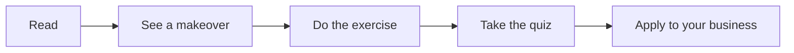

# 🚀 Module 00 — Welcome & How to Use This Guide

> 🟢 Stage 1 · Foundations · ⏱️ ~45 minutes

Two bakeries open on the same street. One posts every day, boosts every post and copies whatever is trending. The other asks its first thirty customers one question: *"What made you come here today?"* Most say they needed a birthday cake at short notice. So it builds one page called "Same-day birthday cakes", appears when people search for that, and messages past customers before the next birthday.

The second bakery does less marketing and gets more from it. **Digital Marketing by Vicky** teaches you to work like the second bakery.

> 🔑 **In short:** To learn digital marketing from zero, start with customers and numbers, build one landing page, then learn one channel deeply while measuring real results. Reading alone isn't enough: every module here ends with work you apply to a practice business.

---

## 🎯 Learning Objectives

By the end of this module, you will be able to:
- Explain what this guide covers and choose a track.
- Set up a practice lab.
- Describe the practice client you will work on throughout.
- Follow a study plan that fits your week.

---

## 1. What You Need to Start

You need a browser, a spreadsheet and basic English. No marketing degree, no code and no ad budget. Every paid-ads exercise can be done on paper first, so you won't spend money before you understand what you are buying.

| Track | Choose it if you… | You will finish with |
|---|---|---|
| 👔 Non-Tech | run, sell, write or manage | strategy, campaigns, copy, budgets and reports |
| 💻 Tech | code, analyse data or set up tools | tracking plans, technical SEO, SQL reports and automation |

Use the switcher at the top of the reader. **All** shows everything. The switcher hides track-specific notes; the shared lessons stay visible.

---

## 2. Meet Your Practice Client

You will apply each module to one fictional business.

**Mitti Studio** is an imaginary handmade-ceramics studio in Kolkata with three ways to earn:

1. **Online shop:** mugs, plates and gift sets, shipped across India.
2. **Weekend workshops:** pottery classes at the studio.
3. **Corporate gifting:** bulk orders for companies.

Its owner, Meera, says: *"We post on Instagram all the time. Some posts do well. Sales don't move. Should we spend more on ads?"*

| Starting numbers (invented for practice) | Per month |
|---|---|
| Website sessions | 12,000 |
| Online orders | 144 |
| Average order value (AOV) | ₹1,800 |
| Online revenue | ₹2,59,200 |
| Ad spend | ₹60,000 |
| Email subscribers | 2,400, never emailed |
| Corporate enquiries | 10, answered "when someone has time" |

> 🔑 All Mitti Studio figures are made up for teaching. Don't use them as industry benchmarks. Your own margins and data decide what is good.

Notice what the table already hints at: there is an unused email list, and slow replies to high-value enquiries. More ads may not be the first fix.

---

## 3. Build Your Practice Lab

| Need | Simple way to start |
|---|---|
| Website | A simple site on WordPress, a website builder's starter plan, or GitHub Pages |
| Analytics | Google Analytics 4 and Google Tag Manager on that site |
| Search data | Google Search Console |
| Keyword ideas | Google autocomplete, Trends and Keyword Planner |
| Design | Canva or Figma starter plan |
| Email | Any email platform with a no-cost starter tier |
| Ad research | Meta Ad Library and Google Ads Transparency Center |
| Planning | Google Sheets |

- [ ] I have a practice site or a page I can edit
- [ ] I created a spreadsheet called "Marketing lab"
- [ ] I chose my own real or imaginary business to run beside Mitti Studio

> ⚠️ Never paste customer names, phone numbers or passwords into practice files, AI tools or public sheets.

### 💻 Tech Lab
Add a Git repository for your site, use browser developer tools, and install Python for small analysis scripts. Keep API keys out of the repository.

---

## 4. How Each Module Works



The last step matters most. Reading about ads doesn't make you a marketer, just as reading recipes doesn't make you a cook.

## 5. Study Plans

| Plan | Pace | Finish |
|---|---|---|
| Relaxed | 5 h a week | about 23 weeks |
| Steady | 8 h a week | about 14 weeks |
| Intensive | 20 h a week | about 6 weeks |

If you own a business and need results first: read 02, 03, 05 and 17, then the one channel that fits your customers.

---

## 6. The Professional Mindset

1. **Start with the customer**, not the platform.
2. **Measure money, not applause.** Likes are clues; contribution profit pays salaries.
3. **Change one important thing at a time.**
4. **Assume you could be wrong.** Write down what would change your mind.
5. **Protect trust.** A trick that works once can cost years.

> ⚠️ Platform screens, rules and prices change often. This guide teaches durable principles, and tells you to check the official page where details move. Platform and legal notes were last reviewed in **November 2026**.

---

## 7. How to Take Notes That Become a Portfolio

Most learners finish a course with a folder of screenshots. Finish this one with evidence instead. Make one document per module:

```text
Module:
One idea in my own words:
What I did for Mitti:
What I did for my own business:
Evidence (link, number, photo, quote):
What surprised me:
What I still don't understand:
```

After 28 modules you'll have the raw material for a portfolio, and you can show *how you think*, which employers and clients care about more than certificates.

## 8. Which Modules Depend on Which

| You want to… | Read in this order |
|---|---|
| Get local customers | 02 → 03 → 05 → 10 → 13 → 17 |
| Sell products online | 02 → 03 → 04 → 05 → 12 → 19 → 17 |
| Become an SEO specialist | 02 → 06 → 08 → 09 → 10 → 20 |
| Become a social media manager | 02 → 06 → 07 → 11 → 12–16 |
| Become a performance marketer | 03 → 05 → 18 → 19 → 20 → 21 → 22 |
| Become a marketing analyst | 03 → 20 → 21 → 22 → 25 |
| Freelance | 02 → 03 → one specialty → 26 → 27 |

Module 03 appears almost everywhere. If you skip the numbers, every later decision rests on guesswork.

## 9. When You Get Stuck

1. **Say what you expected and what happened.** "It doesn't work" can't be solved.
2. **Check the basics:** right account, right date range, right page, tracking on.
3. **Reduce it:** one ad, one page, one event.
4. **Read the official help page,** not only a video from three years ago.
5. **Ask with evidence:** screenshot with private details covered, steps tried, one clear question.

❌ **Weak question**
```text
My ads are not working. Please help.
```

✅ **Strong question**
```text
Search campaign, 5 days, ₹4,200 spent, 260 clicks, 0 bookings. The form
works when I test it. 60% of search terms mention "jobs". Should I fix
terms before changing the page?
```

The strong question nearly answers itself. That happens often.

## 10. Three Promises to Make Now

- I won't publish a claim I can't support.
- I won't message people who didn't agree to it.
- I won't spend more than I've decided to lose while learning.

Write them in your lab sheet. They'll feel obvious today and inconvenient on a difficult day, which is when you need them.

## 🏋️ Exercises

### Exercise 0.1: Meera's question
Before spending more on ads, what three things would you check?

<details>
<summary>View Solution</summary>

Good answers include: (1) Does the site turn visitors into buyers? 144 ÷ 12,000 = 1.2%. (2) Is each ad-driven order profitable after product and shipping costs? (3) Are cheap opportunities unused, such as the email list and unanswered corporate enquiries? You should also ask how many of the 144 orders came from ads.

</details>

---

### Exercise 0.2: Choose your path
Pick one route from the table. Write why, how many hours you have each week, and what finished work you want to show at the end.

<details>
<summary>View Success Check</summary>

A good answer names a specific outcome ("a tested landing page and an honest case study"), a realistic weekly time, and a date. "Learn everything" is not a path.

</details>

## ❓ Common Questions

### How do I start learning digital marketing with no experience?

Interview a few customers, learn the basic numbers (conversion rate, CPA, contribution), make one landing page, then practise one channel for several weeks. Module order 01, 02, 03 and 05 gives you that base before you spend anything on ads.

### How long does it take to learn digital marketing?

This guide is roughly 115 hours of reading and practice: about 14 weeks at 8 hours a week. Basics take a few weeks. Job-level skill usually needs months of real projects, because feedback from real customers can't be rushed.

### Do I need coding to learn digital marketing?

No. Strategy, copy, social media, email and ads can be learned without code. Basic HTML and an understanding of tracking help you work with developers, and the Tech notes cover SQL, data layers and automation for those who want them.

## ✅ Quick Quiz

1. What is the best first step in marketing?
   - A) Choose a platform
   - B) Understand the customer's problem
   - C) Buy followers
2. Why are Mitti Studio's numbers not benchmarks?
   - A) They are invented, and margins differ by business
   - B) They are in rupees
   - C) They are too high
3. Which question is easiest for someone to help with?
   - A) My ads fail
   - B) Spend, clicks, result, what was checked, one question
   - C) Please call me

<details>
<summary>View Answers</summary>

1. **B.** Channel choice follows from where and how the customer decides.
2. **A.** They exist for practice only.
3. **B.** Specific evidence narrows the cause.

</details>

---

> Author: **Vicky** ([abvicky.in](https://abvicky.in)) · Platform built by [Manikarnika Technologies](https://www.manikarnikatechnologies.in/) · © 2026 All rights reserved.
> ➡️ [How Digital Marketing Works](01-how-digital-marketing-works.md)
