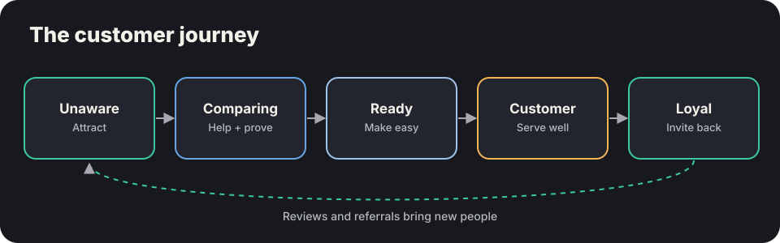

# 🧭 Module 01 — How Digital Marketing Works

> 🟢 Stage 1 · Foundations · ⏱️ ~2.5 hours

Think of the last thing you bought online. You probably saw it somewhere, forgot it, searched, read reviews, asked a friend, left it in a cart, and returned when a message reminded you. Which step "caused" the sale? That question is why digital marketing is interesting, and why simple dashboards can mislead.

> 🔑 **In short:** Digital marketing is the work of helping the right people discover, trust, buy and keep using something through websites, search, social networks, messaging and apps. Good results come from matching the message to the customer's stage and judging profit, not likes.

---

## 🎯 Learning Objectives

- Define marketing, digital marketing and the main channels.
- Map a customer journey.
- Separate paid, owned and earned media.
- Calculate the core metrics without a tool.

---

## 1. What Marketing Is

**Marketing is the work of understanding a group of people, making something valuable for them, and helping them discover, trust, buy and keep using it.** Digital marketing does this through websites, search, social networks, messaging and apps.

Advertising is one part. Product, price, availability and service are parts too. Great ads for a poor product simply help more people find out it is poor.

## 2. The Customer Journey



| Stage | What the person thinks | Useful marketing |
|---|---|---|
| Unaware | nothing yet | a short video of a mug being made |
| Problem-aware | "I need a wedding gift" | a gift guide |
| Comparing | "Handmade or a hamper?" | reviews, photos, comparisons |
| Ready | "Will it arrive by Friday?" | delivery date, clear price, easy payment |
| Customer | "How do I care for it?" | care guide, quick support |
| Repeat | "Who else would love this?" | refill offer, referral |

Real journeys loop and skip. The map helps you match the message to the moment.

## 3. Paid, Owned and Earned

| Type | Example | Strength | Risk |
|---|---|---|---|
| Paid | search ads, social ads | fast, controllable | stops when money stops |
| Owned | website, email list | yours to keep | takes time to build |
| Earned | reviews, press, shares | trusted | you can't control it |

A social profile feels owned, but the platform controls reach and can suspend the account. Your domain and permission-based list are safer foundations.

## 4. Channels at a Glance

| Channel | Best at | Typical speed | Main cost |
|---|---|---|---|
| SEO | meeting existing demand | months | content and expertise |
| Search ads | urgent existing demand | days | clicks |
| Social content | discovery and trust | weeks to months | creative time |
| Paid social | creating demand | days | media and creative |
| Email / WhatsApp | repeat sales, nurture | days once you have consent | list and messages |
| Creators | borrowed trust | weeks | fees and product |
| Partnerships | qualified introductions | weeks | relationship time |
| PR | credibility | unpredictable | time |

> 💡 **Demand capture versus demand creation:** search reaches people already looking. Social and video reach people who were not. If nobody searches for your new idea, search ads cannot create the interest.

### How platforms earn money, and why you should care

Search and social platforms mostly sell attention through **auctions**. Every time a space is available, advertisers compete. The winner isn't simply the highest bidder: platforms also estimate whether people will respond and whether the experience will be poor. A relevant ad can therefore cost less than an irrelevant one.

Keep their incentive in mind. A platform recommendation may help you, and it may also increase spending. Ask: *"What evidence shows this improves **my** profit?"*

### Channels work as a team

A typical Mitti journey might look like this:

| Day | Touch | Job it did |
|---|---|---|
| 1 | Reel of a drop test | made Riya aware |
| 6 | searched "handmade housewarming gift" | confirmed options |
| 6 | read the gift guide | answered questions |
| 9 | Instagram Story | reminded |
| 12 | email with dispatch date | removed doubt |
| 12 | purchase | |

Last-click reporting gives email everything. Cutting Reels because they "don't convert" could quietly shrink next month's email sales.

## 5. The Core Metrics

```text
CTR = clicks / impressions
CPC = spend / clicks
Conversion rate = conversions / visitors
CPA = spend / conversions
AOV = revenue / orders
ROAS = attributed revenue / ad spend
```

Suppose Mitti spends ₹10,000 and gets 100,000 impressions, 1,000 clicks and 20 orders worth ₹36,000.

- CTR = 1,000 ÷ 100,000 = **1%**
- CPC = 10,000 ÷ 1,000 = **₹10**
- Conversion rate = 20 ÷ 1,000 = **2%**
- CPA = 10,000 ÷ 20 = **₹500**
- ROAS = 36,000 ÷ 10,000 = **3.6**

Is 3.6 good? You can't know yet. If making and shipping the goods costs ₹30,000, Mitti lost money: 36,000 − 30,000 − 10,000 = **−₹4,000**. Module 03 fixes this blind spot.

## 6. Vanity Metrics and Decision Metrics

A metric is useful when a change in it would change what you do.

| Vanity alone | Better partner |
|---|---|
| Followers | qualified visits from social |
| Impressions | reach among the right people |
| Page views | enquiries per visit |
| Email list size | revenue per delivered email |

> 👔 **For a manager:** ask for one business result, two leading indicators and one decision in every report.

> 💻 **For a technical marketer:** write the exact numerator, denominator, time window and deduplication rule for each metric. Two tools can both be "right" under different definitions.

## 7. Makeover

❌ **Weak plan**
```text
Post daily, go viral and increase brand awareness.
```

✅ **Strong plan**
```text
Audience: people in Kolkata buying a gift for a couple's new home.
Goal: 25 workshop couple bookings in March.
Message: "Give an afternoon together, then keep the mugs you make."
Channels: gift-guide page, local search, two partner cafes, email.
Measure: bookings, cost per booking, seats filled.
```

## 8. Work Backwards With Funnel Maths

Meera wants 25 workshop bookings. Past data says 4% of workshop-page visitors book, and 2% of ad viewers click.

```text
Visitors needed = 25 / 0.04 = 625
Impressions needed = 625 / 0.02 = 31,250
Cost at ₹12 per click = 625 x 12 = ₹7,500
Cost per booking = 7,500 / 25 = ₹300
```

Now change one assumption. If the page converts at 2% instead, she needs 1,250 visitors and ₹15,000, so each booking costs ₹600. **The page was worth as much as half the ad budget.**

Always calculate a low, base and high case:

| Case | Click cost | Page rate | Cost per booking |
|---|---|---|---|
| High | ₹10 | 5% | ₹200 |
| Base | ₹12 | 4% | ₹300 |
| Low | ₹18 | 2% | ₹900 |

If the low case would hurt, reduce the test budget rather than hoping.

## 9. Who Does What

| Role | Main question |
|---|---|
| Strategist | whom do we serve and why us? |
| SEO specialist | how do we earn useful search demand? |
| Content/copy | what should we say? |
| Designer/video editor | how do we show it? |
| Social/community | who are we talking with? |
| Performance marketer | which paid tests are profitable? |
| CRM/lifecycle | how do we keep promises after signup? |
| Analyst | what happened, and how sure are we? |
| Marketing operations | does the system work reliably? |

In a small business one person does six of these jobs. Do fewer channels, not poorer versions of all of them.

### A realistic day for a one-person marketer

| Time | Work |
|---|---|
| 30 min | check spend, orders, messages and errors |
| 90 min | one important asset |
| 45 min | publish and reply |
| 45 min | one improvement to page, flow or tracking |
| 20 min | log results and tomorrow's one priority |

## 10. Seven Expensive Myths

| Myth | Better thinking |
|---|---|
| "We need to be everywhere" | be useful where buyers decide |
| "It must go viral" | reach without fit rarely pays |
| "More traffic solves sales" | fix the leak first |
| "Our product is for everyone" | start with one clear situation |
| "SEO costs nothing" | it costs time and expertise |
| "Good ROAS means profit" | margin decides |
| "AI will do it" | AI drafts; you need customers and judgement |

## 11. A First Campaign, End to End

```text
Audience: couples in Kolkata looking for a weekend activity
Insight: they want something to do AND something to keep (5 of 6 interviews)
Offer: Saturday couples class, ₹3,000, two mugs each... check cost first
Page: /workshops/couples
Channels: local search, two partner cafes, Instagram proof
Budget: ₹7,500, stop if ₹3,000 brings no booking and tracking is verified
Measure: confirmed bookings, cost per booking, seats filled
Learning question: does "keep what you make" beat "something different to do"?
```

Notice that the offer line questions itself. "Two mugs each" doubles the firing cost. Good campaign documents make such problems visible before customers do.

## 🛠️ Practical Lab: Build a Funnel Calculator and Journey Map

**You will finish with:** a working spreadsheet and a map of one real purchase. Time: 2 hours.

### Tools

| Tool | Use | Open |
|---|---|---|
| Google Sheets | calculator | [sheets.google.com](https://sheets.google.com/) |
| Meta Ad Library | see active ads | [facebook.com/ads/library](https://www.facebook.com/ads/library/) |
| Google Ads Transparency Center | see verified advertisers' ads | [adstransparency.google.com](https://adstransparency.google.com/) |
| Google Trends | compare demand over time | [trends.google.com](https://trends.google.com/) |
| FigJam, Miro or paper | journey map | your choice |

### Step by step: the calculator

1. In row 1 write: `Spend, CPC, Clicks, Page rate, Conversions, Price, Variable cost, Contribution, CPA, Profit after ads`.
2. In row 2 enter `7500, 12`, leave Clicks, then `4%`, leave Conversions, then `3000, 1800`.
3. Use these formulas:

```text
C2  =A2/B2
E2  =C2*D2
H2  =F2-G2
I2  =A2/E2
J2  =(E2*H2)-A2
```

4. You should get 625 clicks, 25 conversions, ₹1,200 contribution, ₹300 CPA and ₹22,500 after ads.
5. Copy the row twice. Make a low case (CPC ₹18, page rate 2%) and a high case (CPC ₹10, page rate 5%).
6. Colour a result red when profit is below zero.

### Step by step: spy without copying

1. Open Meta Ad Library, choose your country and **All ads**, then search three competitors.
2. For each, record hook, promise, proof, offer, format, landing page and start date.
3. Open the Google Ads Transparency Center and search the same names.
4. Open each landing page on your phone. Does it continue the ad's promise?
5. Write one gap: a worry that nobody answers.

> ⚠️ An ad running for months isn't proof of profit. Learn the structure; don't copy words, images or claims.

### Practice task

Ask one friend to recall a recent online purchase. Map six touches on a line, and mark each **paid, owned or earned**. Circle the touches that analytics probably missed.

### If it goes wrong

| Problem | Fix |
|---|---|
| `#DIV/0!` | a rate or spend cell is empty or zero |
| Percent looks 100× too big | format the cell as a percentage and enter 4%, not 4 |
| No ads found | try the Page name, domain, or another country setting |

### Proof to save

- [ ] Sheet with three cases
- [ ] Table of five competitor ads
- [ ] One journey map
- [ ] Three-sentence decision: which number should improve first, and why

## 🏋️ Exercises

### Exercise 1.1: Do the math
₹24,000 buys 1,600 clicks and 32 sales of ₹1,500. Find CPC, conversion rate, CPA and ROAS.

<details>
<summary>View Solution</summary>

CPC = ₹15. Conversion rate = 2%. CPA = ₹750. Revenue = ₹48,000, so ROAS = 2.0.

</details>

### Exercise 1.2: Choose a channel
A 24-hour locksmith needs calls this week. Which channel first?

<details>
<summary>View Solution</summary>

Local search: a verified Business Profile and, if budget allows, call-focused search ads. Demand is urgent and explicit. A brand video is unlikely to be the first priority.

</details>

### Exercise 1.3: Work backwards
You need 40 enrolments. Trial-to-enrol is 25%, page visit-to-trial is 8%, and CPC is ₹9. How many visits and how much spend?

<details>
<summary>View Solution</summary>

Trials = 40 ÷ 0.25 = 160. Visits = 160 ÷ 0.08 = 2,000. Spend = 2,000 × ₹9 = ₹18,000, or ₹450 per enrolment. Check it against contribution before starting.

</details>

### Exercise 1.4: Map your own purchase
Write every touch in your last meaningful online purchase. Mark which ones a seller's analytics could not have seen.

<details>
<summary>View Discussion</summary>

Friends' advice, private messages, another device, a shop visit and memory usually go unseen. That's why dashboards should be read together with interviews and surveys.

</details>

## ❓ Common Questions

### What are the main types of digital marketing?

The main types are SEO, search ads, social media, paid social ads, content, email and WhatsApp, creator partnerships, and analytics with conversion work. They divide into paid, owned and earned media, and they usually work together rather than alone.

### What is the difference between paid, owned and earned media?

Paid media is reach you buy, such as ads. Owned media is what you control more directly, such as your website and email list. Earned media is what others say, such as reviews and press. Paid is quick, owned lasts, earned is trusted.

### Is a high ROAS always good?

No. ROAS compares revenue with ad spend and ignores product, shipping and return costs. ₹36,000 revenue from ₹10,000 ads is 3.6 ROAS, yet it loses ₹4,000 if the goods and delivery cost ₹30,000. Compare ROAS with your break-even figure.

## 🔑 Key Takeaways

- Match message to stage.
- Build owned assets while using paid reach.
- Revenue is not profit.

## ✅ Quick Quiz

1. Which metric includes orders?
   - A) CTR
   - B) CPA
   - C) CPC
2. A brand-new product category has no search volume. What is the likely first job?
   - A) Create demand
   - B) Bid on exact keywords
   - C) Wait
3. If page conversion doubles and traffic cost stays the same, cost per conversion:
   - A) halves
   - B) doubles
   - C) stays
4. Why might cutting an awareness channel hurt email sales?
   - A) Email costs more
   - B) Fewer new people may enter the journey
   - C) It never can

<details>
<summary>View Answers</summary>

1. **B.**
2. **A.** Show the problem and solution where the audience spends time.
3. **A.** Twice the conversions come from the same spend.
4. **B.** Last-click reports hide earlier influence.

</details>

---

> Author: **Vicky** ([abvicky.in](https://abvicky.in)) · Platform built by [Manikarnika Technologies](https://www.manikarnikatechnologies.in/) · © 2026 All rights reserved.
> ⬅️ [Welcome & How to Use This Guide](00-welcome.md) · ➡️ [Customer Research & Positioning](02-customer-research-and-positioning.md)
