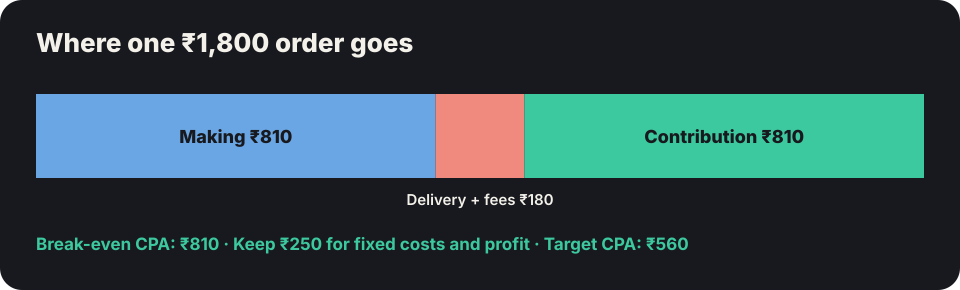

# 📐 Module 03 — Strategy & Unit Economics

> 🟢 Stage 1 · Foundations · ⏱️ ~3 hours

A friend says, "I sold ₹1 lakh through ads!" You ask what was spent: ₹40,000. The product cost ₹55,000 and delivery ₹12,000. Your friend paid ₹7,000 for the privilege of being busy. Strategy starts with choices; unit economics tells you whether those choices can pay.

> 🔑 **In short:** Break-even CPA equals the contribution you earn per order: net price minus variable costs. Break-even ROAS is net price divided by contribution. Set a target CPA below break-even so that something is left for fixed costs and profit.

---

## 🎯 Learning Objectives

- Calculate contribution, break-even CPA and break-even ROAS.
- Estimate LTV honestly.
- Set goals and a budget.
- Produce a one-page strategy.

---

## 1. Unit Economics First



Mitti's average online order:

| Item | Amount |
|---|---|
| Selling price excluding tax | ₹1,800 |
| Materials and making (45%) | −₹810 |
| Shipping, packing, payment fees | −₹180 |
| **Contribution before ads** | **₹810** |

```text
Contribution per order = net price - variable costs
Break-even CPA = contribution per order
Break-even ROAS = net price / contribution per order
```

Break-even CPA is **₹810**. Break-even ROAS is 1,800 ÷ 810 = **2.22**. If Mitti needs ₹250 left per order for fixed costs and profit, target CPA is 810 − 250 = **₹560**, and target ROAS is 1,800 ÷ 560 = **3.21**.

> ⚠️ Include returns, discounts, cash-on-delivery failures and taxes you collect for the government. Leaving them out makes ads look better than they are.

### Build the calculation carefully

| Line | Question to ask |
|---|---|
| Price | after discount, before tax collected for government? |
| Product cost | materials, making labour, failed pieces? |
| Packing | box, filler, note, tape? |
| Shipping | average across zones, returns included? |
| Payment | gateway and cash-on-delivery fees? |
| Returns | refunds, reverse shipping, unsellable stock? |
| Support | is it variable per order? |

Suppose 4% of orders break and replacement costs ₹990. Expected cost per order is 0.04 × 990 = ₹39.60. Mitti's true contribution is nearer ₹770 than ₹810. This guide keeps ₹810 for simple arithmetic, but your own model shouldn't ignore it.

### Discounts are more expensive than they look

| | No discount | 20% off |
|---|---|---|
| Price | ₹1,800 | ₹1,440 |
| Product + delivery costs | ₹990 | ₹990 |
| Contribution | ₹810 | ₹450 |
| Orders needed for ₹81,000 | 100 | 180 |

A 20% discount requires **80% more orders** to keep the same contribution (payment fees would fall slightly; ignored here). Before discounting, ask whether a clearer offer would solve the doubt.

## 2. CAC and LTV

**CAC** is all acquisition cost divided by new customers. Include media, creative, tools and labour when judging the business. **LTV** is the contribution you expect from a customer over a stated period.

If a customer makes an average of 1.4 orders in 12 months and contribution is ₹810 each:

```text
12-month LTV = 1.4 x 810 = 1134
```

So ₹1,134 is expected before acquisition cost. But you pay CAC today and receive the repeat order later. A business can have good LTV and still run out of cash.

> 🔑 Avoid copying "3:1 LTV:CAC" as a law. Margin, retention uncertainty, cash and growth goals decide what is safe.

### Payback period

```text
Payback = acquisition cost / contribution received per month
```

If a subscription customer costs ₹3,000 and leaves ₹500 contribution each month, payback is six months, ignoring cancellations. If one in ten leaves each month, the actual average is longer. Draw the monthly cash, not only the final LTV.

| Month | Customers left from 100 | Contribution at ₹500 | Total |
|---|---|---|---|
| 1 | 100 | ₹50,000 | ₹50,000 |
| 2 | 90 | ₹45,000 | ₹95,000 |
| 3 | 81 | ₹40,500 | ₹1,35,500 |
| 4 | 73 | ₹36,500 | ₹1,72,000 |
| 5 | 66 | ₹33,000 | ₹2,05,000 |
| 6 | 59 | ₹29,500 | ₹2,34,500 |

100 customers cost ₹3,00,000. After six months only ₹2,34,500 has returned. The "six-month payback" was wrong because it forgot that people leave.

## 3. Goal → Driver → Action

Mitti's online revenue goal: ₹3,60,000 a month at the same AOV, so 200 orders.

```text
Orders = sessions x conversion rate
```

| Path | Sessions | Conversion rate | Orders |
|---|---|---|---|
| Today | 12,000 | 1.20% | 144 |
| Better site | 12,000 | 1.67% | about 200 |
| More traffic | 16,667 | 1.20% | about 200 |
| Mixed | 14,000 | 1.43% | about 200 |

The "better site" path needs no extra traffic. You still must test whether it's achievable. Email orders can also close part of the gap.

## 4. Offer Before Ads

An offer is the full reason to act: product, outcome, price, proof, risk reduction and timing.

❌ **Weak**
```text
20% OFF. Hurry!
```

✅ **Strong**
```text
Housewarming set: two mugs and a serving plate, gift-wrapped with
your note. ₹1,950. Order by 2 PM Tuesday for dispatch Wednesday.
Arrives broken? Send a photo within 48 hours and we replace it.
```

The strong offer answers worries without cutting margin. Use real deadlines only.

## 5. Choose Channels

Score each 1–5 and multiply by the weight.

| Criterion | Weight | Email | Search ads | Short video |
|---|---|---|---|---|
| Audience fit | 3 | 5 | 4 | 3 |
| Cost to start | 2 | 5 | 3 | 4 |
| Speed | 2 | 5 | 5 | 2 |
| Skill available | 2 | 4 | 3 | 2 |
| **Total** | | **43** | **34** | **25** |

Scores are judgements, so write why.

## 6. Budget in Three Buckets

- **Proven (about 70%)**: already meets target.
- **Promising (about 20%)**: early signals.
- **Experiments (about 10%)**: learning.

This is a starting habit, not a rule. A new business has no proven bucket, so set a loss limit and test one channel properly. Splitting ₹10,000 across five platforms usually teaches nothing.

## 7. SMART Goal and Guardrails

> Increase online orders from 144 to 200 by 31 March, with blended ad cost per order under ₹560 and damage complaints below 2%.

Guardrails stop you winning the wrong game. Without them, deep discounts could reach 200 orders while losing money.

## 8. One-Page Strategy

```text
Business goal:
Customer and situation:
Problem and evidence:
Positioning:
Offer:
Main conversion:
Primary channel + reason:
Support channels:
Target and guardrail metrics:
Monthly budget and loss limit:
First three experiments:
What we will NOT do:
Owner and review date:
```

> 👔 **For owners:** "What we will not do" is the hardest and most useful line.

> 💻 **For analysts:** build the model with inputs on one sheet, formulas on another and low/base/high scenarios. Don't hide numbers inside formulas.

## 9. Three Scenarios and a Loss Limit

| | Low | Base | High |
|---|---|---|---|
| Spend | ₹20,000 | ₹20,000 | ₹20,000 |
| CPC | ₹16 | ₹12 | ₹10 |
| Clicks | 1,250 | 1,667 | 2,000 |
| Conversion rate | 0.8% | 1.5% | 2.2% |
| Orders | 10 | 25 | 44 |
| Contribution before ads | ₹8,100 | ₹20,250 | ₹35,640 |
| After ads | −₹11,900 | ₹250 | ₹15,640 |

The base case barely breaks even. That's useful to know *before* spending. A wise plan either improves the page first, or tests with ₹8,000 and a clear learning question.

```text
Loss limit = the amount we can lose and still pay staff, suppliers and tax
```

A loss limit is decided on a calm day and respected on an anxious one.

## 10. Choose a North Star and Its Helpers

| Business | Possible main measure | Guardrail |
|---|---|---|
| Store | contribution after marketing | returns, cash |
| Class | paid seats attended | refunds, satisfaction |
| Agency | retained gross profit | delivery overload |
| SaaS | activated, retained customers | support burden |
| Nonprofit | net funds and mission outcome | donor complaints |

One main measure keeps the team together. Guardrails stop it from doing something foolish to reach it.

## 11. Positioning, Price and Packaging

Price is part of the message. Three legitimate ways to increase order value without pressure:

1. **Useful bundle:** two mugs + plate + gift wrap, because gifters want a finished present.
2. **Better fit:** larger set for a family.
3. **Service:** engraved note or dispatch on a chosen date.

Test what people value before discounting what they already wanted.

❌ **Weak bundle**
```text
Buy any 3 slow-moving items and get 40% off!
```

✅ **Strong bundle**
```text
First-home set: two mugs, one serving plate, wrapped with your note.
₹1,950 (₹2,150 separately). Dispatch date shown before payment.
```

Only show a "separate" price if customers could really pay that price.

## 12. Say No on Purpose

Meera's ideas list had 23 items. The strategy kept four.

| Idea | Decision | Reason |
|---|---|---|
| Show delivery date | do | 6 of 8 interviews |
| Email subscribers who consented | do | owned, low cost |
| Reply to corporate leads in hours | do | ₹58,500 contribution per typical order |
| Workshop search test | do | clear demand |
| Podcast | not now | no evidence, high effort |
| New app | no | customers didn't ask |
| Daily discounts | no | destroys contribution |

Review the "not now" list each quarter. Saying no isn't forgetting.

## 13. The Monthly Strategy Meeting

| Minutes | Question |
|---|---|
| 10 | What happened versus goal and guardrails? |
| 15 | What did customers teach us? |
| 15 | Which assumption was most wrong? |
| 15 | Keep, change or stop? |
| 5 | Owner and date |

> 🔑 A strategy that never changes isn't being tested. One that changes every week isn't being followed.

## 🏋️ Exercises

### Exercise 3.1
Price ₹2,400; product ₹1,000; shipping and fees ₹200; average return cost ₹100. Find contribution, break-even CPA and ROAS.

<details>
<summary>View Solution</summary>

Contribution = 2,400 − 1,300 = ₹1,100. Break-even CPA = ₹1,100. Break-even ROAS = 2.18.

</details>

### Exercise 3.2
Mitti spent ₹60,000 and the ad tool claims 80 orders. Is it meeting the ₹560 target?

<details>
<summary>View Solution</summary>

No: 60,000 ÷ 80 = ₹750. It is under break-even (₹810) but above target. The claim may also include orders that would have happened anyway, so check blended results and incrementality (Module 20).

</details>

### Exercise 3.3: Discount decision
Price ₹1,000, variable costs ₹600. A 15% discount is proposed. How many more orders are needed to keep the same contribution?

<details>
<summary>View Solution</summary>

Before: ₹400. After: ₹850 − ₹600 = ₹250. Orders needed: 400 ÷ 250 = 1.6 times, or **60% more**. Also ask how many buyers would have paid full price.

</details>

### Exercise 3.4: Scenario
Build low/base/high cases for a ₹10,000 test in your business. Decide the test size after looking only at the low case.

<details>
<summary>View Success Check</summary>

Inputs have sources, contribution includes returns, and the low case is believable rather than slightly worse than base. The loss limit is written in rupees.

</details>

## ❓ Common Questions

### How do I calculate break-even CPA?

Subtract product, packing, shipping, payment fees and expected returns from the net price. A ₹1,800 order with ₹990 variable costs leaves ₹810, so break-even CPA is ₹810. To keep ₹250 per order, target a CPA of ₹560.

### How much should a small business spend on digital marketing?

There is no universal percentage. Work out contribution per sale, choose one channel, estimate low, base and high results, then set a loss limit you can afford. Fix the page and response process first if they're the bottleneck.

### How much does a 20% discount cost?

More than it looks. If a ₹1,800 order has ₹990 variable costs, a 20% discount cuts contribution from ₹810 to ₹450. You need 80% more orders to earn the same total contribution.

## ✅ Quick Quiz

1. If AOV is ₹1,000 and contribution is ₹250, break-even ROAS is:
   - A) 2.5
   - B) 4
   - C) 0.25
2. Why use guardrails?
   - A) To prevent harmful ways of hitting the goal
   - B) To slow work
   - C) To replace goals
3. Price ₹1,800, costs ₹990, discount 20%. New contribution?
   - A) ₹810
   - B) ₹648
   - C) ₹450
4. Why can a simple payback calculation be too optimistic?
   - A) Customers may leave
   - B) Tax is zero
   - C) Ads cost nothing

<details>
<summary>View Answers</summary>

1. **B.** 1,000 ÷ 250.
2. **A.**
3. **C.** ₹1,440 − ₹990.
4. **A.** Cancellations reduce later contribution.

</details>

---

> Author: **Vicky** ([abvicky.in](https://abvicky.in)) · Platform built by [Manikarnika Technologies](https://www.manikarnikatechnologies.in/) · © 2026 All rights reserved.
> ⬅️ [Customer Research & Positioning](02-customer-research-and-positioning.md) · ➡️ [Website Making Essentials](04-website-making-essentials.md)
