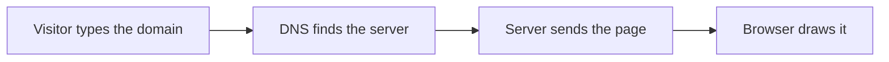

# 🧱 Module 04 — Website Making Essentials

> 🟢 Stage 1 · Foundations · ⏱️ ~5 hours

Meera's cousin built the first Mitti Studio website as a favour. Two years later the cousin moved abroad, the domain was registered in the cousin's email, nobody knew the hosting password, and the site went down in Diwali week. The problem wasn't design. It was ownership.

A website is a small piece of property. Before you decorate it, make sure your name is on the papers.

> 🔑 **In short:** To make a business website, register a domain in the business's name, choose a platform that suits whoever will maintain it, plan pages around customer questions, build for phones first, then test, secure, back up and launch.

---

## 🎯 Learning Objectives

By the end of this module, you will be able to:
- Explain domain, DNS, hosting, SSL and CMS in plain words.
- Choose a website platform that fits the business.
- Plan pages and a sitemap before touching a theme.
- Build, secure, launch and maintain a simple business website.

---

## 1. The Parts of a Website

Think of opening a shop.

| Part | Shop comparison | What it does |
|---|---|---|
| Domain | the address | `mittistudio.example` |
| DNS | the map that leads to it | connects the domain to services |
| Hosting | the building | stores and serves the site |
| SSL/TLS certificate | a sealed envelope | encrypts traffic (HTTPS) |
| CMS | the shelves and stockroom | lets you edit without coding |
| Theme | interior design | controls the look |
| Plugin/app | extra equipment | adds features |
| Backup | insurance | restores after a mistake |



When something breaks, this chain helps you find where. "Site not found" often points to the domain or DNS. A blank page or error 500 usually points to the server or CMS. An ugly page with missing styles is often a theme, cache or file problem.

## 2. Own the Keys

Before design, fill this table and store it in a password manager, not a chat message.

| Asset | Must be registered to | Check |
|---|---|---|
| Domain | the business | renewal date, auto-renew, owner email |
| DNS | the business | who can edit |
| Hosting/builder | the business | billing and recovery email |
| CMS admin | named people | at least two trusted administrators |
| Analytics, Search Console, ads | the business | agency added as a user |
| Business email | own domain | recovery works |

> ⚠️ Give developers and agencies their own limited accounts. Never share the owner's password, and remove access when the work ends.

### Choosing a domain

1. Easy to say on a phone call.
2. Short, without hyphens or clever spelling.
3. Doesn't copy a competitor or trademark.
4. A familiar ending for your market, such as `.com` or `.in`.
5. Room to grow: `kolkatamugs.example` becomes awkward when you sell plates in Pune.

A domain with your keyword in it isn't a shortcut to ranking. Choose a name people remember.

## 3. Choose a Platform

| Option | Good for | Watch out for |
|---|---|---|
| Website builder (Wix, Squarespace and similar) | simple service sites, fast start | harder to move away, monthly fee |
| WordPress (self-hosted) | content, flexibility, many plugins | you handle updates and security |
| WooCommerce (on WordPress) | stores that want control | more maintenance as you grow |
| Shopify | stores that want less maintenance | subscription, app and payment costs |
| Static site (GitHub Pages and similar) | portfolios, guides, speed | needs comfort with files; no built-in cart |
| Link-in-bio page | a temporary start | limited SEO and ownership |

### Decide with five questions

1. Do I sell products, take bookings, or collect enquiries?
2. Who will edit it every week?
3. What must it connect to: payments, shipping, CRM, WhatsApp?
4. What is the **three-year** cost, including theme, apps, renewals and help?
5. Can I export my content, products and customers?

❌ **Weak decision**
```text
My friend uses WordPress, so we will too.
```

✅ **Strong decision**
```text
We sell about 60 products and Meera edits stock herself. She doesn't
want to manage updates. A hosted store fits. We checked the monthly
fee, payment fees and two needed apps against our ₹810 contribution
per order, and tested exporting products and customers.
```

## 4. Plan Before You Design

Start with jobs, not pages. From Module 02, Mitti has three customers: gifters, workshop guests and HR managers.

```text
Home
  Shop
    Mugs
    Plates
    Gift sets
  Workshops
    Beginner class
    Couples class
  Corporate gifting
  Guides
  About
  Contact
  Policies: shipping, returns, privacy, terms
```

Keep the main menu short, using the customer's words. "Corporate gifting" is clear. "Solutions" isn't.

### Minimum pages

| Page | Its one job |
|---|---|
| Home | send each visitor to the right place |
| Product/service | help someone decide |
| About | prove real people stand behind it |
| Contact | make reaching you easy |
| Policies | remove risk and meet legal duties |
| Thank you | confirm, and state what happens next |

Write a page brief before opening the editor:

```text
Page:
Visitor and situation:
Question they arrive with:
Main action:
Proof available:
Must include:
Search topic (if any):
Owner and review date:
```

## 5. Design Basics for Non-Designers

1. **One idea per section.** If a section needs two headings, split it.
2. **Hierarchy.** Biggest text = most important message.
3. **White space.** Space groups things; crowding hides them.
4. **Two fonts, three colours.** One main, one accent, one neutral.
5. **Contrast.** Grey text on white photographs badly and reads worse.
6. **Real photos.** A slightly imperfect photo of your studio beats a perfect stock handshake.
7. **Thumb-friendly.** Buttons need enough size and space.

Design for the phone first. Draw the mobile version on paper, in one column, in order of importance. If it works there, the desktop version is easy.

> 👔 **Owner's test:** open the site outdoors, on mobile data, holding the phone in one hand. That's how many customers meet you.

## 6. Build It: A Safe Order

1. Register the domain and connect DNS.
2. Turn on HTTPS.
3. Set site title, language, time zone and currency.
4. Create the page structure with plain text.
5. Choose a light, well-supported theme.
6. Add real copy and images.
7. Add forms, payments or booking.
8. Add analytics and consent (Modules 20, 21 and 25).
9. Test everything.
10. Remove the "coming soon" or `noindex` setting.
11. Submit the sitemap in Search Console.

### WordPress notes

- Use **pages** for lasting content and **posts** for articles.
- Set a readable permalink structure before publishing.
- Choose plugins that are maintained and needed. Ten good ones beat forty abandoned ones.
- Delete unused themes and plugins; deactivating isn't enough for security.
- Test updates on a staging copy when the site takes money.

### Image preparation

| Step | Why |
|---|---|
| Resize to the displayed size | a 5,000-pixel photo in a 400-pixel box wastes data |
| Export WebP or well-compressed JPEG | faster loading |
| Name it usefully: `blue-handmade-mug.webp` | clear for you and others |
| Write alt text for meaningful images | accessibility and understanding |

### 💻 Tech Lens: A Minimal, Solid Page

```html
<!doctype html>
<html lang="en">
<head>
  <meta charset="utf-8">
  <meta name="viewport" content="width=device-width, initial-scale=1">
  <title>Beginner Pottery Classes in Kolkata | Mitti Studio</title>
  <meta name="description" content="Make your first bowl in one afternoon. Clay, glaze and firing included.">
  <link rel="canonical" href="https://example.com/workshops/beginner">
</head>
<body>
  <header><nav aria-label="Main">...</nav></header>
  <main>
    <h1>Make your first bowl this Saturday</h1>
    <p>A beginner class for up to eight people. ₹1,500, firing included.</p>
    <a href="/book">See available seats</a>
  </main>
  <footer>...</footer>
</body>
</html>
```

Use semantic elements so browsers, search engines and screen readers understand the page. Keep styles in one file, load non-essential scripts late, and set security headers suited to your host.

## 7. Security and Backups

| Risk | Basic protection |
|---|---|
| Stolen password | unique password and two-factor login |
| Outdated software | scheduled updates |
| Bad update | automatic, off-site backup and tested restore |
| Form spam | rate limit, honeypot or challenge |
| Payment data | use a reputable payment provider; don't store card details |
| Unknown admins | quarterly access review |

> 🔑 A backup you have never restored is only a hope. Practise one restore on a staging site.

## 8. Launch Checklist

- [ ] Every link and menu item works
- [ ] Contact form arrives in the right inbox, and not in spam
- [ ] One real low-value order and refund completed
- [ ] Prices, tax, shipping and delivery dates are right
- [ ] Policies reviewed for your business
- [ ] Mobile, tablet and desktop checked
- [ ] Keyboard and contrast checked
- [ ] Page titles and descriptions written
- [ ] 404 page helps people continue
- [ ] Old URLs redirect to the closest new page
- [ ] Analytics records one purchase once
- [ ] Backup taken
- [ ] Search engines are allowed to index public pages

## 9. Maintenance Rhythm

| When | Do |
|---|---|
| Weekly | test form and checkout, check stock and errors |
| Monthly | update software, review speed, fix broken links |
| Quarterly | restore test, access review, refresh key pages |
| Yearly | renewals, policies, full customer walk-through |

> 💡 Put the domain's renewal date in two people's calendars, even if auto-renew is on. Cards expire.

## 🏋️ Exercises

### Exercise 4.1: Choose a platform
A tuition teacher needs a timetable, enquiry form and a few articles. There is no online payment, and the teacher edits from a phone. What would you suggest?

<details>
<summary>View Solution</summary>

A simple hosted builder is a sensible start: low maintenance and phone editing. WordPress is reasonable if articles will become the main way to be found and someone will maintain it. A full store platform is unnecessary. In both cases the teacher should own the domain and test exporting the content.

</details>

### Exercise 4.2: Find the fault
Visitors see "This site can't be reached". The host says the server is fine, and the site works on a temporary host URL. What do you check?

<details>
<summary>View Solution</summary>

Domain expiry first, then DNS records and recent changes, then whether the certificate covers the domain. The temporary URL working tells you that hosting and the CMS are probably healthy.

</details>

### Exercise 4.3: Build it
Publish a three-page site for your practice business. Ask two people to find the price and contact you without help.

## ❓ Common Questions

### What do I need to make a website?

You need a domain, hosting or a hosted builder, HTTPS, page content, and a way to take enquiries or payments. You also need named owners, strong logins, backups and someone responsible for updates.

### Should I use WordPress or Shopify?

WordPress suits content-heavy sites and people willing to handle updates. Shopify suits stores that want less maintenance and accept subscription and app costs. Compare three-year cost, who edits it, needed integrations and whether you can export your data.

### Who should own a website's domain?

The business should own it, with the recovery email, billing and renewal under its control. Give developers and agencies limited access instead of letting them register the domain in their own name.

## 🔑 Key Takeaways

- Own the domain, accounts and backups.
- Choose a platform for the person who will maintain it.
- Structure and words come before themes.
- Launch is the beginning of maintenance.

## ✅ Quick Quiz

1. Who should own the domain?
   - A) The developer
   - B) The business
   - C) The hosting company
2. What makes a backup trustworthy?
   - A) It is automatic
   - B) It has been restored successfully
   - C) It is large
3. What should you do with unused plugins?
   - A) Delete them
   - B) Keep them in case
   - C) Deactivate and forget

<details>
<summary>View Answers</summary>

1. **B.** Agencies and developers can be given access.
2. **B.** Automatic backups can still be incomplete or broken.
3. **A.** Unused code can still carry vulnerabilities.

</details>

---

> Author: **Vicky** ([abvicky.in](https://abvicky.in)) · Platform built by [Manikarnika Technologies](https://www.manikarnikatechnologies.in/) · © 2026 All rights reserved.
> ⬅️ [Strategy & Unit Economics](03-strategy-and-unit-economics.md) · ➡️ [Landing Pages That Convert](05-landing-pages.md)
