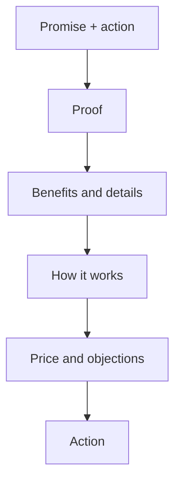

# 🏠 Module 05 — Landing Pages That Convert

> 🟢 Stage 1 · Foundations · ⏱️ ~3 hours

Imagine a shop where the door is stuck, prices are hidden and the cashier asks for your life story before accepting money. Sending more people there would not help. A weak page is that shop.

---

## 🎯 Learning Objectives

- Structure a page around one visitor and one action.
- Write a clear first screen.
- Reduce friction in forms and checkout.
- Check speed, mobile, accessibility and trust.

---

## 1. Website or Landing Page?

A **website** supports many journeys. A **landing page** continues one promise. If an ad says "Pottery class for couples, Saturday", don't send people to the home page.

| Element | Question it answers |
|---|---|
| Headline | Am I in the right place? |
| Subheading | What do I get? |
| Image/video | What does it look like? |
| Call to action | What do I do next? |
| Proof | Why believe you? |
| Details | Does this fit me? |
| Objections | What if it goes wrong? |
| Final action | How do I finish? |

## 2. The First Screen

❌ **Weak**
```text
Welcome to our website
Crafting moments. Inspiring lives.
[Learn more]
```

✅ **Strong**
```text
Make two mugs together this Saturday
A beginner pottery class in Kolkata. Clay, glaze and firing included.
₹3,000 per couple. No experience needed.
[See available seats]
```

Test: show the screen for five seconds. Can someone say what it is, who it's for and what to do?

### Five headline tests

Read the headline and ask:

1. **Specific:** could a competitor use it unchanged?
2. **Relevant:** does it match the click that brought them?
3. **Believable:** is proof nearby?
4. **Clear:** would a busy person understand it once?
5. **Useful:** does it help a decision?

### Match message to source

| They clicked… | First screen should say… |
|---|---|
| "couples pottery Kolkata" | couples class, city, date, price |
| drop-test Reel | the tested gift set and packing proof |
| email "still deciding on size?" | size guide and their product |
| LinkedIn checklist | corporate gifting, lead times, invoice |

Same business, four different first screens. This is called **message match**, and it often does more than any design change.

## 3. Page Blueprint



Use one primary action. A secondary action such as "Ask on WhatsApp" is fine for visitors who aren't ready.

### A complete example, section by section

```text
1. PROMISE     Make two mugs together this Saturday
               Beginner class, Kolkata. ₹3,000 per couple, firing included.
               [See available seats]
2. PROOF       4 customer photos, real reviews, "max 8 people"
3. WHAT        Centre, shape, decorate. We fire and send a pickup date.
4. FOR WHOM    Never touched clay? Good. Not suitable for under-12s.
5. HOW         Book → come 10 min early → make → collect in 3 weeks
6. PRICE       ₹3,000. Includes / doesn't include.
7. WORRIES     Parking, clothes, lateness, cancellation, allergies
8. HOST        Meera's photo, experience, how she teaches
9. ACTION      [Choose your Saturday]  or  Ask a question
```

Each section answers the next thing the visitor would think. If a section answers no question, delete it.

### Long or short?

| Short page works when | Longer page works when |
|---|---|
| cheap, familiar, warm visitor | costly, new, risky or complex |
| one simple choice | several people decide |

"People don't read" is incomplete. People don't read what doesn't help them.

## 4. Trust Is Specific

- Real names and photos, used with permission.
- Complete price, delivery and return information.
- Business address and contact details.
- Reviews that include context.
- Guarantees you can honour.

Fake countdowns, invented reviews and pre-ticked extras are harmful and may be unlawful. Module 25 covers this.

### Build a proof bank

| Claim | Proof | Source/date | Permission | Where used |
|---|---|---|---|---|
| packing survives drops | video of 10 drops | Oct test | own | product, ad |
| beginners succeed | before/after photos | class log | written | workshop |
| HR teams reorder | two references | email | yes | gifting |

When someone wants to write "loved by thousands", check the bank. If it isn't there, it doesn't go on the page.

## 5. Forms

Every field has a cost. Ask only what the next step needs.

| Corporate enquiry field | Keep? |
|---|---|
| Work email | yes |
| Quantity and date | yes, needed to quote |
| Budget range | optional |
| Full address | later |
| Date of birth | no |

Use visible labels, the right mobile keyboard, clear errors and autofill. Tell people what happens after they submit.

## 6. Checkout

Review: guest checkout, total cost early, several payment choices, delivery date, editable cart, saved progress, clear confirmation. Try your checkout monthly on a cheap phone and slow connection.

## 7. Speed and Core Web Vitals

| Metric | Measures | Google's "good" threshold |
|---|---|---|
| LCP | main content loading | 2.5 s or less |
| INP | response to interaction | 200 ms or less |
| CLS | visual movement | 0.1 or less |

Thresholds are judged at the 75th percentile of visits. Start with large images, unused scripts and slow hosting. A perfect lab score does not guarantee sales.

### 💻 Tech Checklist

```html

```

- Don't lazy-load the main above-the-fold image.
- Set image dimensions to reduce layout shift.
- Load third-party tags only when needed.
- Test with field data as well as Lighthouse.

## 8. Accessibility Is Customer Service

- Text contrast that people can read.
- Useful alternative text for meaningful images.
- Keyboard access and visible focus.
- Captions on video.
- Labels and errors that don't rely on colour.

> 👔 **Owner's test:** watch three people try to buy or enquire on their own phones. Don't help. Note every hesitation.

## 9. Product Pages

- [ ] Photos: front, scale in hand, detail, use, packaging
- [ ] Price, tax and delivery date before cart
- [ ] Size in millilitres **and** everyday words
- [ ] Material, care, what varies between handmade pieces
- [ ] Stock that is true
- [ ] Reviews including the less perfect ones
- [ ] Returns and breakage
- [ ] Related items that help, not distract

❌ **Weak description**
```text
Beautiful premium mug crafted with love. Perfect for everyone.
```

✅ **Strong description**
```text
A 350 ml mug for people who refill twice. The handle fits three fingers.
Wheel-thrown, so size varies by about 10 ml. Dishwasher safe; keep the
gold-rim version out of the microwave. Dispatch by Wednesday.
```

## 10. Lead Pages

A lead form asks for trust before giving value. State what happens next:

```text
1. We reply by 5 PM the next working day.
2. You get a price range and lead time, not a generic brochure.
3. If we aren't a fit, we'll say so.
```

| Mistake | Fix |
|---|---|
| "Submit" | "Get my gift quote" |
| 11 fields | quantity, date, work email |
| No confirmation | thank-you page and email |
| Phone demanded | optional, with reason |

Short forms aren't always better: one good qualifying question can save everyone time. Judge by qualified enquiries, not raw submissions.

## 11. Checkout Walk-Through

Buy your own product each month and time it.

| Step | Check |
|---|---|
| Cart | editable, total and date visible |
| Account | guest possible |
| Address | autofill, pincode check early |
| Payment | UPI, card and other methods your buyers use |
| Failure | cart kept, clear retry |
| Success | order number, date, support |
| Message | arrives promptly, no surprise promotions |

Failed payments deserve attention: a person who tried to pay and couldn't is the warmest lead you have.

## 12. A Five-Person Usability Test

```text
"Imagine your friend is moving on Sunday. Use this site to find a gift
under ₹2,000 that will reach on time. Please think aloud. I won't help,
because I'm testing the site, not you."
```

Record: where they look first, words they misread, hesitation, wrong turns, and what they say when done. Fix problems that affect two or more people, then test again.

| Person | Found gift? | Saw date? | Problem | Quote |
|---|---|---|---|---|
| 1 | yes | no | opened FAQ | "When does it come?" |
| 2 | yes | no | left to check WhatsApp | "I'd ask them" |
| 3 | no | no | filter hidden | "Is there under 2000?" |
| 4 | yes | yes, late | scrolled past | |
| 5 | yes | no | guessed | "Maybe a week?" |

Four of five didn't see the date in time. No A/B test is needed to justify making it clearer.

> 💡 Ask developers and designers to *watch* one session. Five minutes of a confused customer changes more minds than a long report.

## 🏋️ Exercises

### Exercise 5.1: Write the corporate gifting first screen
Include outcome, audience, minimum order, proof and one action.

<details>
<summary>View Sample Solution</summary>

**Handmade gifts your team will actually use.** Ceramic desk sets for 50–500 people, packed individually with your message. GST invoice and sample available. Button: **Get a quote within one working day.** Use the response promise only if the team can keep it.

</details>

### Exercise 5.2: Audit a page
Score 0–2 for clarity, relevance, proof, action, mobile, speed, accessibility and trust. Fix the lowest high-impact item.

### Exercise 5.3: Message match
An ad says "Diwali gifts for 50 employees, GST invoice, sample in 3 days". It leads to the shop home page. Write the correct first screen.

<details>
<summary>View Sample</summary>

**Handmade Diwali gifts for teams of 50+.** Sample in 3 days. Individual packing, GST invoice, dates confirmed in writing. Button: **Request a sample.** Include the order cut-off date, and only promise three days if it's reliable.

</details>

### Exercise 5.4: Run the test
Do the five-person test on your own page. Submit the table and three fixes.

<details>
<summary>View Success Check</summary>

You used one realistic task, didn't help, recorded behaviour as well as opinions, and fixed causes shared by at least two people.

</details>

## ✅ Quick Quiz

1. A couples-workshop ad should lead to:
   - A) Home page
   - B) Matching workshop page
   - C) Instagram profile
2. INP measures:
   - A) Visual stability
   - B) Interaction responsiveness
   - C) Download size
3. Message match means:
   - A) Using one headline everywhere
   - B) Continuing the promise that earned the click
   - C) Matching colours
4. Four of five testers miss delivery date. You should:
   - A) Make it clearer
   - B) Wait for an A/B test
   - C) Ignore it

<details>
<summary>View Answers</summary>

1. **B.**
2. **B.**
3. **B.** Visitors confirm they're in the right place.
4. **A.** Strong usability evidence is enough to fix a clear problem.

</details>

---

> Author: **Vicky** ([abvicky.in](https://abvicky.in)) · Platform built by [Manikarnika Technologies](https://www.manikarnikatechnologies.in/) · © 2026 All rights reserved.
> ⬅️ [Website Making Essentials](04-website-making-essentials.md) · ➡️ [Copywriting & Content](06-copywriting-and-content.md)
