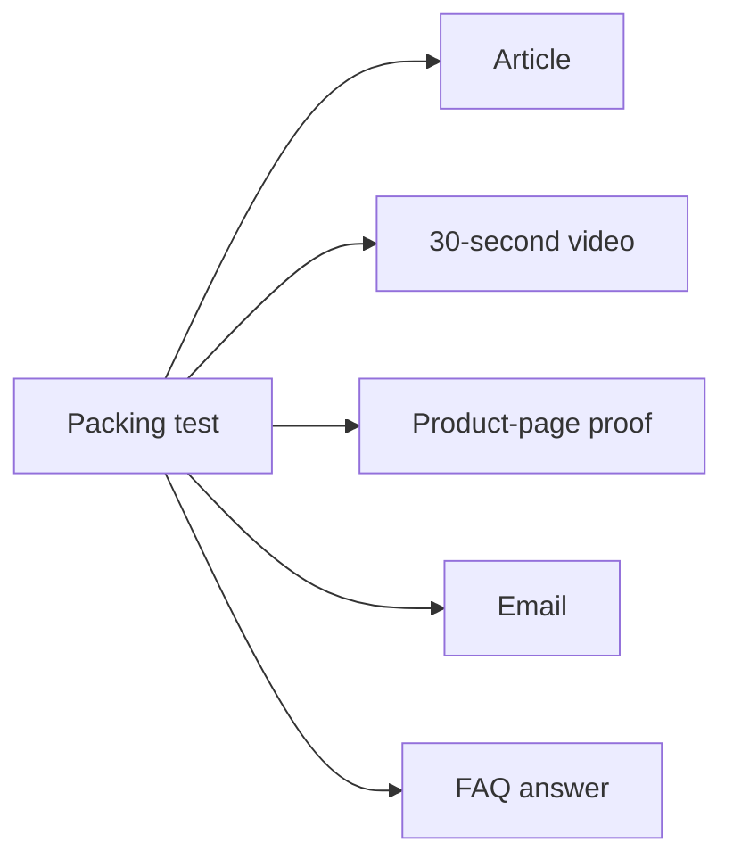

# ✍️ Module 06 — Copywriting & Content

> 🔵 Stage 2 · Content & Search · ⏱️ ~4 hours

A good shop assistant notices what you need, explains the difference between two options and tells you honestly when the cheaper one is enough. Good copy does the same in writing.

> 🔑 **In short:** Good copywriting turns features into believable benefits using customers' own words, backs them with proof and makes the next step obvious. Good content answers real customer questions and has a distribution plan before it is written.

---

## 🎯 Learning Objectives

- Turn features into believable benefits.
- Write headlines, body copy and calls to action.
- Plan content from customer questions.
- Build a calendar and repurpose one strong idea.

---

## 1. Copy or Content?

**Copy** asks for a next step: buy, book, reply. **Content** helps, teaches or entertains and builds trust. Many pieces do both. Each still needs a job.

## 2. Feature → Benefit → Proof

| Feature | So what? | Proof |
|---|---|---|
| Wide mug handle | comfortable with a full hand | close-up photo and measurement |
| Drop-tested packing | less worry about breakage | test video, replacement policy |
| Small class | more help from the teacher | "maximum 8 people" |

Ask "so what?" until you reach a real improvement in the customer's life. Stop before it becomes silly. A mug does not "transform your destiny".

## 3. Two Useful Frameworks

**PAS: Problem, Agitate, Solve**

```text
Need a housewarming gift by the weekend?
Another hamper is quick, but it looks like everyone else's.
Choose a handmade pair, add a personal note and see the delivery
date before you pay.
```

"Agitate" means show the real consequence. It doesn't mean frighten or shame people.

**AIDA: Attention, Interest, Desire, Action** works well for longer pages. Frameworks help you draft; customer evidence decides.

### More frameworks, with their limits

| Framework | Steps | Good for | Danger |
|---|---|---|---|
| PAS | problem, agitate, solve | ads, emails | scaring people |
| AIDA | attention, interest, desire, action | pages | treating people as a machine |
| BAB | before, after, bridge | case stories | unrealistic "after" |
| 4Cs | clear, concise, compelling, credible | editing | none, use always |
| FAB | feature, advantage, benefit | product copy | stopping at "advantage" |

### One product, four angles

```text
PAS   Moving-in gift by Sunday? Another hamper won't feel like you.
      Choose a set, add a note, see the dispatch date first.
BAB   Before: "I'll just send money." After: she drinks from it daily.
      Between them: a two-mug set wrapped with your words.
FAB   Corrugated sleeve + paper (feature) absorbs corner hits (advantage),
      so your gift is far less likely to arrive in pieces (benefit).
Story We dropped 40 boxes off a table. Here's the one we now use.
```

The same facts carry different emotions. Test which situation your audience recognizes.

## 4. Headlines

| Type | Example |
|---|---|
| Outcome | Make your first bowl in one afternoon |
| Specific audience | Corporate gifts your new joiners will use |
| Question | Which mug survives a dishwasher? |
| Objection | No experience? We guide every step |
| Comparison | Stoneware or porcelain: what to choose |

Write 20, keep 3. The first five are usually what everyone else would write.

❌ **Weak**
```text
Unlock the magic of timeless craftsmanship
```

✅ **Strong**
```text
A housewarming gift they'll use every morning
```

### Turn customer words into headlines

| Customer said | Headline |
|---|---|
| "Will it reach by Sunday?" | See the delivery date before you pay |
| "She'd know I didn't think" | A housewarming gift that feels like you |
| "I was scared I'd be the only beginner" | Everyone in this class is a beginner |
| "I don't know what size" | Pick your mug by the drink you love |

This is the most dependable headline method in the guide. Your job is mostly listening and shortening.

## 5. Edit for Clarity

1. Put the main point first.
2. Replace adjectives with facts.
3. Cut repeated sentences.
4. Read aloud.
5. Check every claim, price and date.
6. Make the next step obvious.

> 🔑 Clear beats clever when the reader must act.

## 6. Content Pillars From Customer Jobs

| Pillar | Customer job | Example |
|---|---|---|
| Choose | pick well | stoneware size guide |
| Care | keep it lasting | dishwasher test |
| Gift | feel thoughtful | gift by budget |
| Make | learn a hobby | first-class mistakes |
| Trust | reduce risk | how we pack |

List 10 real questions under each pillar. That gives 50 ideas without chasing trends.

## 7. A Useful Brief

```text
Reader and situation:
Question:
One-sentence answer:
Evidence or first-hand experience:
What competing pieces miss:
Format and distribution:
Next step:
Expert reviewer:
Update date:
```

## 8. Make Once, Adapt Many Times



Adapt to the place. Don't paste a long article into a caption. A search reader wants a direct answer, while a video viewer needs to see the drop test quickly.

| Day | Work |
|---|---|
| Mon | collect questions and choose one |
| Tue | make the main asset |
| Wed | edit and fact-check |
| Thu | adapt to two channels |
| Fri | reply, distribute and review |

> 👔 **Small-team rule:** two useful pieces every week for six months beat twenty weak posts followed by silence.

> 💻 **Content operations:** store topic, intent, owner, status, URL, update date and conversions in one table. Use version history for important pages.

## 9. Microcopy: The Smallest Words

| Place | Weak | Better |
|---|---|---|
| Button | Submit | Get my quote |
| Form help | Required | We'll use this only to send the quote |
| Error | Invalid input | Enter a 6-digit PIN code |
| Empty cart | Your cart is empty | Nothing here yet. See gifts that dispatch tomorrow |
| Out of stock | Sold out | Sold out. Next firing: 18 December. Tell me |
| Success | Thank you | Booked. Bring short nails and comfortable clothes |

Microcopy appears when someone is already trying to act. A small improvement there can matter more than a clever banner.

## 10. Storytelling Without Inventing

A useful business story has five parts:

```text
Person + situation
Goal
Obstacle (specific)
Choice
Change + honest limit
```

> Asha booked the beginner class after three failed YouTube attempts. Her first bowl still collapsed. The teacher showed her to anchor one elbow, and the second one stood. It leans a little. She drinks from it anyway.

The lean makes it believable. Get permission, change only what protects privacy, and don't turn one good result into a promise.

## 11. Write in the Customer's Language

Many Indian customers move between English, Hindi, Bengali, Tamil and other languages in one conversation.

- Use the language they use to *decide*, not only to chat.
- Don't translate word by word; rewrite the idea.
- Ask a fluent person to check tone, honorifics and local meaning.
- Keep prices, dates and legal text accurate in every version.
- Avoid dialect as a joke.

❌ **Weak translation**
```text
"Handle with love" translated literally so it sounds like an instruction
to embrace the parcel.
```

✅ **Strong adaptation**
```text
Native writer chooses the everyday phrase people use for fragile items,
tested with three customers.
```

## 12. Editorial Quality Control

| Check | Question |
|---|---|
| Purpose | What will the reader do or understand? |
| Evidence | Where did each important fact come from? |
| Original value | What did we test, photograph or experience? |
| Completeness | What obvious question remains? |
| Fairness | Did we state limits and alternatives? |
| Voice | Would a colleague say this? |
| Access | Headings, alt text, captions, readable language? |
| Freshness | Owner and review date? |

### Edit in four passes

1. **Structure:** move or delete whole sections.
2. **Clarity:** shorten sentences; explain terms.
3. **Proof:** check facts and permissions.
4. **Polish:** spelling, rhythm, links.

Polishing a paragraph before deciding whether it belongs wastes time.

### Before and after

```text
Before (44 words): At Mitti Studio, we are extremely passionate about
providing our valued customers with an unparalleled selection of premium
quality handcrafted ceramic products that are designed to elevate the
everyday experience of dining and bring an enhanced sense of joy to
each and every home.

After (19 words): We make plates and mugs by hand in Kolkata. They're
for everyday meals, dishwasher included, and breakages get replaced.
```

The second version is shorter *and* says more.

## 13. Distribution Is Half the Work

| Asset | Day 1 | Week 1 | Month 1 | Later |
|---|---|---|---|---|
| Gift guide | email, Story | partner cafes, Reel | internal links, ads test | update for next festival |

Make a distribution list before writing. If you can't name ten people or places that would want the piece, reconsider the topic.

### Content scorecard

```text
Value score = useful actions / qualified readers
```

A care guide may produce fewer sales but reduce support questions. Count the job it was given. Review the lowest-value quarter each year: improve, merge, redirect or remove.

> 👔 **Briefing a freelancer:** share customer quotes, examples you like *and why*, facts they may use, one decision-maker and a fair revision limit.

> 💻 **Content as data:** keep facts such as price, seats and dates in one source and reference them, so one change doesn't require editing 30 pages.

## 🛠️ Practical Lab: Research, Write and Publish One Complete Asset

**You will finish with:** one published article or page, four adaptations and a distribution log. Time: 6 hours.

### Tools

| Job | Tool | Open |
|---|---|---|
| Customer words | your interviews, reviews, support log | lab sheet |
| Questions | Google autocomplete, AnswerThePublic | [answerthepublic.com](https://answerthepublic.com/) |
| Interest | Google Trends | [trends.google.com](https://trends.google.com/) |
| Draft | Google Docs | [docs.google.com](https://docs.google.com/) |
| Clarity check | Hemingway Editor, read aloud | [hemingwayapp.com](https://hemingwayapp.com/) |
| Images | own photos, Canva | [canva.com](https://www.canva.com/) |
| Schedule | Buffer, Meta Business Suite or calendar | [buffer.com](https://buffer.com/) |

### Where to publish

| Place | Good for | Set up |
|---|---|---|
| Your blog | owned search asset | WordPress **Posts → Add New** |
| LinkedIn article/newsletter | professional depth | from a profile or Page with access |
| Medium or Substack | reach or email audience | create profile; keep the full original on your site |
| YouTube | demonstration | Module 14 |
| Partner's site | borrowed audience | agreed topic, honest author line |

### Step by step

1. Pick one question three customers asked.
2. Search it. Write what the first five pages answer and what they don't show.
3. Create evidence: test, photo, price comparison, checklist or interview.
4. Fill the brief: reader, answer, evidence, action, distribution, reviewer.
5. Write the answer in 40–60 words.
6. Draft headings as questions; add evidence, limits and next step.
7. Write 20 headlines. Ask five people what each promises. Choose the most accurately understood.
8. Edit in four passes: structure, clarity, proof, polish.
9. In WordPress: add title, short URL, category, descriptive image names, alt text, internal links, author and preview. Publish.
10. Ask Search Console to inspect it (Module 08).
11. Adapt it to: email, carousel, 30-second script and a useful answer in a permitted community.
12. Record where you shared it and what happened after 7 and 30 days.

### Practice task

Create *"What size mug should I buy?"* for Mitti. Measure four real cups with water, photograph each in the same hand, publish a table and make a seven-slide carousel.

### Distribution checklist

- [ ] Two existing pages link to it
- [ ] Two customers or experts were asked for correction, not praise
- [ ] One partner sees a reason to share it
- [ ] One community answer is complete without a click
- [ ] One email to permitted subscribers
- [ ] UTMs used only on external campaign links

### If it goes wrong

| Problem | Fix |
|---|---|
| It sounds like everyone else | add a test, number, mistake or photo |
| Nobody reads | distribute to ten named places before making another |
| Readers don't act | check next-step relevance |
| Too long to finish | publish a narrower answer |

### Proof to save

- [ ] Evidence file and brief
- [ ] 20 headlines with test notes
- [ ] Published URL and four adaptations
- [ ] 7-day and 30-day result rows

## 🏋️ Exercises

### Exercise 6.1
Turn "eight seats, tools included, two-hour class" into a short workshop promotion.

<details>
<summary>View Sample Solution</summary>

**Try pottery without buying a thing.** Join seven other beginners for a guided two-hour class. We provide the clay and tools, and help at every step. Choose your Saturday seat. If the total is eight, "join up to seven others" is accurate.

</details>

### Exercise 6.2
Create five pillars, 25 questions and a four-week calendar for your business. Name a distribution channel for each piece.

### Exercise 6.3: Microcopy
Rewrite: (a) "Oops! Something went wrong" on a failed UPI payment; (b) "Subscribe to our newsletter"; (c) "Read more".

<details>
<summary>View Samples</summary>

(a) "Your UPI app didn't confirm the payment. If money left your account, don't pay again; we'll check using order 1042. Otherwise, try again or choose another method." (b) "Get two useful pottery emails a month." (c) "See how we tested the packing."

</details>

### Exercise 6.4: Cut it in half
Take a 200-word page from any business. Rewrite in 100 without losing a fact customers need.

<details>
<summary>View Success Check</summary>

Adjectives became facts, repeated points disappeared, and the action and limits remain. Ask a stranger which version is easier to act on.

</details>

## ❓ Common Questions

### What is the difference between copywriting and content writing?

Copywriting asks for a next step, such as buying or booking. Content writing helps, teaches or entertains to build trust. Many pieces do both, but each should have one main job.

### How do I write a good headline?

Start from something a customer actually said, then shorten it. "Will it reach by Sunday?" becomes "See the delivery date before you pay". Check that it is specific, relevant, believable and clear.

### What is the PAS formula in copywriting?

PAS means problem, agitate, solve. Name a real problem, show its true consequence and offer a solution with proof. It should clarify the situation, never frighten or shame people.

## ✅ Quick Quiz

1. Strongest proof of packing quality?
   - A) "World-class"
   - B) A genuine drop-test video and clear replacement terms
   - C) A star icon
2. Content pillars should begin with:
   - A) Customer questions
   - B) Trending audio
   - C) Competitor colours
3. Most dependable headline source?
   - A) Competitor slogans
   - B) Real customer wording
   - C) Longest adjective list
4. In editing, what comes first?
   - A) Structure
   - B) Commas
   - C) Colours

<details>
<summary>View Answers</summary>

1. **B.**
2. **A.**
3. **B.** It reflects the situation the reader recognizes.
4. **A.** Don't polish sections that should be deleted.

</details>

---

> Author: **Vicky** ([abvicky.in](https://abvicky.in)) · Platform built by [Manikarnika Technologies](https://www.manikarnikatechnologies.in/) · © 2026 All rights reserved.
> ⬅️ [Landing Pages That Convert](05-landing-pages.md) · ➡️ [Design & Video Editing](07-design-and-video-editing.md)
