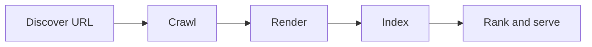
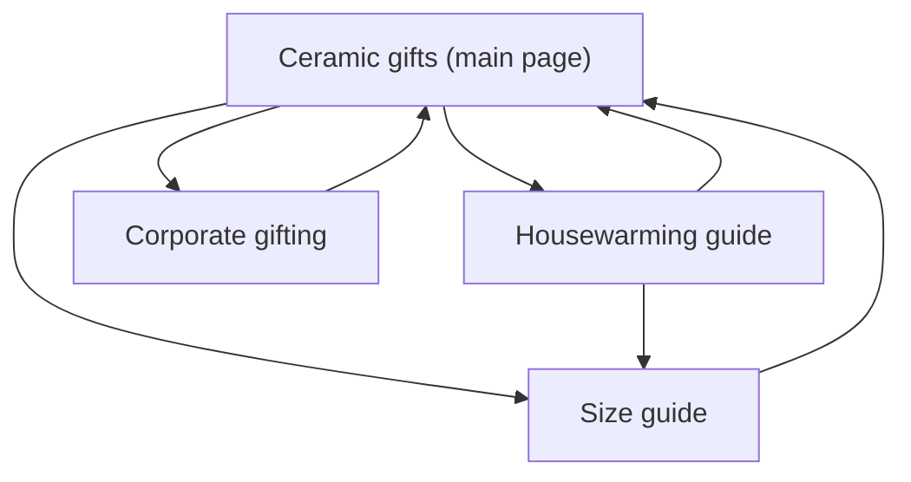

# 🔍 Module 08 — SEO: Keywords & On-Page

> 🔵 Stage 2 · Content & Search · ⏱️ ~5 hours

SEO is like running a well-organized library. The librarian must find the book, understand it, trust it and believe it answers this reader's question. Repeating the title 40 times on the cover helps nobody.

> 🔑 **In short:** SEO for beginners means finding what people search for, understanding the intent, giving each intent one genuinely useful page, and linking pages clearly. Titles, headings and keywords help search engines understand pages that already deserve to be found.

---

## 🎯 Learning Objectives

- Explain crawling, indexing and ranking.
- Match keywords to intent and pages.
- Improve titles, content, structure and internal links.
- Measure SEO with Search Console.

---

## 1. How Search Works



A page that isn't crawled or indexed can't rank normally. An indexed page still has no guarantee of ranking. Never trust anyone who guarantees the number-one position.

## 2. Search Intent

| Intent | Query | Best page |
|---|---|---|
| Learn | how to clean stoneware | guide |
| Compare | stoneware vs porcelain | comparison |
| Buy | handmade mug set | category |
| Local | pottery class near me | local page/profile |
| Navigate | Mitti Studio contact | contact page |

Search the query and inspect the results. If they're mostly shopping categories, a long essay is probably the wrong format.

### Read the results page like a strategist

Search `gift for new home` and note:

| Observe | What it suggests |
|---|---|
| Mostly lists and guides | people are still choosing |
| Product grids and ads | strong shopping demand |
| Local map | nearby intent |
| Videos | demonstration helps |
| AI answer | simple facts may be answered there |
| Forums | people want experience and honesty |
| Very large shops only | broad competition; look narrower |

Record country, language, device and date. Results vary by person and place, so check with a private window *and* treat it as a sample.

### Intent can change

"Diwali gifts" in July is planning. Two days before Diwali it's urgent delivery. The same page may need a different first screen by season.

## 3. Keyword Research

1. Start with customer language from Module 02.
2. Collect autocomplete, related searches, Search Console and keyword-tool ideas.
3. Group queries that deserve the same answer.
4. Score relevance, business value, realistic competition and evidence you can offer.
5. Assign one main page per group.

| Group | Value | Difficulty judgement | Page | Priority |
|---|---|---|---|---|
| pottery class kolkata | high | medium | workshop page | 1 |
| ceramic corporate gifts | high | medium | gifting page | 1 |
| clean stoneware | low-medium | low | care guide | 2 |
| coffee mugs | medium | high | category | 3 |

> ⚠️ Tool volume and difficulty are estimates. A low-volume query from a buyer can beat a huge, vague query.

### A worked keyword plan

Meera begins with one sentence from an interview: *"Will it reach by Sunday?"*

```text
Seed:       housewarming gift
Modifiers:  handmade, under 2000, for couple, delivery date, Kolkata
Questions:  what to give, what size mug, is stoneware microwave safe
Problems:   broken in delivery, late, impersonal
Compare:    ceramic vs glass, hamper alternatives
```

Cluster:

| Page | Main query group | Supporting questions |
|---|---|---|
| Category | handmade housewarming gifts | price, dispatch, sizes |
| Guide | housewarming gift ideas | couple, under ₹2,000, last-minute |
| Guide | mug size guide | ml, cappuccino, tea |
| Policy/proof | safe delivery | packing test, replacement |

One guide can answer many related queries. Ten pages saying the same thing compete with each other.

### Score simply

```text
Priority = relevance (1-5) x business value (1-5) x evidence we have (1-5) / effort (1-5)
```

Mug size guide: 4 × 3 × 5 ÷ 2 = 30. History of ceramics: 2 × 1 × 2 ÷ 3 = 1.3. The formula isn't science; it makes you explain your choice.

## 4. On-Page SEO

- A unique, descriptive title.
- One clear main heading.
- A direct answer early.
- Original evidence, photos or experience.
- Descriptive internal links.
- Useful images with alt text.
- Clear author, company and update information where it helps.

❌ **Weak title**
```text
Home | Pottery Class Pottery Kolkata Best Pottery Cheap Pottery
```

✅ **Strong title**
```text
Beginner Pottery Classes in Kolkata | Mitti Studio
```

Meta descriptions can influence clicks, but search engines may rewrite them.

### Page makeover

❌ **Weak page**
```text
H1: Best Handmade Mugs | Handmade Mug Online | Buy Handmade Mugs
"Handmade mugs are the best handmade mugs. Our handmade mugs..."
One stock photo. No size. No price until cart.
```

✅ **Strong page**
```text
H1: Handmade Stoneware Mugs
First line: Everyday mugs from ₹850, made in Kolkata, dispatched Wednesday.
Filter: size, colour, handle, microwave safe
Photo: each size held in the same hand
Short guide: choosing 180, 250 or 350 ml
Proof: packing test and reviews
Links: care guide, gift sets, size guide
```

The strong page mentions mugs naturally and helps people choose. Keyword use is a result of being clear.

### Image SEO

Name files usefully, compress, add dimensions, place images near relevant text and write alt text that describes the image's purpose: "350 ml green mug held in one hand". Don't write "mug mug cheap mug".

## 5. Site Structure and Internal Links

```text
Home
  Shop > Mugs > Blue mug
  Workshops > Couples class
  Corporate gifting
  Guides > Stoneware care
```

Link from the care guide to the mug category using helpful words. Every important page needs a path from other pages. Avoid creating several near-identical pages for tiny keyword variations.

### Topic clusters



A cluster isn't a ranking trick. It's a library with signs. Each supporting page answers a separate question and helps readers move to the next decision.

### Internal-link audit in 30 minutes

1. List the five pages that make money.
2. Search your site for related terms.
3. From each relevant article, add one descriptive link.
4. Remove dead ends by adding a useful next step.
5. Fix links that pass through redirects.

## 6. Measure

Use **Search Console** for queries, impressions, clicks and indexing. Use analytics for enquiries and revenue. Compare similar periods and note seasonality.

| Pattern | Possible cause | Next check |
|---|---|---|
| Impressions up, clicks flat | lower rank or result features | query and page split |
| Clicks up, sales flat | wrong intent or weak page | landing-page conversion |
| One page falls | competitor, page change, indexing | live result, history, inspection |
| Whole site falls | technical, demand or broad change | tracking, coverage, date, demand |

> 👔 **Set expectations:** agree on leading work (useful pages fixed), leading signals (qualified impressions) and outcomes (enquiries). SEO can take months and may fail.

## 7. Write a Page That Deserves to Rank

```text
Query group: is stoneware microwave safe
Reader: owns or is about to buy a piece
Answer in 40 words: depends on body, glaze and metallic detail; how to check
Our evidence: 8 glazes, 3 cycles, temperature readings, photos
What others miss: gold rims, hairline cracks, hot handles
Structure: answer → test → how to check yours → when not to → care
Expert: Meera (maker), date
Action: see pieces marked microwave safe
```

Information already repeated across ten sites adds little. Your test, photos, prices, failures and expertise are hard to copy. If you have none, *create* some before writing.

### Signs of people-first content

- A real person or organization stands behind it.
- The answer comes early.
- Limits and alternatives are stated.
- It doesn't pretend to know what it hasn't tested.
- After reading, the visitor doesn't need to search again.

## 8. Update, Merge or Remove

| Page has… | Action |
|---|---|
| impressions, weak clicks | improve title and match |
| position just below top, good fit | improve evidence and links |
| traffic, no business value | add next step or accept its job |
| overlap with another page | merge and redirect |
| old, wrong, useful topic | update thoroughly |
| no use, links or demand | remove carefully |

Don't change the date without meaningful work. Keep a log: date, change, reason, result after a fair interval.

## 9. SEO for a Small Store in 12 Weeks

| Week | Work |
|---|---|
| 1 | Search Console, baseline, fix indexing |
| 2 | customer words and query clusters |
| 3–4 | two money pages |
| 5 | size guide with original photos |
| 6 | internal links and images |
| 7 | packing-test article and video |
| 8 | partner and local links |
| 9 | update two older pages |
| 10 | technical/template fix (Module 09) |
| 11 | conversion review |
| 12 | report, learn, next plan |

Six useful pages done properly are a reasonable quarter for one person.

## 10. Reporting SEO Honestly

```text
Goal: 12 corporate enquiries/month from organic by March.
Done: gifting page rebuilt, 4 links earned, 2 guides.
Signals: non-brand impressions 3,100 -> 4,400; clicks 62 -> 95.
Outcome: enquiries 2 -> 5. One came from a partner article.
Limit: wedding season overlaps; we can't attribute all growth to SEO.
Next: improve lead-time section (asked in 4 of 5 calls).
```

These figures illustrate the format. Separate **brand** queries (people who already know you) from **non-brand** queries, because growth in brand searches may come from other marketing.

### 💻 Query Classification

```python
def query_type(query, brand_terms=("mitti studio", "mittistudio")):
    q = query.lower()
    if any(term in q for term in brand_terms):
        return "brand"
    if any(word in q for word in ("near me", "kolkata", "salt lake")):
        return "local"
    if q.startswith(("how", "what", "why", "is ", "can ")):
        return "question"
    if any(word in q for word in ("buy", "price", "gift", "order")):
        return "commercial"
    return "other"

print(query_type("is stoneware microwave safe"))
```

Use it as a first sort, then check samples. Rules miss meaning.

## 🛠️ Practical Lab: Register Search Tools and Improve One Page

**You will finish with:** a verified site, a 30-query map and one improved page. Time: 6 hours.

### Tools and where to register

| Tool | Use | Open | Cost to begin |
|---|---|---|---|
| Google Search Console | Google queries, indexing, sitemaps | [search.google.com/search-console](https://search.google.com/search-console/) | none |
| Bing Webmaster Tools | Bing data, keywords, AI Performance | [bing.com/webmasters](https://www.bing.com/webmasters/) | none |
| Keyword Planner | ad keyword ideas and ranges | [Google Ads tools](https://ads.google.com/home/tools/keyword-planner/) | Google Ads account needed |
| Google Trends | comparison and season | [trends.google.com](https://trends.google.com/) | none |
| Ahrefs Webmaster Tools | own-site checks | [ahrefs.com/webmaster-tools](https://ahrefs.com/webmaster-tools) | limited access |
| Screaming Frog | crawl your site | [screamingfrog.co.uk](https://www.screamingfrog.co.uk/seo-spider/) | limited version |

### Verify Search Console

1. Sign in and choose **Add property**.
2. **Domain property** covers protocols and subdomains and needs a DNS record. **URL-prefix** covers one exact prefix and offers more methods.
3. Domain: copy the TXT record → DNS host → add TXT → wait → **Verify**. Don't delete the record later.
4. URL-prefix: use the HTML file, HTML tag, GA4 or GTM method shown.
5. Open **Sitemaps**, enter `sitemap.xml` and submit.
6. Open **URL inspection**, paste your page, read Google-selected canonical, then **Test live URL**.
7. If it's genuinely ready, choose **Request indexing**. This is a request, not a guarantee.
8. Add a second owner. Give agencies limited access.

### Set up Bing Webmaster Tools

1. Sign in, then import verified sites from Search Console or add manually.
2. Check the sitemap.
3. Open **Search Performance**, **Site Scan**, **Backlinks** and **Keyword Research**.
4. If available, open **AI Performance**. It reports citations in supported Microsoft AI experiences, not all assistants and not clicks.

### Build the keyword map

1. Put 20 exact customer phrases in `Keywords`.
2. Type each slowly in Google and record useful autocomplete ideas.
3. Search Console: **Performance → Search results → Queries**, last three months. Add queries with impressions.
4. Keyword Planner: **Discover new keywords**. Use ranges as direction, not exact truth.
5. Search five groups and record result types.
6. Fill: `Group, Example queries, Intent, Best page, Business value, Evidence we own, Priority`.
7. Choose **one** page for each group.

### Improve one page in 60 minutes

| Minutes | Task |
|---|---|
| 10 | confirm intent and compare five results |
| 10 | write the 40–60 word answer |
| 10 | add original photo, number, table or example |
| 10 | improve title, H1 and image alt text |
| 10 | add two links in and two useful links out |
| 10 | preview on phone, publish, inspect |

### Find easy opportunities

In Search Console, compare the last 28 days with the previous period. Filter **impressions high, position roughly 5–20**. Choose only queries relevant to your customer, then improve the answer and links. Position is an average, so check page and query together.

### If it goes wrong

| Symptom | Check |
|---|---|
| DNS won't verify | correct host/root, full TXT value, propagation |
| Sitemap can't be fetched | exact URL, status 200, XML, robots |
| Discovered, not indexed | links, uniqueness, value, server capacity |
| Wrong page ranks | intent, canonical, internal links, overlapping content |

### Proof to save

- [ ] Verified property and submitted sitemap, private data hidden
- [ ] 30-query map with one page per group
- [ ] Before/after page with change date
- [ ] Baseline clicks, impressions and queries, plus a 28-day follow-up date

## 🏋️ Exercises

### Exercise 8.1
Choose page types for "what is stoneware", "buy dinner set", "Mitti opening hours".

<details>
<summary>View Solution</summary>

Guide, shop/category, and Business Profile/contact page.

</details>

### Exercise 8.2
Audit ten URLs: index status, purpose, query group, title, internal links, speed and conversion. Make a ranked fix list.

### Exercise 8.3: Match the page
The results for "best mug for tea" are mostly guides. Mitti has only a category page. What would you create, and how would it lead to sales?

<details>
<summary>View Solution</summary>

A guide comparing size, wall thickness, handle and lid with original tests and photos, linking to filtered products. Don't force the category page to answer an informational need.

</details>

### Exercise 8.4: Cannibalization
Three posts target "clean stoneware", "remove stains from stoneware" and "stoneware cleaning tips". Decide.

<details>
<summary>View Solution</summary>

Check queries and results for each. If intent is the same, merge the best information into one strong page and redirect the others. Keep separate only if each serves a truly different need, such as metal marks versus tea stains.

</details>

## ❓ Common Questions

### How do I do keyword research?

Begin with customer phrases, add autocomplete, Search Console and tool ideas, group queries that deserve the same answer, then rank by relevance, business value and the original evidence you can offer. Assign one main page per group.

### How long does SEO take to work?

Often several months, and it may not work for every query. Time depends on competition, site quality, demand and how useful the page is. Track qualified impressions first, then clicks and enquiries. Nobody can guarantee a position.

### What is search intent?

Search intent is what the person wants: to learn, compare, buy, find somewhere nearby or reach a known site. Check the results page: mostly product grids suggests buying, while guides suggest learning.

## ✅ Quick Quiz

1. Can schema markup guarantee a rich result?
   - A) Yes
   - B) No
2. Two pages answer the exact same intent. A sensible option is:
   - A) Consolidate useful content and redirect where appropriate
   - B) Make ten more
   - C) Hide both
3. Brand query growth may come from:
   - A) only SEO
   - B) ads, PR or word of mouth too
   - C) robots.txt
4. Best response to repeated generic information?
   - A) Longer copy
   - B) Add original evidence
   - C) More keywords

<details>
<summary>View Answers</summary>

1. **B.**
2. **A.**
3. **B.** People may have discovered the brand elsewhere.
4. **B.** Evidence gives readers something new.

</details>

---

> Author: **Vicky** ([abvicky.in](https://abvicky.in)) · Platform built by [Manikarnika Technologies](https://www.manikarnikatechnologies.in/) · © 2026 All rights reserved.
> ⬅️ [Design & Video Editing](07-design-and-video-editing.md) · ➡️ [Technical SEO & Link Building](09-technical-seo-and-links.md)
