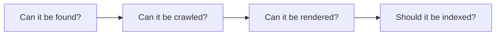

# 🛠️ Module 09 — Technical SEO & Link Building

> 🔵 Stage 2 · Content & Search · ⏱️ ~5 hours

A new website launches. It's beautiful, fast and completely invisible in search. Three weeks later someone finds one ticked box: *"Discourage search engines from indexing this site."* The best article in the world cannot rank from behind a locked door.

Module 08 covered *what* to publish. This one makes sure it can be found, understood and trusted.

> 🔑 **In short:** Technical SEO makes sure pages can be found, crawled, rendered and indexed. Check those four gates in order before rewriting content, then fix redirects, duplicates, speed and structured data, and earn links with things worth referencing.

---

## 🎯 Learning Objectives

By the end of this module, you will be able to:
- Diagnose crawling, rendering and indexing problems.
- Use robots rules, canonicals, redirects and sitemaps correctly.
- Add and validate structured data.
- Plan a safe site migration.
- Earn links without buying trouble.

---

## 1. The Four Gates



Check them in this order. Don't rewrite content when a page fails at gate two.

| Gate | Typical failure | Evidence |
|---|---|---|
| Found | no internal link, missing sitemap | crawl of your own site |
| Crawled | robots block, login, server error | URL inspection, logs |
| Rendered | content needs a script that fails | rendered HTML |
| Indexed | `noindex`, duplicate, weak page | page indexing report |

## 2. Status Codes

| Code | Meaning | Action |
|---|---|---|
| 200 | page works | normal |
| 301 / 308 | moved permanently | redirect old to closest new page |
| 302 / 307 | moved temporarily | use when it really is temporary |
| 404 | not found | fine for pages that never had a replacement |
| 410 | gone | deliberate removal |
| 429 / 503 | too many requests / unavailable | temporary; fix if repeated |
| 500 | server error | investigate quickly |

A page that says "Not found" but returns 200 is a **soft 404**. Search engines may waste effort on it.

Avoid redirect chains such as A → B → C. Point A directly to C.

## 3. Robots, Noindex and Canonical

These three are often confused.

| Tool | Says | Doesn't do |
|---|---|---|
| `robots.txt` | "please don't crawl this path" | hide or secure it |
| `noindex` | "don't show this page in results" | work if the crawler can't see it |
| canonical | "this is the preferred version" | force the choice |

```text
User-agent: *
Disallow: /cart
Disallow: /search
Sitemap: https://example.com/sitemap.xml
```

❌ **Broken combination**
```text
robots.txt blocks /old-sale
the page also has noindex
(The crawler may never see the noindex.)
```

✅ **Working removal**
```text
Allow crawling of /old-sale, serve noindex, wait until it drops out.
Or delete it and return 404/410. Or redirect to a true replacement.
```

Private information needs a login. None of these tools are security.

## 4. Duplicate and Parameter URLs

The same mug may appear at:

```text
/mugs/blue
/mugs/blue?colour=blue
/mugs/blue?utm_source=newsletter
/collections/gifts/mugs/blue
```

Link internally to one clean version, use a consistent canonical, and avoid creating endless filter combinations. Decide which filtered pages deserve to rank ("blue mugs" might) and which don't ("blue mugs under ₹812 sorted by newest").

## 5. Sitemaps and Internal Discovery

A sitemap should list canonical, indexable, working URLs. It isn't a place for redirects, blocked pages or drafts. It helps discovery, but internal links show importance.

**Orphan check:** export sitemap URLs and crawled URLs. Any page in the sitemap that the crawler couldn't reach by links is an orphan. Link it from a relevant page or ask why it exists.

## 6. JavaScript and Rendering

If main content appears only after scripts run, rendering can be delayed or fail. Check the **rendered HTML** in URL inspection.

- Use real links with `href`, not only click handlers.
- Render important text and metadata on the server where practical.
- Don't hide main content behind an action that a crawler won't perform.
- Return correct status codes from app routes.

## 7. Speed, Found in the Field

Module 05 introduced LCP, INP and CLS. Work through them by cause.

| Symptom | Frequent causes | First fixes |
|---|---|---|
| Slow LCP | heavy hero image, slow server, late CSS | compress and prioritize image, cache, reduce blocking files |
| Poor INP | heavy scripts, tag overload | remove scripts, split long tasks |
| Bad CLS | images without sizes, late banners | set dimensions, reserve space |

Compare **field** data (real visits) and **lab** data (a test). Fix a template, not one URL: one product-page improvement may help 60 products.

> 👔 **Priority rule:** speed work earns its place when it helps important pages that people actually use. Chasing the last points on a test score rarely does.

## 8. Structured Data

Structured data describes facts already visible on the page. Useful types include Organization, LocalBusiness, Product, Article, BreadcrumbList and Event. Which search features are supported changes, so check Google's [current gallery](https://developers.google.com/search/docs/appearance/structured-data/search-gallery).

### 💻 Event Markup for a Workshop

```json
{
  "@context": "https://schema.org",
  "@type": "Event",
  "name": "Beginner Pottery Class",
  "startDate": "2026-12-12T11:00:00+05:30",
  "endDate": "2026-12-12T13:00:00+05:30",
  "location": {
    "@type": "Place",
    "name": "Mitti Studio",
    "address": {
      "@type": "PostalAddress",
      "addressLocality": "Kolkata",
      "addressCountry": "IN"
    }
  },
  "offers": {
    "@type": "Offer",
    "price": "1500",
    "priceCurrency": "INR",
    "availability": "https://schema.org/InStock",
    "url": "https://example.com/workshops/beginner"
  }
}
```

> ⚠️ Never mark up reviews you don't show, prices that differ, or events that don't exist. Markup makes a page *eligible*; it doesn't guarantee a rich result.

## 9. International and Multilingual Pages

If you publish separate English, Hindi and Bengali versions, give each a URL, translate the whole page, link between languages and use `hreflang` correctly.

```html
<link rel="alternate" hreflang="en-IN" href="https://example.com/en/care">
<link rel="alternate" hreflang="bn-IN" href="https://example.com/bn/care">
<link rel="alternate" hreflang="x-default" href="https://example.com/en/care">
```

Every version should reference itself and the others. Don't redirect people automatically by location without a way to choose.

## 10. Site Migration Without Tears

1. Crawl the old site and save the list.
2. Export top pages by clicks, links and revenue.
3. Map every important old URL to the closest new URL.
4. Keep titles, content and internal links unless there's a reason to change.
5. Test on a blocked staging site; confirm the block won't go live.
6. Launch at a quiet time, with a rollback plan.
7. Check redirects, canonicals, robots, sitemap and analytics.
8. Watch errors, indexing and revenue daily at first.

❌ **Weak redirect plan**
```text
Redirect all old pages to the home page.
```

✅ **Strong redirect plan**
```text
/blue-mug.html      -> /mugs/blue
/class.php?id=2     -> /workshops/beginner
/diwali-2022        -> 410 (no useful replacement)
```

## 11. Links and Authority

A link is a small public recommendation. A relevant recommendation from a trusted source says more than a hundred from random directories.

### Ways to earn links

| Method | Mitti idea |
|---|---|
| Original evidence | test 12 mugs through 100 dishwasher cycles and publish the method |
| Useful tool | glaze-colour visualizer or gift-set planner |
| Local news | community class for a neighbourhood school |
| Partner pages | cafes using Mitti cups |
| Expert comment | answer a journalist's question on craft materials |
| Link recovery | fix broken links to old pages; ask about unlinked mentions |

### Outreach that respects people

```text
Subject: Broken stoneware-care link on your kitchen guide

Hi {{name}}, your guide to kitchen gifts links to a care page that now
returns an error ({{url}}). We published a tested replacement with
photos here: {{our_url}}. If it helps your readers, you're welcome to
use it. Either way, thanks for the guide.
```

One useful email and at most one polite follow-up is enough.

### Avoid

- Buying links intended to pass ranking value.
- Private blog networks and automated comments.
- Large-scale link exchanges.
- Guest posts created only for exact-match anchor text.

Mark paid links `rel="sponsored"` and user-generated links `rel="ugc"`. Most sites don't need to disavow random spam links; be cautious and follow Google's current guidance before using that tool.

## 12. A One-Day Technical Audit

| Hour | Task | Output |
|---|---|---|
| 1 | crawl 500 URLs | status, title, canonical, depth |
| 2 | Search Console | indexing and manual-action check |
| 3 | templates | speed and rendering |
| 4 | structured data | valid, true, visible |
| 5 | internal links | orphans, depth |
| 6 | backlinks | lost, relevant, harmful patterns |
| 7–8 | write up | ranked fixes |

Score each fix by **pages affected × business value × confidence ÷ effort**. An audit of 200 equal-priority warnings is a way of not deciding.

### 💻 A Tiny Status Checker

```python
import sys
import urllib.request
import urllib.error

def check(url):
    request = urllib.request.Request(url, headers={"User-Agent": "site-checker"})
    try:
        with urllib.request.urlopen(request, timeout=15) as response:
            return response.status, response.geturl()
    except urllib.error.HTTPError as error:
        return error.code, url
    except (urllib.error.URLError, TimeoutError) as error:
        return "ERR", str(error)

for line in sys.stdin:
    url = line.strip()
    if url:
        status, final = check(url)
        print(status, url, "->" if final != url else "", final if final != url else "")
```

Use it on your own site, at a gentle pace.

## 🛠️ Practical Lab: Fix a Crawl Problem and Earn Your First Links

**You will finish with:** a ranked technical fix list, ten link prospects and five personal pitches. Time: 10 hours.

### Tools

| Job | Tool | Open |
|---|---|---|
| Crawl | Screaming Frog | [screamingfrog.co.uk](https://www.screamingfrog.co.uk/seo-spider/) |
| Index/canonical | Search Console | [search.google.com/search-console](https://search.google.com/search-console/) |
| Structured data | Rich Results Test, Schema Validator | [search.google.com/test/rich-results](https://search.google.com/test/rich-results), [validator.schema.org](https://validator.schema.org/) |
| Speed | PageSpeed Insights | [pagespeed.web.dev](https://pagespeed.web.dev/) |
| Own links | Search Console, Bing Webmaster Tools, Ahrefs Webmaster Tools | Module 08 |
| Fast URL notice | IndexNow | [indexnow.org](https://www.indexnow.org/) |

### Technical lab, step by step

1. Crawl a site you own. Start gently and respect server limits.
2. Export status, title, canonical, robots, depth and inlinks.
3. Filter 404s with internal links. Fix the linking page.
4. Filter 3xx internal links. Point them to the final URL.
5. Compare sitemap URLs with the crawl. Find orphans, redirects and `noindex` pages.
6. Test five templates in URL Inspection: home, service, product, article and contact.
7. Validate structured data and compare it with visible text.
8. Fix one template, recrawl and save the difference.

### Where backlinks really come from

| Method | Where to look | What to offer | Difficulty | Main risk |
|---|---|---|---|---|
| Suppliers and partners | stockists, associations, venues | accurate partner page or photo | low | asking without a reason |
| Local organizations | schools, events, chambers, community calendars | useful event or resource | low | sponsorship disguised as editorial |
| Business listings | directories customers use | correct facts | low | hundreds of junk listings |
| Unlinked mentions | search your brand and founder | polite correction | low | demanding a link |
| Broken links | old resources in your topic | matching replacement | medium | weak replacement |
| Resource pages | colleges, hobby groups, guides | tested checklist or tool | medium | mass email |
| Original data | your test, survey, price study | method and results | medium | poor method |
| Journalist requests | request platforms | expert, specific answer | medium | pretending expertise |
| Podcasts/webinars | shows your buyers hear | story and useful takeaway | medium | irrelevant audience |
| Guest article | relevant publisher | unique practical experience | medium | scaled keyword-anchor posts |
| Useful tool | calculator, template, dataset | solves a repeated task | high | building before demand |
| PR campaign | local or trade media | timely evidence | high | manufactured story |

### Where to register or begin

| Type | Places to consider | Notes |
|---|---|---|
| Journalist requests | [Qwoted](https://www.qwoted.com/), [Featured](https://featured.com/), [Source of Sources](https://sourceofsources.com/), [HARO](https://www.helpareporter.com/) | programs and prices change; answer only real expertise |
| Agency/service profiles | [Clutch](https://clutch.co/), [GoodFirms](https://www.goodfirms.co/) | verification and real client reviews |
| Software profiles | [G2](https://www.g2.com/), [Capterra](https://www.capterra.com/) | only for real software |
| Company facts | [Crunchbase](https://www.crunchbase.com/), LinkedIn Page | check eligibility and accuracy |
| New products | [Product Hunt](https://www.producthunt.com/) | genuine launch, not a link drop |
| Code/data | [GitHub](https://github.com/), [Kaggle](https://www.kaggle.com/) | useful repository or licensed dataset |
| Local | Module 10 directory list | customers must use them |
| Communities | Reddit, Quora, specialist forums | many links are nofollow/ugc; value is the answer |

> ⚠️ Google treats buying or selling ranking links, excessive exchanges and giving a product in return for a linked article as link spam. Qualify paid or sponsored links. See the [spam policies](https://developers.google.com/search/docs/essentials/spam-policies).

### Find ten prospects

Use searches such as:

```text
"pottery" "resources" Kolkata
"gift guide" ceramics India
intitle:"partners" pottery school
"your brand name" -site:yourdomain.example
"your founder name" -site:yourdomain.example
site:.ac.in ceramics resources
```

1. Search your brand and competitors.
2. In Bing Webmaster Tools, check Backlinks and compare similar sites where offered.
3. Open every page. Is it current, relevant, used by people and edited by someone?
4. Score audience, relevance, editorial quality, useful offer and contact path from 0–2.
5. Keep scores of 7 or more.

### Pitch and follow up

1. Find the right editor or owner on their public site.
2. Read the page and name the exact problem or section.
3. Offer one relevant asset in under 120 words.
4. Don't request specific anchor text.
5. Follow up once after about a week. Then stop.

```text
Subject: Data for your fragile-gift packing guide

Hi {{name}}, your guide explains packing, but doesn't compare methods.
We tested four across 40 drops and published the raw table, limits and
photos: {{url}}. You're welcome to use the result with credit if it helps.
If not, no reply is needed. {{real_name}}, {{role}}
```

### Link tracker

```text
Prospect | URL | method | relevance | useful offer | contact source | sent | reply | link URL | rel type | referral visits | notes
```

### Practice week

| Day | Do |
|---|---|
| 1 | five mention/partner prospects |
| 2 | make one original checklist or test |
| 3 | five resource/broken-link prospects |
| 4 | send two personal pitches |
| 5 | answer one relevant expert request |
| 6 | send three pitches |
| 7 | review replies and improve the asset |

### If it goes wrong

| Problem | Fix |
|---|---|
| No replies | better asset and smaller relevant list |
| Asked to pay for a ranking link | decline or treat as a labelled advertisement |
| Link is nofollow | judge referral and trust; don't argue |
| Irrelevant spam links appear | usually monitor; seek expert help before disavowing |

### Proof to save

- [ ] Before/after crawl
- [ ] Ten scored prospects, five sent pitches
- [ ] Any earned link with visible URL; zero is an honest result
- [ ] Learning: which offer produced useful replies

## 🏋️ Exercises

### Exercise 9.1: Which gate?
A page is linked from the menu, returns 200, shows content in a browser, but inspection says "Excluded by noindex". Which gate fails, and what do you do?

<details>
<summary>View Solution</summary>

The indexing gate. Decide whether the page should appear. If yes, find where `noindex` is set (CMS, plugin, HTTP header or template), remove it, confirm in the live test and request indexing.

</details>

### Exercise 9.2: Redirect map
Old site: `/about-us.html`, `/cheap-mugs`, `/blog/2019-office-party`, `/contact.php`. New site has About, Mugs and Contact. Write the map.

<details>
<summary>View Solution</summary>

`/about-us.html` → `/about`; `/cheap-mugs` → `/mugs`; `/contact.php` → `/contact`; the office-party post can return 410 if it has no useful links or visits, after checking.

</details>

### Exercise 9.3: Audit
Audit one site you own or have permission to test. Produce no more than ten ranked fixes.

## ❓ Common Questions

### What is the difference between robots.txt and noindex?

robots.txt asks crawlers not to fetch a path. noindex asks search engines not to show a page. If robots.txt blocks the page, a crawler may never see its noindex. Neither protects private information.

### Why is my page not indexed on Google?

Common reasons are noindex, a robots block, a canonical pointing elsewhere, duplicate or thin content, server errors or no internal links. Use URL inspection in Search Console and check in that order.

### How do I get backlinks safely?

Publish original tests, data or tools, work with real partners, answer journalists, and fix broken links. Avoid buying ranking links, automated comments and link networks. Mark paid links as sponsored.

## 🔑 Key Takeaways

- Solve access before content.
- robots, noindex and canonical do different jobs.
- Migrations succeed through mapping and checking.
- Earn links with things worth referencing.

## ✅ Quick Quiz

1. You want a page out of search results. Which fails?
   - A) Blocking it in robots.txt and relying on its noindex tag
   - B) Serving noindex on a crawlable page
   - C) Returning 410
2. What does a canonical do?
   - A) Forces indexing
   - B) Suggests the preferred duplicate
   - C) Adds security
3. Best redirect for a discontinued mug with a close replacement?
   - A) Home page
   - B) The close replacement
   - C) A random category

<details>
<summary>View Answers</summary>

1. **A.** The crawler may never see the tag.
2. **B.** Search engines may choose differently if signals conflict.
3. **B.** Send people to the most similar useful page.

</details>

---

> Author: **Vicky** ([abvicky.in](https://abvicky.in)) · Platform built by [Manikarnika Technologies](https://www.manikarnikatechnologies.in/) · © 2026 All rights reserved.
> ⬅️ [SEO: Keywords & On-Page](08-seo-keywords-and-on-page.md) · ➡️ [Local SEO & AI Search](10-local-seo-and-ai-search.md)
