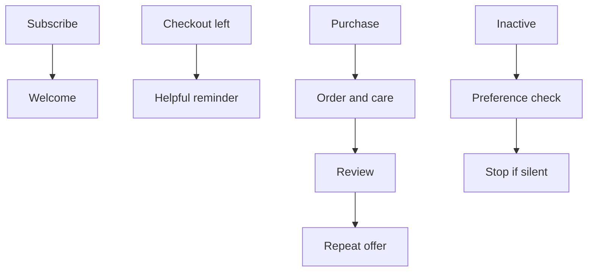

# 💌 Module 17 — Email & WhatsApp Marketing

> 🟠 Stage 3 · Social, Email & Ads · ⏱️ ~5 hours

An inbox is closer to someone's home than a billboard. People let you in for a reason. Keep the promise and they may stay for years; abuse it and one button removes you.

> 🔑 **In short:** Email and WhatsApp marketing work when people clearly agreed to hear from you and each message helps at the right moment. Start with welcome, post-purchase and careful reminder flows, and stop messages as soon as someone buys or opts out.

---

## 🎯 Learning Objectives

- Build a permission-based list.
- Create lifecycle flows and useful campaigns.
- Protect deliverability.
- Use WhatsApp where a message deserves it.

---

## 1. Permission and Promise

❌ **Weak form**
```text
Enter your phone to continue.
```

✅ **Strong form**
```text
Get the gift-care guide and about two useful emails a month.
[ ] Email me guides and offers from Mitti Studio.
Unsubscribe anytime. Read our privacy notice.
```

Leave the box unticked. Record time, source, wording and channel. Permission for delivery updates isn't automatically permission for promotions.

> ⚠️ Mitti's 2,400 old subscribers may not remember joining. Check valid permission, remove bad addresses, and begin with a small recent group. Never buy a list.

### Grow a list people are glad to join

| Signup reason | Good when |
|---|---|
| Useful guide | answers a real decision |
| Back-in-stock alert | person wants that item |
| Class waitlist | clear expectation |
| Early access | genuinely limited launch |
| Discount | margin allows, not your only reason |
| Order receipt opt-in | separate, unticked choice |

❌ **Weak popup**
```text
WAIT!! Don't go! [covers the page after one second]
No thanks, I hate saving money.
```

✅ **Strong form**
```text
Choosing a gift? Get the size and occasion guide by email.
One guide now, then about two emails a month.
[email] [Send the guide]    Not now
```

Delay a form until it can help, make closing easy and don't shame people.

## 2. Essential Flows



| Flow | Trigger | Main job |
|---|---|---|
| Welcome | signup | promise, story, best starting point |
| Browse/cart | intent signal | answer a concern |
| Post-purchase | order | reduce worry and teach use |
| Replenish/repeat | suitable time | next useful purchase |
| Win-back | inactivity | preferences or reason to return |

Always exit someone from a cart flow after purchase.

### Three-message welcome

1. **Immediately:** promised guide and one action.
2. **Day 2:** how the product is made, tested and delivered.
3. **Day 5:** choose a gift by situation.

### Write a complete welcome series

**Email 1, immediately**

```text
Subject: Your mug-size guide
Preview: Match the size to what you drink.

Hi {{first_name|there}},
Here's the guide: {{link}}.
Most people choose wrong for one reason: they guess. Fill your favourite
cup with water, pour it into a measuring jug and compare.
Is this for you or a gift? Choose one so I can send useful ideas:
[For me] [A gift]
Meera, Mitti Studio
```

**Email 2, gift path**

```text
Subject: Will it arrive in one piece?
We dropped 40 test boxes. This is how we pack now: {{link}}
If a piece arrives broken, send a photo within 48 hours.
[See ready-to-gift sets]
```

**Email 3**

```text
Subject: Three gifts people keep using
For tea lovers / first homes / someone who has everything.
Each link shows the next dispatch date.
Don't need a gift now? [Change what I receive]
```

Each message has one job. "Meera" is a real sender who can receive replies.

### Cart flow decisions

| Cart | Message |
|---|---|
| First-time, high value | packing proof and support |
| Repeat buyer | direct return link |
| Workshop | true seats and cancellation |
| Out of stock | alternative or notify |
| Already purchased | nothing |

Avoid an automatic discount in the first message, since it teaches people to abandon carts.

## 3. Segmentation

Start with buyer/non-buyer, product interest, recency and location if needed. A segment should receive a meaningfully different message. Fifty tiny segments create work, not relevance.

## 4. Write the Email

```text
Subject: Will it survive the journey?
Preview: We tested our gift packing so you don't have to worry.
Opening: The customer's concern.
Body: One useful proof.
Button: Choose a ready-to-gift set
Footer: Sender identity, reason for email, unsubscribe.
```

Use live text, not one huge image. Test links, dark mode and mobile.

### Subject line makeovers

| Weak | Better | Why |
|---|---|---|
| Newsletter #14 | 3 ways to fix a wobbly handle | a concrete benefit |
| You won't believe this!!! | Why our blue glaze failed | honest curiosity |
| Last chance (third time) | Orders close Tuesday for Friday arrival | true deadline |
| RE: your account | Your class starts Saturday at 11 | not deceptive |

Test one real difference, such as *outcome versus question*, on a sufficient random sample. Don't use fake "Re:" or "Fwd:".

## 5. Deliverability

- Authenticate with **SPF, DKIM and DMARC**.
- Send to people who asked.
- Make leaving easy.
- Remove hard bounces and suppress complaints.
- Increase volume gradually.

Google's [bulk-sender guidance](https://support.google.com/a/answer/14229414) applies to those sending about 5,000 or more messages to personal Gmail accounts a day. It includes authentication, DMARC and one-click unsubscribe for promotional mail. Google advises user-reported spam below **0.1%** and preventing it from reaching **0.3%**.

> 🔑 Open rates are inflated and incomplete because some privacy features load images automatically. Prefer clicks, replies, conversions and revenue per delivered email.

### Domain setup in plain words

| Record | What it tells receivers |
|---|---|
| SPF | these systems may send for me |
| DKIM | this message has my valid signature |
| DMARC | check alignment, and here's my policy and reporting |

Start DMARC reporting carefully, identify every legitimate sender (shop, invoices, support, newsletter), then tighten policy with technical help. A strict policy on day one can block your own receipts.

### Warm up

| Period | Send to |
|---|---|
| Week 1 | recent buyers who opted in |
| Week 2 | recent engaged subscribers |
| Week 3 | wider recent list |
| Pause | if bounces, complaints or blocks rise |

### If delivery drops

1. Stop non-essential promotional sends.
2. Check authentication and recent changes.
3. Split by mailbox provider.
4. Inspect bounces and complaints.
5. Send only to recently active, consenting people.
6. Fix the source before increasing volume.

## 6. WhatsApp

Use for time-sensitive service, requested help, appointments and carefully chosen offers. Business platform templates are grouped into marketing, utility and authentication, with service conversations handled separately. Pricing varies by category and market and has changed, so check the [official pricing page](https://developers.facebook.com/documentation/business-messaging/whatsapp/pricing) before forecasting.

❌ **Weak**
```text
SALE!!! Buy now!!! Final chance!!!
```

✅ **Strong**
```text
Hi {{name}}, two places opened in the Saturday beginner class you
asked about. ₹1,500 including firing. Reply BOOK by 6 PM and we'll
send the link, or STOP for no more class offers.
```

Send only if they asked and the seats are real.

### 💻 Event Design

```json
{
  "event_id": "evt_1042",
  "event": "order_completed",
  "customer_id": "cust_778",
  "order_id": "ord_991",
  "value": 1800,
  "currency": "INR",
  "occurred_at": "2026-11-20T10:30:00Z"
}
```

Verify webhook signatures, accept retries, deduplicate by `event_id`, and update suppression before sending.

## 7. Measure Incremental Value

```text
Revenue per delivered email = attributed revenue / delivered emails
```

Keep a random holdout group that receives no promotional message. The difference in contribution per person is stronger evidence than last-click revenue.

## 8. Segment by What Changes the Message

| Segment | Message difference |
|---|---|
| Bought a mug in 30 days | care and complementary plate |
| Attended class | next skill level |
| Corporate buyer | reorder calendar and contact |
| Gift guide, no order | occasion and delivery help |
| No activity in 180 days | keep, change or stop |

```text
RFM: Recency, Frequency, Monetary value
```

A simple RFM table can find valuable customers without collecting sensitive traits. Don't treat someone's past spending as permission for more pressure.

## 9. A Two-Email Monthly Calendar

| Month | Useful email | Offer email |
|---|---|---|
| Jan | store and clean without chips | beginner dates |
| Feb | gift by relationship, inclusive | couples/friends class |
| Mar | packing test | spring set |
| Apr | heat and glaze care | Mother's Day preparation |
| May | children's making idea | children's class |
| Jun | monsoon care | workshop bundle |

Choose occasions your customers actually celebrate, and let people opt out of sensitive ones.

## 10. WhatsApp: App or Platform?

| Business App | Business Platform (API) |
|---|---|
| small team, direct chat | integrations, templates, larger team |
| low setup | approvals, pricing and technical work |
| manual follow-up | automation with consent and controls |

Start with the app if one person can answer. Move only when volume, reliability or integration justifies it.

### Conversation design

```text
1 Confirm why we're messaging.
2 Give the requested fact.
3 Offer two or three clear choices.
4 Hand to a person easily.
5 Respect STOP across systems.
```

```text
Welcome to Mitti support. What do you need?
1. Order update  2. Workshop  3. Corporate quote  4. Talk to a person
```

Don't trap people in a bot. Set expected reply hours and never ask for card numbers, OTPs or passwords.

### Cost check

```text
Campaign contribution = added orders x contribution - message cost - discounts
```

Suppose 2,000 permitted messages cost ₹1 each and add 8 orders at ₹810. Result: 6,480 − 2,000 = **₹4,480** before labour. If orders would have happened anyway, the real result may be negative. The ₹1 is only an example; use your current rate.

## 11. Lifecycle Testing

| Test | Better question |
|---|---|
| Subject | which promise do people value? |
| Timing | when does this help most? |
| Offer | does clarity beat discount? |
| Flow length | does message three add contribution? |
| Frequency | do long-term revenue and complaints improve? |

Test frequency with separate groups over enough time. A single campaign can look profitable while increasing unsubscribes that cost future sales.

## 12. Monthly Health Report

```text
Delivered:
Complaint and unsubscribe rates:
New consented subscribers by source:
Welcome: clicks and first-order contribution
Post-purchase: support questions and repeat rate
Campaign: added contribution (holdout)
Automation errors:
Removed inactive people:
Decision:
```

> 👔 **Owner's question:** which automated message would customers miss if we switched it off?

### 💻 SQL: 90-Day Repeat Rate

```sql
WITH first_order AS (
  SELECT customer_id, MIN(ordered_at) AS first_at
  FROM orders
  WHERE status = 'paid'
  GROUP BY customer_id
)
SELECT date_trunc('month', f.first_at) AS cohort,
       COUNT(DISTINCT f.customer_id) AS customers,
       COUNT(DISTINCT o.customer_id) AS repeated,
       ROUND(100.0 * COUNT(DISTINCT o.customer_id)
             / COUNT(DISTINCT f.customer_id), 1) AS repeat_pct
FROM first_order f
LEFT JOIN orders o
  ON o.customer_id = f.customer_id
 AND o.status = 'paid'
 AND o.ordered_at > f.first_at
 AND o.ordered_at <= f.first_at + INTERVAL '90 days'
WHERE f.first_at < CURRENT_DATE - INTERVAL '90 days'
GROUP BY 1
ORDER BY 1;
```

The final filter excludes people who haven't had a full 90 days yet. The query uses PostgreSQL syntax.

## 🏋️ Exercises

### Exercise 17.1
Write a care email after purchase.

<details>
<summary>View Sample</summary>

Subject: Before your first cup. Give a three-step care note, what to do if it arrived broken, and one link to the full guide. Don't make a service email mainly promotional without the right permission.

</details>

### Exercise 17.2
Campaign: 10,000 people messaged, 120 orders. Similar 10,000-person random holdout: 80 orders. What did the campaign add?

<details>
<summary>View Solution</summary>

The estimated increase is 40 orders, not 120. Multiply by contribution, subtract message and discount cost, and consider statistical uncertainty.

</details>

### Exercise 17.3: Fix the flow
A customer buys at 10:00, receives "You forgot your cart" at 10:30 and "20% off" at 14:00. Find three faults.

<details>
<summary>View Solution</summary>

No purchase exit, poor event timing or identity matching, and an unnecessary discount. Add checks immediately before each send, deduplicate, test guest-to-customer matching, apologize if needed and consider whether to honour the offer.

</details>

### Exercise 17.4: Plan
Write three complete messages for your welcome flow and the exact exit conditions.

<details>
<summary>View Success Check</summary>

Expectation matches signup; each has one job; purchase, opt-out and preference change stop or alter messages; sender is identifiable.

</details>

## ❓ Common Questions

### What emails should a small business automate first?

Start with a welcome series, order and care messages, a helpful cart reminder, and a preference check for inactive people. Every flow needs exit rules so that buyers and opted-out people stop receiving it.

### Why do my emails go to spam?

Frequent causes are missing SPF, DKIM or DMARC, old or bought lists, complaints and sudden volume. Pause promotions, fix authentication, send to recent consenting people and increase slowly.

### Is WhatsApp marketing allowed in India?

It can be, with appropriate permission, WhatsApp policy compliance and applicable data and telecom rules. A number given for delivery isn't automatic permission for offers. Get current legal advice for your case.

## ✅ Quick Quiz

1. Best list source?
   - A) Purchased contacts
   - B) Clear signups
2. Why a holdout?
   - A) Estimate added effect
   - B) Improve subject design
3. A cart flow must stop when:
   - A) The person buys or opts out
   - B) Three months pass only
   - C) Never
4. SPF, DKIM and DMARC relate to:
   - A) Image size
   - B) Sending identity and authentication
   - C) Discount rules

<details>
<summary>View Answers</summary>

1. **B.**
2. **A.**
3. **A.** Check status immediately before sending.
4. **B.** They help receivers evaluate mail claiming your domain.

</details>

---

> Author: **Vicky** ([abvicky.in](https://abvicky.in)) · Platform built by [Manikarnika Technologies](https://www.manikarnikatechnologies.in/) · © 2026 All rights reserved.
> ⬅️ [X (Twitter) & Threads](16-x-and-threads.md) · ➡️ [Google Ads](18-google-ads.md)
