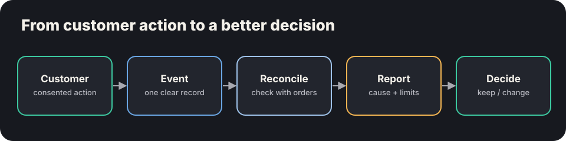
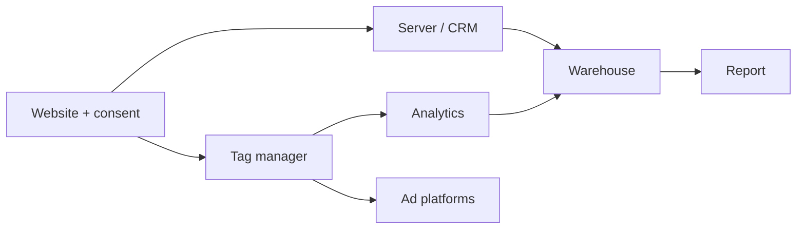

# 📊 Module 20 — Analytics & Tracking

> 🟣 Stage 4 · Measure & Scale · ⏱️ ~6 hours

Google Ads claims 80 orders. Meta claims 70. Email claims 40. The shop has 144. Nobody necessarily lied: each tool counted journeys using its own rules. Analytics is the skill of asking what a number can and cannot prove.

> 🔑 **In short:** Marketing analytics should answer business questions: define the metric, record one clean event per action, label campaigns consistently, compare with real orders, and separate attribution (who gets credit) from incrementality (what the marketing added).

---

## 🎯 Learning Objectives

- Write a measurement plan.
- Set up events and UTMs.
- Understand attribution and incrementality.
- Build a report that leads to decisions.

---

## 1. Begin With Questions



| Business question | Event/data | Decision |
|---|---|---|
| Which pages lead to booking? | booking, landing page | improve or promote |
| Where does checkout fail? | cart, checkout, purchase | fix step |
| Are leads useful? | CRM stage/value | budget |
| Do buyers return? | orders by customer | retention |

Don't track everything "just in case". It adds cost, privacy risk and confusion.

### Write a measurement plan

| Level | Mitti example | Source of truth | Decision |
|---|---|---|---|
| Business | contribution after ads | accounts + ads | budget |
| Result | paid orders, attended seats | shop/booking | capacity |
| Behaviour | product view, cart, enquiry | analytics | page fix |
| Diagnostic | speed, error, video hold | tool | technical/creative fix |
| Quality | refund, damage, show-up | operations | promise/process |

Define each metric in a small dictionary:

```text
Metric: new customer CPA
Numerator: ad spend, all channels, tax excluded
Denominator: customers with first paid order in period
Window: calendar month, Asia/Kolkata
Excludes: test and refunded-before-dispatch orders
Owner: Meera   Source: ads + shop   Last checked:
```

Without a definition, two honest people can argue for an hour about the same word.

## 2. Event Plan

```text
Event: workshop_booked
When: server confirms payment
Parameters: workshop_type, value, currency, transaction_id
Do not collect: name, email, phone
Owner: web team
Test: one paid, one failed, one refunded booking
```

Use consistent lowercase names. Check whether the analytics product has a recommended event before inventing one. In GA4, important business actions are marked as **key events**; advertising products may call an action a conversion.

## 3. Analytics Stack



Small businesses may not need a warehouse. Shop records + analytics + a spreadsheet can be enough.

### 💻 Data Layer

```js
window.dataLayer = window.dataLayer || [];
window.dataLayer.push({
  event: "purchase",
  ecommerce: {
    transaction_id: "MITTI-1042",
    value: 1800,
    currency: "INR",
    items: [{ item_id: "MUG-BLUE", item_name: "Blue mug", price: 900, quantity: 2 }]
  }
});
```

Push only after confirmed payment. Prevent reloads from sending it again. Test GTM Preview and GA4 DebugView, then compare with actual orders.

### GA4 in plain language

GA4 records **events** and their **parameters**. A page view is an event; a purchase is an event. You choose a few as **key events** because they matter to the business.

| Area | Use |
|---|---|
| Acquisition | where visits came from |
| Engagement | pages and events |
| Monetization | commerce data if correctly sent |
| Explorations | custom path and funnel questions |
| Advertising | attribution views |
| Admin | streams, retention, filters, links |

### First setup

- [ ] Business owns the property
- [ ] Correct time zone and currency
- [ ] Web stream and one tag
- [ ] Data-retention setting reviewed
- [ ] Internal/developer traffic handled and tested
- [ ] Search Console and Ads linked if appropriate
- [ ] Key events limited
- [ ] Consent checked
- [ ] Raw export considered if needed

Reports may apply thresholds, modelling or sampling. Record settings and don't expect every screen to match exactly.

### A useful exploration

Question: where do mobile gift buyers stop?

```text
Segment: mobile, landing page contains /gifts
Steps: product view -> add_to_cart -> begin_checkout -> purchase
Breakdown: new/returning
Period: 28 complete days
Check: event tests and shop orders
```

## 4. UTMs

```text
https://example.com/gifts?utm_source=newsletter&utm_medium=email&utm_campaign=diwali_2026&utm_content=proof
```

| Parameter | Answers |
|---|---|
| source | who sent? |
| medium | what channel type? |
| campaign | which effort? |
| content | which creative/link? |
| term | useful keyword label |

Keep an approved list. Don't tag internal links, because they can overwrite the visit's source. Don't put personal data in URLs.

### UTM governance

| Channel | source | medium |
|---|---|---|
| Newsletter | newsletter | email |
| WhatsApp | whatsapp | messaging |
| Meta ad | meta | paid_social |
| Instagram bio | instagram | social |
| Creator | creator_slug | influencer |
| QR on cafe card | cafe_slug | qr |

❌ **Weak**
```text
Facebook / FB / facebook_ads / Facebook Ad / cpc
```

✅ **Strong**
```text
source=meta  medium=paid_social  campaign=2026-12_gifting  content=drop-test
```

Case and spelling can split one channel into five. Generate links from a sheet with approved dropdowns, then test redirects and page parameters.

## 5. Attribution

Attribution assigns credit; it doesn't automatically prove cause.

GA4 currently documents data-driven and last-click options. Settings change, so check [Google's attribution help](https://support.google.com/analytics/answer/10596865). Compare settings and lookback periods before comparing reports.

| Method | Good for | Blind spot |
|---|---|---|
| Last click | simple consistency | earlier influence |
| Data-driven | path patterns | opaque, observed data only |
| Platform | in-platform optimization | overlaps with others |
| Survey | human recall | memory and selection |
| Incrementality test | cause | cost, sample and design |

### Compare two attribution stories

Riya saw a creator on day 1, clicked Meta on day 4, searched Google on day 8 and bought from email on day 9.

| View | Credit story |
|---|---|
| Last click | email |
| Meta report | may claim within its window |
| Google report | may claim search |
| Survey | creator first made her consider it |
| Shop | one order |

The shop is right about *one order*. The other reports are different explanations of influence. Use them to make hypotheses, and tests to judge cause.

## 6. Incrementality

If conversion is 3% in an exposed randomized group and 2% in holdout:

```text
Incremental rate = 3% - 2% = 1 percentage point
Relative lift = (3% - 2%) / 2% = 50%
```

For 10,000 exposed people, that's about 100 added conversions, subject to uncertainty. A non-random comparison between retargeted cart users and everyone else is unfair: cart users were already more likely to buy.

### Practical incrementality tests

| Test | How | Best use |
|---|---|---|
| Random user holdout | some eligible people see no campaign | email, owned audience |
| Geo test | comparable areas on/off | larger paid activity |
| Conversion lift | platform's randomized test | paid ads, when available |
| Time on/off | compare periods | weak evidence, only with caveats |

#### Geo example

Two similar regions each average 100 orders. Region A receives ₹40,000 ads and has 125; B has 105 without. A naive before/after says 25. Compared with B, A added about 20. At ₹810 contribution, 20 × 810 = ₹16,200, which doesn't cover ₹40,000. Check whether regions were truly comparable and whether later purchases are missing.

Don't run a test just to prove a channel you already decided to keep. Write the decision for each possible outcome first.

## 7. Reconcile Reports

1. Same date range and time zone?
2. Same order status, tax and refunds?
3. Same deduplication?
4. Consent or blocked tracking?
5. Click date versus order date?
6. Different attribution windows?

Choose one source of truth for each question: the shop/accounting record for revenue, ad account for spend, CRM for qualified leads.

## 8. A Decision Dashboard

| Layer | Mitti metric |
|---|---|
| Result | contribution after ads |
| Drivers | orders, conversion rate, AOV |
| Channel | qualified visits, new customers, spend |
| Guardrail | refunds, damage, spam rate |
| Learning | test and next decision |

### 💻 SQL: New-Customer Orders

```sql
WITH ranked AS (
  SELECT order_id, customer_id, ordered_at, net_value,
         ROW_NUMBER() OVER (
           PARTITION BY customer_id ORDER BY ordered_at, order_id
         ) AS order_number
  FROM orders
  WHERE status = 'paid'
)
SELECT date_trunc('month', ordered_at) AS month,
       COUNT(*) AS new_customers,
       SUM(net_value) AS first_order_revenue
FROM ranked
WHERE order_number = 1
GROUP BY 1
ORDER BY 1;
```

This PostgreSQL example needs complete order history and a stable customer ID. Decide separately how to treat later refunds.

> 👔 **Weekly report:** what changed, why we think so, confidence, what we will do and what we need.

## 9. Data Quality Audit

Pick 30 real orders and trace them.

| Order | Shop | GA4 | Ads import | CRM | Value match | Issue |
|---|---|---|---|---|---|---|
| 1042 | yes | yes | yes | yes | yes | – |
| 1043 | yes | no | no | yes | – | consent/blocking |
| 1044 | yes | twice | once | yes | no | refresh duplicate |

Some loss can be expected when consent is declined or tags are blocked. Duplicates and wrong values usually need technical work.

### Alarm rules

- Zero purchase events during normal trading.
- Events exceed shop purchases materially.
- Spend rises sharply beyond plan.
- Refund or cancellation rate changes.
- Lead form submissions with no CRM records.

Alert a person, include a link and say what to check. Fifty noisy alerts teach everyone to ignore them.

## 10. Cohorts and Retention

A cohort is people who started in the same period.

| First order | Customers | Repeat by 30d | by 60d | by 90d |
|---|---|---|---|---|
| Jul | 100 | 8% | 14% | 19% |
| Aug | 110 | 7% | 13% | 18% |
| Sep | 150 | 4% | 8% | 11% |

September brought more customers who repeated less. Was acquisition quality lower, the offer different, the season unusual or product experience worse? Don't celebrate 150 until you know.

### Margin by channel

```text
Channel contribution = attributed or incremental order contribution - media - creative - tool - labour where relevant
```

Be explicit about the attribution method. A precise sum based on uncertain credit is still uncertain.

## 11. Make Reports People Use

❌ **Weak report**
```text
GA4 users up 18%, sessions up 12%, bounce down 5%, 42 charts attached.
```

✅ **Strong report**
```text
Gift orders rose 144 to 166. Visits rose 2%; mobile checkout completion
rose after dispatch date became visible. Season also changed, so the
page may not explain all 22. Next: usability test and an experiment
with the date shown in two ways. Owner: Asha, 4 Dec.
```

Use one chart per question, start axes sensibly, label the source and period, and show uncertainty when decisions are close.

### Dashboard layout

| Row | Contents |
|---|---|
| 1 | business result and target |
| 2 | drivers and guardrails |
| 3 | channel contribution and new customers |
| 4 | funnel and data-quality alarms |
| 5 | tests, decisions, owners |

## 12. Privacy in Measurement

Collect the minimum, configure retention, avoid personal data in events and URLs, honour consent, limit access, and document vendors. Seek legal and technical review for identity matching and server-side data sharing. Analytics is useful; knowing everything about everyone is not the goal.

## 13. A Week of Analytics

| Day | Work |
|---|---|
| Monday | spend, orders, alarms |
| Tuesday | lead and refund quality |
| Wednesday | one customer journey, start to finish |
| Thursday | test review |
| Friday | decision report and definition corrections |

> 💡 Spend an hour with customer calls for every four hours in dashboards. Numbers show patterns; people explain them.

### 💻 Reconciliation in SQL

```sql
WITH platform_orders AS (
  SELECT transaction_id, COUNT(*) AS event_count, MAX(value) AS event_value
  FROM analytics_purchase_events
  WHERE event_date >= DATE '2026-11-01'
    AND event_date < DATE '2026-12-01'
  GROUP BY transaction_id
)
SELECT o.order_id, o.net_value, p.event_count, p.event_value
FROM orders o
LEFT JOIN platform_orders p ON p.transaction_id = o.order_id
WHERE o.status = 'paid'
  AND o.ordered_at >= TIMESTAMP '2026-11-01 00:00:00'
  AND o.ordered_at < TIMESTAMP '2026-12-01 00:00:00'
  AND (p.transaction_id IS NULL OR p.event_count > 1 OR o.net_value <> p.event_value);
```

Adjust time zone and valid statuses to your data. Equality checks for decimal values may need rounding or integer paise.

## 🛠️ Practical Lab: Set Up GA4 and Build a Decision Report

**You will finish with:** a GA4 property, a UTM sheet, a reconciliation and a one-page report. Time: 5 hours.

### Tools and where to register

| Job | Tool | Open | Cost to begin |
|---|---|---|---|
| Website analytics | Google Analytics 4 | [analytics.google.com](https://analytics.google.com/) | none for standard |
| Practice with real data | Google's GA4 demo account | [demo account help](https://support.google.com/analytics/answer/6367342) | none |
| Reports | Looker Studio | [lookerstudio.google.com](https://lookerstudio.google.com/) | standard version |
| Behaviour | Microsoft Clarity | [clarity.microsoft.com](https://clarity.microsoft.com/) | none |
| Links | Campaign URL Builder | [ga-dev-tools.google](https://ga-dev-tools.google/campaign-url-builder/) | none |
| Raw data practice | BigQuery sandbox | [cloud.google.com/bigquery](https://cloud.google.com/bigquery) | limits apply |

No website yet? Use the demo account for the report tasks.

### Create GA4, step by step

1. Sign in with the business account → **Admin → Create → Property**.
2. Set name, reporting time zone and currency. For India: Asia/Kolkata time and INR.
3. Choose industry/objectives; these mostly change default reports.
4. **Data streams → Web** → enter site URL and stream name.
5. Review **Enhanced measurement**. Keep the events you understand.
6. Copy the Measurement ID (`G-...`). Install **once**: through GTM (Module 21) or your platform's official integration.
7. Open **Reports → Realtime**, then visit your site with the consent state you want to test.
8. **Admin → Data collection and modification → Data retention:** review the setting.
9. **Admin → Data streams → Configure tag settings → Define internal traffic**, then test the filter before making it active.
10. **Admin → Product links:** link Search Console and Google Ads only if needed.
11. **Admin → Access management:** add a second owner-level person.
12. **Admin → Events / Key events:** mark only confirmed business outcomes.

### Build a UTM sheet

1. Columns: `URL, source, medium, campaign, content, final link, owner, tested`.
2. Add dropdowns for source and medium (**Data → Data validation**).
3. Build the link in row 2:

```text
=A2&"?utm_source="&B2&"&utm_medium="&C2&"&utm_campaign="&D2&"&utm_content="&E2
```

Use `&` instead of `?` if the URL already has parameters.

4. Click each link in a private window; check **Realtime** for source/medium.

### Four reports to make in GA4

| Question | Where | Settings |
|---|---|---|
| Where do visits come from? | Reports → Acquisition → Traffic acquisition | session source/medium |
| Which pages start visits? | Reports → Engagement → Landing page | add key events |
| Where do buyers stop? | Explore → Funnel exploration | product → cart → checkout → purchase |
| What do buyers do first? | Explore → Path exploration | start at session start |

### Reconcile ten orders

1. Export ten real orders from the shop.
2. In GA4 Explore, add `Transaction ID` and `Purchase revenue`.
3. Match each ID. Mark missing, duplicate and wrong value.
4. Give one likely cause for each and check it.

### One-page Looker Studio report

1. Create → Report → add GA4 (or Sheets) as data.
2. Row 1: orders, revenue, contribution from your sheet.
3. Row 2: traffic by channel and conversion.
4. Row 3: one table of tests and decisions from Sheets.
5. Add a text box: *what changed, likely reason, limit, next decision*.
6. Share with **view** access to named people.

### If it goes wrong

| Symptom | Check |
|---|---|
| No realtime data | tag ID, consent, ad blocker, right property |
| Everything twice | tag in theme **and** GTM |
| Traffic says "Unassigned" | unusual medium names, missing parameters |
| `(not set)` | missing value or processing; check definition |
| Reports differ from shop | dates, time zone, tax, refunds, consent |

### Proof to save

- [ ] Property settings, IDs hidden if private
- [ ] Ten tested UTM links
- [ ] Ten-order reconciliation
- [ ] One-page report with a decision and a limit

## 🏋️ Exercises

### Exercise 20.1
Make four UTMs for one launch across email, WhatsApp, Meta and a creator.

<details>
<summary>View Pattern</summary>

Keep campaign identical. Change source/medium consistently: newsletter/email, crm/whatsapp, meta/paid_social, creator_name/influencer.

</details>

### Exercise 20.2
Platforms claim 190 orders; shop has 144. What can you say?

<details>
<summary>View Solution</summary>

Claims overlap or use different rules. Don't add them. Use 144 for actual orders, compare definitions, and test incrementality.

</details>

### Exercise 20.3: Geo test
Region with ads: orders 80 → 110. Matched region without: 80 → 92. Spend ₹14,000, contribution ₹700. Estimate and decide.

<details>
<summary>View Solution</summary>

Added orders are about (110 − 80) − (92 − 80) = 18. Contribution is ₹12,600, less ₹14,000 spend = −₹1,400 before other costs. Consider uncertainty, delayed purchases and whether a smaller spend may work; don't scale based on 30.

</details>

### Exercise 20.4: Metric dictionary
Write definitions for lead, qualified lead, booking, attendance and repeat customer.

<details>
<summary>View Success Check</summary>

Every definition has an event, time window, owner, inclusion/exclusion and source. "Interested" is defined or not used.

</details>

## ❓ Common Questions

### What is GA4 used for?

GA4 records events from a website or app and helps you study acquisition, behaviour and key events such as purchases. It isn't an accounting system, so compare its purchases with your shop or payment records.

### Why don't Google Ads, Meta and GA4 numbers match?

They use different windows, dates, identity, consent and credit rules, and can claim the same order. Don't add them together. Use the shop for actual orders and tests for added effect.

### What is incrementality in marketing?

It is the outcome that wouldn't have happened without the activity. If a random exposed group buys at 3% and the holdout at 2%, the added effect is one percentage point, with some uncertainty.

## ✅ Quick Quiz

1. Does attribution prove cause?
   - A) Yes
   - B) No
2. When should a purchase event fire?
   - A) Button click
   - B) Confirmed purchase
3. Shop has one order; three platforms claim it. How many orders?
   - A) Three
   - B) One, with different credit claims
   - C) Zero
4. In the geo example, 25 vs 5 growth suggests extra orders of about:
   - A) 20
   - B) 25
   - C) 30

<details>
<summary>View Answers</summary>

1. **B.**
2. **B.**
3. **B.** Don't add overlapping claims.
4. **A.** Subtract comparison-region growth.

</details>

---

> Author: **Vicky** ([abvicky.in](https://abvicky.in)) · Platform built by [Manikarnika Technologies](https://www.manikarnikatechnologies.in/) · © 2026 All rights reserved.
> ⬅️ [Meta Ads (Facebook & Instagram)](19-meta-ads.md) · ➡️ [Google Tag Manager](21-google-tag-manager.md)
