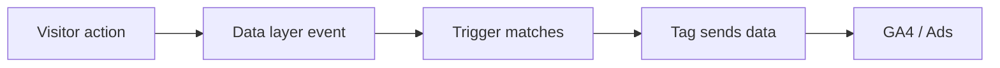

# 🏷️ Module 21 — Google Tag Manager

> 🟣 Stage 4 · Measure & Scale · ⏱️ ~5 hours

Every time Mitti wanted to measure a button, Meera messaged the developer and waited a week. Then they installed Tag Manager, and now four people can add tags. Six months later there are 31 tags, nobody knows what half of them do, and purchases are counted twice.

Tag Manager removes a bottleneck. It also removes a guard. This module teaches both the speed and the discipline.

> 🔑 **In short:** Google Tag Manager is a switchboard that decides when to send website events to tools such as GA4 and Google Ads. Use a clean data layer, trigger on confirmed outcomes, test consent and failures, and publish with versions.

---

## 🎯 Learning Objectives

By the end of this module, you will be able to:
- Explain containers, tags, triggers, variables and the data layer.
- Set up GA4, a click event, a form event and a purchase.
- Test in Preview, publish with versions and roll back.
- Handle consent, naming and governance.

---

## 1. What It Is

**Google Tag Manager (GTM)** is a switchboard. Your site tells it *something happened*; it decides *which tools to inform*.

| Word | Plain meaning | Example |
|---|---|---|
| Container | the switchboard for one site | Mitti web |
| Tag | message to a tool | GA4 event |
| Trigger | when to send | booking confirmed |
| Variable | information to include | value, currency |
| Data layer | clean message board on the page | `workshop_booked` |
| Version | saved published state | v14 |
| Workspace | draft area | "booking event" |



GTM isn't analytics: it doesn't store reports. GA4 does that.

## 2. Before You Install

1. Measurement plan (Module 20).
2. Consent design (Module 25).
3. Business-owned account, with two administrators.
4. A test page or staging site.
5. A list of existing hard-coded tags. If GA4 is already in the theme, adding it again in GTM will double-count.

## 3. Install

1. Create an account and web container.
2. Place the provided code as instructed, usually through one trusted integration.
3. Don't also install the same container with a plugin.
4. Open Preview and confirm the container loads once.

> ⚠️ Anyone with publish access can run code on your site. Treat GTM permissions like website administrator permissions.

## 4. First Tag: GA4

| Field | Value |
|---|---|
| Tag type | Google tag |
| Tag ID | your GA4 measurement ID (variable) |
| Trigger | Initialization - All Pages |
| Name | `GA4 - Google tag - All pages` |

Set consent defaults **before** tags that depend on them. Google's consent initialization trigger exists for this. Check Preview for the order.

GA4's enhanced measurement may already record page views, scrolls, outbound clicks and some form interactions. Look there before creating duplicates.

## 5. Second Tag: A Click

Goal: measure people who tap the WhatsApp help button.

1. Enable the built-in Click variables.
2. Trigger: *Click - Just Links*, some clicks.
3. Condition: Click URL starts with `https://wa.me/`.
4. GA4 Event tag:

| Parameter | Value |
|---|---|
| Event name | `whatsapp_click` |
| `link_location` | page section variable |
| Not included | phone number, message text |

A click isn't an enquiry. Name it honestly.

❌ **Weak**
```text
Event: lead   Trigger: any click on the page
```

✅ **Strong**
```text
Event: whatsapp_click   Trigger: click URL starts with https://wa.me/
Later, the CRM records: qualified_enquiry
```

## 6. Third Tag: A Form

Ways, from strongest to weakest:

| Method | Why |
|---|---|
| Data layer event from the confirmed server response | means the form really succeeded |
| Thank-you page view | simple, if the page can't be reached otherwise |
| Element visibility of success message | fragile but workable |
| Submit-button click | counts failures as successes |

```js
window.dataLayer = window.dataLayer || [];
window.dataLayer.push({
  event: "corporate_enquiry_submitted",
  form_id: "gifting_main",
  quantity_band: "100-249",
  enquiry_id: "enq_2041"
});
```

Send a band, not a name, email or phone.

## 7. Fourth Tag: A Purchase

```js
window.dataLayer = window.dataLayer || [];
window.dataLayer.push({ ecommerce: null });
window.dataLayer.push({
  event: "purchase",
  ecommerce: {
    transaction_id: "MITTI-1042",
    value: 1800,
    currency: "INR",
    items: [
      { item_id: "MUG-BLUE", item_name: "Blue mug", price: 900, quantity: 2 }
    ]
  }
});
```

Clearing `ecommerce` first avoids mixing details from an earlier event. Fire after confirmed payment, use a unique transaction ID, and prevent a refresh from pushing the event again.

### Set up in GTM

1. Trigger: Custom Event, name `purchase`.
2. Tag: GA4 Event, name `purchase`, ecommerce from data layer.
3. Ads conversion tag only if needed, with the same transaction ID.
4. Consent settings on each tag.

## 8. Variables You Will Use

| Variable | Use |
|---|---|
| Constant | measurement IDs |
| Data Layer Variable | values such as `quantity_band` |
| Lookup Table | staging vs live ID by hostname |
| Page Path | targeting a trigger |
| Click URL/Text | click rules |
| First-party cookie | careful, purposeful use |

A lookup table by hostname prevents test traffic entering the live property.

## 9. Test Like You Mean It

| Test | Expected |
|---|---|
| Load page | one Google tag |
| Reject optional consent | optional tags don't fire as configured |
| Accept | tags update, once |
| Click WhatsApp | one event, correct parameters |
| Submit invalid form | no success event |
| Submit valid form | one success event |
| Pay | one purchase, correct value |
| Refresh thank-you page | no second purchase |
| Back button | no repeated event |
| Mobile browser | same results |

Use GTM **Preview**, GA4 **DebugView**, the browser's network tab and your real orders. "The tag fired" isn't the same as "the data is right".

> 🔑 Keep a test-evidence sheet: date, tester, case, expected, actual, screenshot.

## 10. Publish With Versions

1. Name the workspace for one purpose.
2. Review changed tags, triggers and variables.
3. Get a second pair of eyes for purchase or consent changes.
4. Publish with a useful name and description.
5. Check live data after publishing.
6. Roll back to the earlier version if something breaks.

```text
Version: 2026-12-05 | Corporate enquiry event
Why: replace button-click counting
Changed: 1 tag, 1 trigger, 3 variables
Tested by: MR  Evidence: sheet row 41-46
Risk: form theme update may remove push
```

## 11. Naming and Governance

```text
Tag:      GA4 - Event - corporate_enquiry_submitted
Trigger:  CE - corporate_enquiry_submitted
Variable: DLV - quantity_band
```

| Control | Rule |
|---|---|
| Access | named users, least privilege, quarterly review |
| Custom HTML | needs review; prefer official templates |
| Templates | check publisher and permissions |
| Agencies | edit in workspace, client publishes or approves |
| Cleanup | pause, observe, then delete |
| Documentation | every tag has purpose, owner, expiry |

Custom HTML from a blog can slow the site, leak data or break checkout. If you can't explain it, don't publish it.

## 12. Consent Mode, Briefly

Consent Mode passes the visitor's choice to Google tags. It doesn't collect consent, and it isn't a banner. You need a lawful, clear interface and correct defaults and updates.

1. Set default states.
2. Show a choice.
3. Update states when the visitor chooses.
4. Confirm tags respect them.
5. Let people change their mind.

Basic and advanced implementations behave differently before choice. Decide with legal and technical advice; see [Google's consent settings help](https://support.google.com/tagmanager/answer/10718549). Delivery options such as CDN-injected tag gateways can change load order, so retest consent after such changes.

### 💻 Consent Default (Illustration)

```js
window.dataLayer = window.dataLayer || [];
function gtag() { dataLayer.push(arguments); }
gtag("consent", "default", {
  ad_storage: "denied",
  ad_user_data: "denied",
  ad_personalization: "denied",
  analytics_storage: "denied"
});
```

This must run before the container. Your consent tool should send the matching `update`. It's an example, not a compliance solution.

## 13. Server-Side Tagging

A server container receives events first, then forwards them. It can give you control over what each vendor receives and reduce browser work. It also adds cost, maintenance, security duties and no exemption from consent.

| Consider | Skip for now |
|---|---|
| high volume, technical owner, clear need | few orders, no maintainer |

## 14. Monthly Audit

- [ ] Remove tags for ended campaigns
- [ ] Check duplicates and firing counts
- [ ] Compare purchases with shop orders
- [ ] Review users and permissions
- [ ] Test consent states
- [ ] Check page speed effect
- [ ] Export a container backup

> 👔 **Owner's three questions:** Who can publish? What does each tag cost us in speed and privacy? When did someone last compare GA4 purchases with real orders?

## 🏋️ Exercises

### Exercise 21.1: Find the bug
GA4 shows 288 purchases; the shop has 144. List likely causes in the order you would check.

<details>
<summary>View Solution</summary>

Exactly double suggests duplication: (1) GA4 in theme **and** GTM; (2) event from both browser code and a plugin; (3) two tags or triggers; (4) thank-you refresh, though that rarely gives exactly double. Compare transaction IDs in Preview and network requests.

</details>

### Exercise 21.2: Event design
Design an event for "download size guide" with trigger, parameters and tests.

<details>
<summary>View Sample</summary>

Check whether enhanced measurement already records file downloads. If a separate event is needed: `size_guide_download`, trigger on that exact link, parameters `page_type` and `product_category`. Tests: click once, middle-click, mobile, consent rejected, broken file.

</details>

### Exercise 21.3: Build
Install GTM on your practice site, create one data-layer event, record ten test cases, publish, then roll back once for practice.

## ❓ Common Questions

### What is the difference between GTM and GA4?

GTM decides when and what to send. GA4 stores and reports analytics data. You can use GA4 without GTM, but GTM makes it easier to manage several tags if access and testing are controlled.

### Why is GA4 counting purchases twice?

Exactly double often means GA4 is installed both in the theme and in GTM, or two tags fire on one event. Compare transaction IDs, check GTM Preview and network requests, and test a page refresh.

### Is the thank-you page a good conversion trigger?

It works if the page can't be reached any other way, but refreshes can repeat it. A data-layer event from confirmed server success, with a unique ID, is stronger.

## 🔑 Key Takeaways

- The data layer is the contract.
- Confirmed outcomes beat button clicks.
- Test rejection and failure, not only success.
- Publishing rights are site-admin rights.

## ✅ Quick Quiz

1. Where are reports stored?
   - A) GTM
   - B) GA4 or another analytics tool
   - C) The data layer
2. Best form-success trigger?
   - A) Submit button click
   - B) Confirmed server success in the data layer
   - C) Page load
3. Consent Mode by itself:
   - A) Collects consent
   - B) Passes choices to tags
   - C) Replaces privacy law

<details>
<summary>View Answers</summary>

1. **B.**
2. **B.**
3. **B.** You still need a proper choice interface.

</details>

---

> Author: **Vicky** ([abvicky.in](https://abvicky.in)) · Platform built by [Manikarnika Technologies](https://www.manikarnikatechnologies.in/) · © 2026 All rights reserved.
> ⬅️ [Analytics & Tracking](20-analytics-and-tracking.md) · ➡️ [Conversion Optimization](22-conversion-optimization.md)
