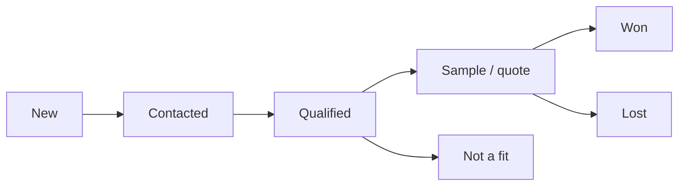

# ⚙️ Module 23 — Automation & CRM

> 🟣 Stage 4 · Measure & Scale · ⏱️ ~4 hours

An HR manager asks for 200 gift sets on Friday. Mitti replies on Wednesday. Another supplier replied in an hour. The problem wasn't lead generation; it was dropping the lead.

> 🔑 **In short:** A CRM keeps each enquiry's owner, stage and next step visible; automation handles repeatable actions. Map and fix the manual process first, then automate with permission checks, exit rules, duplicate protection and error alerts.

---

## 🎯 Learning Objectives

- Design a useful CRM pipeline.
- Assign, score and follow up with leads.
- Automate with safeguards.
- Measure speed and outcomes.

---

## 1. Fix the Process First

Automation makes a process faster, including a bad one. Map the manual journey and remove needless steps.



Each stage needs an observable entry rule. "Warm" means different things to different people; "confirmed quantity, date and authority" can be checked.

### Map Mitti's corporate enquiry

```text
Form → validation → acknowledgement → owner assigned → fit check →
sample/quote → HR decision → advance → production → delivery → feedback
```

For each arrow ask: who acts, with what information, by when, what if it fails, and how do we know it finished? Draw the current messy process first. The "ideal" map can hide where leads actually disappear.

### Stage entry rules

| Stage | Entry proof |
|---|---|
| New | valid enquiry received |
| Contacted | person sent a useful reply |
| Qualified | quantity, date, budget/fit and decision route checked |
| Quoted | agreed scope sent |
| Won | written approval and required payment |
| Lost | clear reason and permission for future contact |

Don't move a lead to "contacted" because an auto-reply was sent.

## 2. Minimum CRM

| Field | Why |
|---|---|
| source | measure origin |
| need and quantity | route and quote |
| stage | see work |
| owner | one accountable person |
| next action/date | prevent forgetting |
| consent status | respect choices |
| won value / lost reason | learn |

Don't collect sensitive data without a necessary purpose and protection.

## 3. Lead Scoring

| Signal | Points |
|---|---|
| 100+ units | +30 |
| needed within 60 days | +20 |
| requests sample | +20 |
| student research | −20 |

Scores should be checked against real wins. Avoid sensitive or unfair traits. Explain the score to sales and allow override.

### Make scoring explainable

Mitti checks 40 past leads. Of leads with 100+ units, 9 of 20 won. Of leads under 100 units, 2 of 20 won. The large-order signal may deserve points, but 40 leads are a small set and the team may have treated large leads better. Use points to prioritize, then review quarterly.

❌ **Weak score**
```text
+20 if surname suggests a wealthy community.
```

✅ **Strong score**
```text
+20 only if person states a quantity and delivery date we can serve.
```

Avoid sensitive inference and proxies. A salesperson must be able to override with a reason.

## 4. Follow-Up

| Time | Mitti action |
|---|---|
| immediate | confirm receipt and realistic next step |
| within promised working time | human answers the need |
| day 2 | sample or useful example |
| day 5 | question that helps decide |
| later | stop, or nurture with permission |

```text
Hi {{name}}, I saw you need 200 gifts for 12 March. I can send a sample
by Tuesday. Is your decision mainly about the budget, delivery date or
custom message? I'll tailor the quote around that.
```

Only offer a date the studio can meet.

### Follow-up that adds information

| Touch | Useful addition |
|---|---|
| First response | direct answer, realistic time, one question |
| Sample | photos, dimensions, what varies |
| Quote | total, tax, lead time, assumptions, expiry |
| Check-in | address one decision blocker |
| Final | ask whether to close or nurture |

❌ **Weak**
```text
Just checking in!
```

✅ **Strong**
```text
Your quote assumes artwork approval by 5 December. I attached a photo
of the sample and a one-page delivery plan. Does procurement need our
vendor form before they can approve?
```

Stop when someone says no. Keep a suppression record so another system doesn't start again.

## 5. Automation Pattern

**Trigger → check → wait → action → exit → log**

```text
Trigger: checkout started
Check: marketing permission, stock, no order
Wait: sensible delay
Action: answer delivery concern
Exit: purchase, opt-out or out of stock
Log: message and result
```

Define what happens when a tool fails. Avoid two systems sending the same reminder.

### 💻 Reliable Webhooks

- Verify signature and timestamp.
- Return quickly and process in a queue.
- Retry safe operations with increasing delay.
- Deduplicate with event ID.
- Keep failed events visible.
- Encrypt and limit personal data.
- Reconcile totals daily.

```python
import hmac
import hashlib

def valid_signature(secret: bytes, body: bytes, received: str) -> bool:
    expected = hmac.new(secret, body, hashlib.sha256).hexdigest()
    return hmac.compare_digest(expected, received)
```

This teaches HMAC comparison. Each provider has its own exact header, timestamp and encoding rules; follow its documentation.

## 6. Choose Tools

Score must-haves, not feature lists: integrations, permission control, export, reliability, support, cost and ease. Run a two-week trial with five real processes.

> 🔑 Keep an export and a written process. Otherwise, changing tools can mean losing your business memory.

## 7. Metrics

- Median first-response time and missed-response count.
- Lead → qualified → quote → won rates.
- Value won by source.
- Opt-outs and complaints.
- Automation errors and duplicates.

Use working-hours rules consistently. The average can hide one lead left for ten days.

> 👔 **Daily habit:** no qualified lead without an owner and next date.

## 8. CRM Setup From Scratch

1. List objects: person, company, deal, task.
2. Define source of truth for each field.
3. Remove duplicates with agreed rules.
4. Import a small test, then compare counts and values.
5. Assign permissions by role.
6. Build only the necessary pipeline.
7. Test first enquiry, returning person, duplicate, opt-out, lost lead.
8. Train users with a written one-page guide.
9. Run old and new systems briefly and reconcile.
10. Retire old exports securely.

| Data test | Pass |
|---|---|
| Same email twice | links or flags, no unintended merge |
| Two people, one company | separate contacts, same company |
| Lead changes source | original source kept |
| Opt-out | stops every relevant message |
| Staff leaves | ownership and access move promptly |

## 9. Tool Choice Scorecard

| Requirement | Weight | Tool A | Tool B | Spreadsheet |
|---|---|---|---|---|
| Follow-up reminders | 5 | 5 | 4 | 1 |
| Permission/opt-out | 5 | 4 | 5 | 1 |
| Form integration | 4 | 5 | 3 | 1 |
| Easy export | 4 | 3 | 5 | 5 |
| Monthly cost | 3 | 2 | 4 | 5 |
| **Weighted total** | | **83** | **89** | **49** |

```text
Weighted score = sum(weight x rating)
```

Test the highest score with real work before signing a long contract. A spreadsheet may be sensible for five leads a month, but not for 500 messages or sensitive access needs.

## 10. Lifecycle Map

| Customer event | Immediate | Later | Stop/guard |
|---|---|---|---|
| Enquiry | answer | useful resource | replied, unqualified |
| First order | receipt, care | review/help | refunded |
| Damage | support, resolution | lesson | no promotion while unresolved |
| Workshop booked | directions, policy | reminder | cancelled |
| Workshop missed | check-in | reschedule | no shame or repeat spam |
| Corporate won | schedule, owner | reorder date | changed contact/permission |
| Opt-out | confirm as appropriate | none | suppression |

Customer service and marketing must share status. Sending a promotion while a broken-order complaint is open is a process failure, not a clever upsell.

## 11. Automation Runbook

```text
Name: workshop waitlist
Purpose/owner:
Trigger and data source:
Permission rule:
Wait/retry:
Dedup key:
Exit states:
Message versions:
Failure alert and manual fallback:
Rollback:
Last tested:
```

### Test matrix

| Case | Expected |
|---|---|
| New eligible person | one invitation |
| Duplicate event | no second invitation |
| Seat disappears | no false offer |
| Person opts out during wait | no send |
| Messaging provider times out | safe retry, alert if exhausted |
| Payment succeeds twice | one booking |
| Admin corrects data | audit trail |

Run these in a test environment with fake people before real messages.

## 12. Find the Profit in Speed

Mitti receives 60 corporate leads. Ten are qualified; three win at ₹58,500 contribution. A new response process increases qualified-to-won from 30% to 40%, so wins go from 3 to 4: **₹58,500 additional contribution**. If the process costs ₹15,000 in staff and tools, the estimated gain is ₹43,500 before other costs.

Is speed the cause? Test or compare carefully; reps may have chased the best leads first. But the process may be worth trying even before a perfect experiment.

## 13. Reliability Review

| Monthly check | Question |
|---|---|
| Queue | are events stuck or failing? |
| Duplicates | did anyone receive two? |
| Suppression | are all channels honouring it? |
| Ownership | is every open deal assigned? |
| Templates | are price, policy and link true? |
| Access | who can export data? |
| Deliverability | complaints and replies? |

> 👔 **Meeting:** show three lost leads. Reconstruct what happened before buying another automation.

### 💻 Idempotent Event Handling

```python
def handle_event(event, processed_ids, send_message):
    event_id = event["event_id"]
    if event_id in processed_ids:
        return "duplicate"
    send_message(event["customer_id"], event["kind"])
    processed_ids.add(event_id)
    return "sent"
```

This demonstrates the idea. Two servers could still race, and a crash after sending but before recording could duplicate a message. Production systems need a durable unique constraint, transactional outbox or provider idempotency, plus careful retry handling.

## 🏋️ Exercises

### Exercise 23.1
Draw Mitti's workshop waitlist flow.

<details>
<summary>View Solution</summary>

Seat opens → oldest eligible consenting person → reserve for stated time → send payment link → paid/declined/expired → offer next. Stop on opt-out; prevent simultaneous offers; log each action.

</details>

### Exercise 23.2
Design a pipeline with an observable rule and lost reasons.

### Exercise 23.3: Compare lead handling
100 leads at ₹400 CPL. Process A qualifies 30% and wins 20%. B qualifies 25% and wins 32%. Which wins more at the same cost?

<details>
<summary>View Solution</summary>

A: 100 × 30% × 20% = 6 customers, cost ₹6,667 each. B: 100 × 25% × 32% = 8, cost ₹5,000 each. Check definitions and similar lead quality; B may have stricter qualification.

</details>

### Exercise 23.4: Runbook
Write the waitlist runbook, including one payment-success message that arrives late.

<details>
<summary>View Success Check</summary>

The late success is reconciled with seat and payment status, never creates two seats, has an owner, and has a manual path for refunds or alternatives.

</details>

## ❓ Common Questions

### What should a small business track in a CRM?

Track source, need, stage, owner, next action date, consent and the won value or lost reason. Add a field only if someone will use it. Every qualified lead needs an owner and a next date.

### What is lead scoring?

It ranks leads using signals linked with real wins, such as quantity and deadline. Check scores against past outcomes, avoid sensitive or unfair traits and let people override them with a reason.

### Which marketing automation should I build first?

Choose a repeated, reversible step with a clear trigger, such as confirming an enquiry and assigning an owner. Test duplicates, opt-outs and failures before adding promotional messages.

## ✅ Quick Quiz

1. First automation step?
   - A) Connect tools
   - B) Map the process
2. Why use event IDs?
   - A) Prevent duplicate processing
   - B) Personalize emails
3. An auto-reply alone means a lead is:
   - A) Contacted
   - B) Not necessarily contacted by a person
   - C) Won
4. Why reconcile CRM with real records?
   - A) Automated systems can drop or duplicate events
   - B) Titles matter
   - C) It replaces consent

<details>
<summary>View Answers</summary>

1. **B.**
2. **A.**
3. **B.** The stage rule requires a useful human reply.
4. **A.** Check the full process, not only messages.

</details>

---

> Author: **Vicky** ([abvicky.in](https://abvicky.in)) · Platform built by [Manikarnika Technologies](https://www.manikarnikatechnologies.in/) · © 2026 All rights reserved.
> ⬅️ [Conversion Optimization](22-conversion-optimization.md) · ➡️ [AI Tools for Marketers](24-ai-tools-for-marketers.md)
