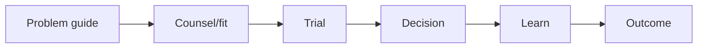

# 🗂️ Module 26 — Industry Playbooks

> 🌟 Stage 5 · Pro · ⏱️ ~5 hours

The same medicine doesn't suit every patient. These playbooks are starting diagnoses. Replace their assumptions with your own evidence.

> 🔑 **In short:** A useful marketing plan starts from the business's real constraint, such as seats, stock, margin or reply time. Pick one customer situation, one main channel, a measurable outcome and a limit, then learn, fix, test and decide over 90 days.

---

## 🎯 Learning Objectives

- Adapt a plan to a buying journey.
- Choose suitable metrics and risks.
- Build a 90-day plan.

---

## 1. E-Commerce

| Part | Plan |
|---|---|
| Foundation | product photos, total cost, delivery, returns |
| Capture | category SEO, Shopping/search |
| Create demand | demos, creators, paid social |
| Retain | post-purchase, care, next product |
| Measure | contribution, new-customer CPA, repeat rate, returns |

**First 30 days:** fix checkout and product pages, unit economics, purchase tracking, permission-based welcome and post-purchase flow.

### Store scorecard

| Area | Weekly check | Decision |
|---|---|---|
| Demand | new customers, search terms | channel and stock |
| Site | product → cart → payment | fix leak |
| Offer | contribution, bundle mix | price/creative |
| Delivery | late, damage, refund | pause/repair |
| Customer | repeat, support theme | product and lifecycle |

#### 90-day store plan

1. Interview five recent and five non-buyers.
2. Repair price, photos, total, delivery and checkout.
3. Set purchase/contribution reporting.
4. Launch one search and one creative test.
5. Start consented welcome and care flow.
6. Review stock-limited scaling.

Don't scale a product that costs more to replace than it contributes.

## 2. Local Services

Business Profile, calls, useful service pages, honest reviews, local search and quick response. Measure booked profitable jobs, not just calls. Avoid fake locations.

### Local service scorecard

```text
Local profit = completed jobs x contribution - lead cost - missed-job cost - extra travel
```

For an electrician, a 30-minute response can matter more than an award. Set clear service area, qualified call/job tracking, safety/licence details, rate information and a reliable human response. Reviews describe actual experience; they don't replace verification.

## 3. Restaurants and Cafes

Accurate hours, menu, photos, reservation and local discovery. Short videos show food; repeat offers use permission. Track covers, margin, repeat visits and no-shows. Promote only what the kitchen can serve well.

### Restaurant weekly plan

| Day | Focus |
|---|---|
| Monday | stock/margin and dead hours |
| Tuesday | one dish/story, real photo |
| Wednesday | reservation/search check |
| Thursday | neighbourhood partner |
| Friday | staff briefing on promise |
| Sunday | reviews, no-shows, repeat guests |

❌ **Weak offer**
```text
50% OFF EVERYTHING, only today (every day)
```

✅ **Strong offer**
```text
Weekday lunch table: two plates and tea, ₹{{true_price}}, 12–3 PM.
Order ahead if you have 30 minutes.
```

Use real food, hours and availability. A packed table can still lose money if discount and wastage exceed margin.

## 4. Education and Coaching

Parents, learners and employers may be different decision-makers. Offer transparent syllabus, teacher, fees, schedule, results context and trial. Track enquiry → contacted → attended → enrolled → retained. Never promise guaranteed jobs, marks or income without lawful, reliable support. Protect minors' data.

### Education funnel with trust



Use clear teacher credentials, curriculum, fees, support, refund policy and typical outcomes with context. Separate learner and guardian data. Follow up with answers, not a chain of urgency texts. Count attendance and completion, not only enrolment.

### Coaching 90-day plan

| Days | Work |
|---|---|
| 1–20 | interview learners, inspect promises, proof and capacity |
| 21–45 | one diagnostic lead page and a useful resource |
| 46–65 | consented follow-up, two creative angles |
| 66–80 | trial experience and show-up fix |
| 81–90 | enrolment quality, completion, refund and next decision |

## 5. B2B Services

Start with a narrow problem and account list. Publish useful comparisons, case evidence and expert answers. Use partnerships, search, LinkedIn and focused outreach that follows applicable rules. Track qualified meetings, opportunities, margin and sales cycle. One buyer can have finance, user and security stakeholders.

### B2B account map

| Stakeholder | Question | Asset |
|---|---|---|
| User | Will this solve my work? | demo |
| Manager | Will the team adopt? | pilot plan |
| Finance | What is total cost/risk? | transparent model |
| Security | What data/access? | security answers |
| Procurement | Can we approve? | documents |

Choose 30 target companies and ask for one specific learning conversation each. A list of 10,000 strangers is not account-based marketing.

## 6. SaaS

Connect marketing to activation, not just signup.

```text
Signup → first useful action → repeated use → paid → retained
```

Build problem pages, comparisons, demos, onboarding and product emails. Track activation, retention, expansion and acquisition payback. Don't scale a leaky trial.

### SaaS launch plan

```text
Problem signal → useful search/demo → signup → activation → repeated value → paid → renewal
```

Set the activation event from retained users, not from a guess. Test onboarding with real tasks, then acquire. Add changelog, comparisons, security answers and customer stories when facts and permission support them. CAC payback should reflect retained contribution, not just first payment.

## 7. Creators and Publishers

Choose a repeatable promise, build search/social discovery, and move interested people to an owned email list. Earn through products, memberships, licensing or sponsors. Track returning readers, subscriber value and revenue concentration. Disclose sponsors.

## 8. Nonprofits

Map donor, volunteer and beneficiary needs separately. Explain use of funds, show dignified stories with consent, offer recurring giving and report outcomes. Track retention and net funds, plus mission results. Don't use guilt or exploit suffering.

## 9. Real Estate and High-Value Purchases

Use accurate availability, location, cost, floor plan, legal information and fast qualified follow-up. Lead cost is early; site visit and lawful sale quality matter. Long attribution windows and phone interactions need careful CRM practice.

## 10. Healthcare and Finance

Prioritize accuracy, privacy, licensing and advertising rules. Use qualified reviewers, balanced evidence, clear risk and secure forms. Never use unsafe pressure or unsupported cures/returns. Get professional legal and compliance review.

## 11. Apps

Optimize store page, problem-focused content, partnerships, paid install tests and onboarding. Measure retained value instead of cheap installs. Respect tracking permission and platform rules.

> 💡 Choose two similar playbooks and borrow their useful parts. A pottery workshop is both local service and education.

## 12. The 90-Day Plan

| Days | Focus | Output |
|---|---|---|
| 1–15 | learn | interviews, economics, audit, tracking |
| 16–30 | fix | offer, page, response process |
| 31–60 | test | one primary channel, two support tests |
| 61–75 | improve | funnel and retention |
| 76–90 | decide | stop, repeat or scale; next plan |

### Mitti's filled plan

- **Goal:** 200 orders/month with blended ad cost/order under ₹560.
- **Days 1–15:** interview 8 gifters; test checkout on 5 phones; check email permission.
- **Days 16–30:** show delivery date, improve gift page, reply process for corporate leads.
- **Days 31–60:** five gift-creative angles; consented welcome series; search campaign for workshops with a ₹16,200 loss limit.
- **Days 61–90:** compare contribution, interview buyers, keep only supported tests.
- **Not doing:** new platform, daily discounts, influencer contracts above the test limit.

> 💻 **Plan with capacity:** stock, class seats and response hours are constraints in the model. Marketing demand you can't serve damages trust.

## 13. Four Complete Planning Cases

### Case 1: Two-chair dental clinic

| Brief | Plan |
|---|---|
| Constraint | only 18 new-patient slots |
| Customer | people with urgent pain and planned check-ups |
| Promise | clear appointment path, not unsupported medical outcome |
| Channel | accurate Business Profile, service page, call-focused local search |
| Measurement | answered calls → kept appointments → contribution |
| Risk | emergencies, private health data, claim rules |
| First 30 days | call answer process, accurate hours, safe service information |
| Not doing | before/after claims without review, mass lead forms |

### Case 2: Small clothing brand

| Brief | Plan |
|---|---|
| Constraint | ₹35,000 stock risk and 12% returns |
| Customer | office commuters choosing breathable shirts |
| Insight | "Will this stick to me by noon?" |
| Offer | three fabric sample cards, then shirt choice |
| Channel | fabric test video, Instagram, search/Shopping, email |
| Measurement | contribution after returns, size exchange, repeat |
| First 30 days | size guide, fabric proof, return policy, checkout |
| Not doing | daily 60% discount or copied influencer claims |

### Case 3: Coding school

| Brief | Plan |
|---|---|
| Constraint | 40 seats, two teachers, high support needs |
| Customer | final-year learners considering first project |
| Offer | live portfolio clinic and transparent syllabus |
| Channel | useful YouTube/LinkedIn, campus partners, consented nurture |
| Measurement | attended clinic, qualified enrolment, completion, support |
| Risk | employment guarantees and learner data |
| First 30 days | show projects, teacher, actual support hours |
| Not doing | "job guaranteed" or countdown pressure |

### Case 4: B2B packaging supplier

| Brief | Plan |
|---|---|
| Constraint | one sales engineer and 10-day sample lead time |
| Customer | small food exporters losing parcels |
| Promise | right-size, tested sample based on an actual shipment |
| Channel | case evidence, LinkedIn/search, partner fulfilment firms |
| Measurement | qualified problem → sample → repeat contribution |
| Risk | lab claims and shipping suitability |
| First 30 days | diagnostic form, sample workflow, response promise |
| Not doing | generic cold blasts or unproven "unbreakable" claim |

Each case names a constraint first. That's how you make a playbook useful instead of making it generic.

## 14. Cross-Channel Budget Planner

| Layer | Low-risk start | Scale only when |
|---|---|---|
| Foundation | research, page, measurement, response | before paid traffic |
| Capture demand | search/local | demand and unit economics fit |
| Create demand | content/social/creator | message and proof earn attention |
| Keep customers | service, email, retention | permission and product value |
| Experiment | small capped test | learning can alter decision |

```text
Monthly budget = loss limit + retained-customer work + one test + delivery capacity reserve
```

Suppose a local service has ₹25,000. It might use ₹6,000 for page/response work, ₹10,000 for one search test, ₹4,000 for useful creative, ₹3,000 for customer follow-up and reserve ₹2,000. It might instead use no paid spend and fix answering first. The right budget follows the bottleneck.

## 15. Forecast With Capacity

A studio has 8 seats × 4 classes = 32 monthly seats. If 20% are no-shows, 32 bookings may give 25–26 attendances. Safe overbooking is often wrong for workshops because late arrivals lose a promised place. Improve reminders and cancellation policy before selling more than capacity.

| Scenario | Bookings | Attendances | Contribution at ₹650 |
|---|---|---|---|
| Low | 20 | 16 | ₹10,400 |
| Base | 26 | 21 | ₹13,650 |
| High | 32 | 26 | ₹16,900 |

The table counts attended seats only, as if no-shows were refunded in full, and ignores fixed rent. Add your actual policy and costs. A campaign that creates 60 enquiries without 32 useful seats may hurt reputation.

## 16. Measurement by Playbook

| Business | Leading signal | Quality result | Guardrail |
|---|---|---|---|
| Local | qualified call | completed job | wait time |
| Cafe | reservation | profitable cover | waste |
| Coaching | attended trial | completed learner | refund/claim |
| B2B | qualified meeting | retained contribution | sales time |
| SaaS | activation | retained customer | support load |
| Creator | repeat readers | ethical subscriber/revenue value | trust |
| Nonprofit | informed donor | net mission outcome | dignity/cost |
| Health | safe appointment | qualified care outcome | privacy/safety |

## 17. Playbook Quality Test

- [ ] One customer situation and one business constraint
- [ ] Offer and claim supported
- [ ] Every channel has a reason
- [ ] Unit economics/capacity visible
- [ ] Consent and risk checked
- [ ] Measurement reaches a real outcome
- [ ] Stop/learn/scale decision is written
- [ ] "Not doing" is specific

### Retrospective example

```text
Planned: 12 qualified corporate samples in 30 days, ₹15,000 cap.
Observed: 8 qualified, 4 late sample requests, 1 won order.
Likely bottleneck: 10-day sample time, not lead volume.
Limits: two partner leads were unusually large.
Decision: shorten sample preparation before adding ad spend.
Next check: 8 more qualified samples in the same segment.
```

The example gives numbers so you can see how to write a decision. Use real results in your own report.

## 🛠️ Practical Lab: Run a 30-Day Sprint for One Business

**You will finish with:** a chosen playbook, registered channels, weekly evidence and a decision. Time: 30 days.

### Pick your registration set

| Business | Register first | Add later |
|---|---|---|
| Online store | domain, store, Search Console, GA4, Merchant Center, email tool, Instagram | Meta/Google Ads; marketplaces such as [Amazon Seller Central](https://sell.amazon.in/) or [Flipkart Seller Hub](https://seller.flipkart.com/) if margin allows |
| Local service | Business Profile, Bing Places, Apple Business, call log, WhatsApp Business | Justdial/Sulekha test, Search ads |
| Restaurant/cafe | Business Profile, Instagram, reservations | [Zomato](https://www.zomato.com/partner-with-us) and [Swiggy](https://partner.swiggy.com/) partner programs after commission maths |
| Coaching | website, Business Profile if eligible, YouTube, email, CRM | Search/Meta lead test |
| B2B supplier | website, LinkedIn Page, CRM, [IndiaMART](https://seller.indiamart.com/) if it fits | LinkedIn/Search ads, [GeM](https://gem.gov.in/) for government buyers if eligible |
| SaaS | website, Search Console, product analytics, LinkedIn | [G2](https://www.g2.com/)/[Capterra](https://www.capterra.com/) profile, Product Hunt |
| Creator | YouTube or Instagram, email list, media kit | sponsors, memberships |
| Nonprofit | website, payment partner, email | [Google for Nonprofits](https://www.google.com/nonprofits/) if eligible |
| App | store listings ([Google Play Console](https://play.google.com/console/), [App Store Connect](https://appstoreconnect.apple.com/)), analytics | install ads |

Marketplaces and delivery apps charge commission or fees. Recalculate contribution first.

### 30 days, day by day

| Days | Do | Evidence |
|---|---|---|
| 1 | choose business, get written permission | permission note |
| 2–3 | profit model and capacity | sheet |
| 4–6 | three interviews, 30 reviews | quotes |
| 7 | choose one customer and offer | one-page plan |
| 8–10 | register/secure needed accounts | accounts tab |
| 11–13 | page, form/booking, fast reply process | live URL, tests |
| 14 | five-person test and fix | before/after |
| 15 | analytics and UTMs | test log |
| 16–20 | five useful assets on one channel | links |
| 21 | ask real customers for honest reviews | requests sent |
| 22–24 | ten partner/link contacts | tracker |
| 25–27 | improve best asset; small authorized test if ready | result |
| 28 | reconcile results | sheet |
| 29 | decide stop/repeat/scale | decision |
| 30 | present in five minutes | slides or page |

### Weekly 30-minute review

```text
Goal and number:
Customer lesson:
What we made:
What failed:
Profit/capacity check:
Next week's ONE priority:
What we will not do:
```

### Two practice businesses (no client needed)

1. **Mitti Studio workshops:** 32 seats a month, ₹650 contribution each, 10 enquiries unanswered weekly.
2. **Neighbourhood tutor:** 40 seats, ₹30,000 budget, relies on word of mouth.

Simulate customers with friends, label all results as practice, and never mix them with real claims.

### If it goes wrong

| Problem | Do |
|---|---|
| Owner won't share numbers | use ranges; don't run paid ads |
| Too many channels | stop all but one |
| No results by day 20 | check message and path before effort |
| Owner wants fake reviews | decline in writing |

### Proof to save

- [ ] Day-30 presentation with a limit stated
- [ ] Account and permission record
- [ ] Weekly reviews
- [ ] Final decision signed by the owner, or labelled as practice

## 🏋️ Exercises

### Exercise 26.1
Build a 90-day plan for a tutoring centre with 40 seats and ₹30,000.

<details>
<summary>View Success Check</summary>

Includes parent/learner interviews, seat and margin limits, truthful outcomes, local/search and referral tests, safe data handling, enrolment rather than lead goal, response process and a loss limit.

</details>

### Exercise 26.2
Take an SaaS plan and remove three tasks that don't serve activation.

### Exercise 26.3: Build a constrained plan
A bakery can make 60 birthday cakes a week, has ₹10,000 and loses 8% of orders to pickup confusion. Write a 30-day plan.

<details>
<summary>View Success Check</summary>

Prioritize capacity and pickup clarity, then local search, photo proof, message response and repeat consent. Track profitable pickups, not raw leads. Don't sell more than 60 or hide pickup conditions.

</details>

### Exercise 26.4: Choose the bottleneck
An online course has 2,000 views, 300 clicks, 40 trials, 8 enrolments and 3 completions. What should it improve first?

<details>
<summary>View Discussion</summary>

There are several losses: views-to-click 15%, click-to-trial 13.3%, trial-to-enrol 20%, enrol-to-complete 37.5%. Completion may represent a promise/fulfilment problem and should be investigated before buying more enrolments; also check the quality and size of the sample. "Lowest percentage" alone isn't the decision.

</details>

## ❓ Common Questions

### What should a 90-day digital marketing plan include?

Days 1–15 learn, 16–30 fix, 31–60 test, 61–75 improve and 76–90 decide. Include goal, customer, capacity, budget limit, measures, owners and what you will not do.

### What is the best digital marketing for a local business?

Usually an accurate Business Profile, useful service pages, honest reviews, quick answers and local search, followed by a small ad test. If calls are being missed, fix that before buying more.

### How should a coaching institute market itself?

Show the syllabus, teachers, fees, schedule and outcomes with context, offer a useful trial and follow up with answers. Track attendance, enrolment and completion, and never promise guaranteed jobs or marks without lawful proof.

## ✅ Quick Quiz

1. A good coaching metric is:
   - A) Leads only
   - B) Enrolments, attendance and fulfilled outcomes
2. Playbooks are:
   - A) Starting hypotheses
   - B) Guarantees
3. A clinic has 18 available slots but plans for 100 extra bookings. First?
   - A) Increase spend
   - B) Change the plan to fit capacity and safety
   - C) Fake urgency
4. Why include "not doing"?
   - A) To protect focus and constraints
   - B) To look short
   - C) To replace measures

<details>
<summary>View Answers</summary>

1. **B.**
2. **A.**
3. **B.** Marketing can't promise work the clinic can't deliver.
4. **A.** Choices make the plan usable.

</details>

---

> Author: **Vicky** ([abvicky.in](https://abvicky.in)) · Platform built by [Manikarnika Technologies](https://www.manikarnikatechnologies.in/) · © 2026 All rights reserved.
> ⬅️ [Privacy, Law & Ethics](25-privacy-law-and-ethics.md) · ➡️ [Becoming a Pro](27-becoming-a-pro.md)
